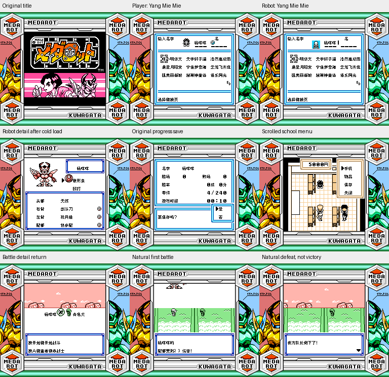

# 徽章战士 初代锹形虫版

原输入：Medarot - Kuwagata Version (Rev 1)

原输入完整SHA256：`19762a746f413714810c12ed41ddf0b09ee4a7eb538f6c820a6b9efa0b7dbe1a`。此处“原输入”保留改版、既有汉化或地区修订身份，不一律称干净零售ROM。

| 字号 | 当前版本 | 音频 | 输出完整SHA256 |
| --- | --- | --- | --- |
| 8px | v0.1.0 | unchanged | `352d20da181f952d8d2c586d7f26c742f10477f93f0dbd7a5a588bc52b6494c4` |

## 源码与补丁

- 8px／v0.1.0／unchanged：源码包（完整性未独立确认）：[下载](https://github.com/shiyi1133/youxi-hanhua-releases/releases/download/source-migration-20261022-02a/medarot-1-kuwagata-current-source-152a8cc93074-public-r01.zip)（ZIP SHA256 `3b5549e59df54aa27614505d31b293a73550f2fd98574a463d1895f5c283514f`）；补丁：[下载](https://github.com/shiyi1133/youxi-hanhua-releases/releases/download/patch-migration-20261022/medarot-1-kuwagata-current-patches.zip)（ZIP SHA256 `e9278b0b9b4254e106bdb8827ec0c9e7e495aed399921a4ec772498a4961ce53`）。
  该包已核对对应版本与字节安全；完整修改源码覆盖范围未独立确认。

补丁须直接应用于完整SHA一致的实际原输入；普通字、大字和音乐变体分别核对。公开源码归档不表示本轮重新构建或通过新的运行验收。原作、字体、已有翻译及工具依赖的权利与许可，依各包对应许可保留。

## 范围与验证边界

- 8px／v0.1.0：原生8px普通字；无大字版。。
  Japan Rev1 GB/SGB，普通原生8px；1632对白指针、560列表、102文字图块的中文实现；原艺术标题、原SGB边框保留。姓名保留原生8字字段和有限44姓/44名字表及假名页，无10px。
  胜利结算
  自然商店实际购买
  深层事件及全流程通关
  实机
  联机
  任意旧档姓名兼容

本次资料搬运未新增模拟器、实机或全通验收；未记录或未测试的范围不写成通过。问题单开放只表示尚未关闭，已关闭也不单独证明全部场景都修复。

[公开反馈及问题状态](feedback.md) · [报告BUG](https://github.com/shiyi1133/youxi-hanhua-releases/issues/new?template=bug_report.md)

## 对应版本截图

徽章战士 初代锹形虫版 v0.1.0 8px；原生8px普通字；无大字版。；最终ROM真实九宫格（自然/诊断/续行边界按本说明）

图像SHA256：`a25987798623b1fb1de63763317b6142eec24c475e44e5164069a9856de70614`；绑定ROM SHA256：`352d20da181f952d8d2c586d7f26c742f10477f93f0dbd7a5a588bc52b6494c4`。

