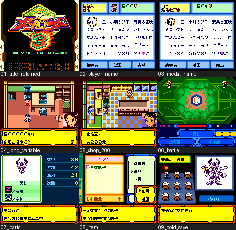

# 徽章战士3 锹形虫版

原输入：Medarot 3 - Kuwagata Version

原输入完整SHA256：`b0577f44de79b82bab9167e9fcd19bf139ab0023e44d7901e29e6a9b2b400182`。此处“原输入”保留改版、既有汉化或地区修订身份，不一律称干净零售ROM。

| 字号 | 当前版本 | 音频 | 输出完整SHA256 |
| --- | --- | --- | --- |
| 8px | v0.1.0 | unchanged | `2654ac1019ebe1a2c42e0477afb28ab9a4f15c7e00e8dad97ecf18ee5d247158` |

## 源码与补丁

- 8px／v0.1.0／unchanged：源码包（完整性未独立确认）：[下载](https://github.com/shiyi1133/youxi-hanhua-releases/releases/download/source-migration-20261022-02a/medarot-3-kuwagata-current-source-6c23ca9391eb-public-r01.zip)（ZIP SHA256 `891b5288ba678486d730b50dcf5d45ca8bf1193fae219d73d9fddc8e986eb477`）；补丁：[下载](https://github.com/shiyi1133/youxi-hanhua-releases/releases/download/patch-migration-20261022/medarot-3-kuwagata-current-patches.zip)（ZIP SHA256 `6c10a18dca513a8e0e936e2209985d18216f1383fa2eed64772788b997720c7c`）。
  该包已核对对应版本与字节安全；完整修改源码覆盖范围未独立确认。

补丁须直接应用于完整SHA一致的实际原输入；普通字、大字和音乐变体分别核对。公开源码归档不表示本轮重新构建或通过新的运行验收。原作、字体、已有翻译及工具依赖的权利与许可，依各包对应许可保留。

## 范围与验证边界

- 8px／v0.1.0：普通原生8px；无大字版。
  普通原生8px限定测试版。已识别正文、名称和菜单汉化；中文玩家及徽章命名、购买、战斗、正常保存后新进程冷读有提供者自测。
  原品牌标题、版权、TRANSFORM TEST动画、原生输入日文/拉丁/符号页及部分按键标识保留。旧map中リーダー/メダロット2/3、シフト、パワー及GET/LOSE等尚未证实消费者，不能宣称不可达。全路线/全部变量/全部技能、深层分支、联机传输、真实硬件与完整通关未验证。列表和元数据原生拷贝为显式注入组/索引的诊断，非自然取得全部物品。仅提供者自测，无独立人员QA。

本次资料搬运未新增模拟器、实机或全通验收；未记录或未测试的范围不写成通过。问题单开放只表示尚未关闭，已关闭也不单独证明全部场景都修复。

[公开反馈及问题状态](feedback.md) · [报告BUG](https://github.com/shiyi1133/youxi-hanhua-releases/issues/new?template=bug_report.md)

## 对应版本截图

普通8px v0.1.0真实CGB九宫格；提供者同目标原生截图拼接，保留限定测试范围

图像SHA256：`6d48b4740853cbc6353e7ba94643f54ab395f5d716487f8367afcd22e5348382`；绑定ROM SHA256：`2654ac1019ebe1a2c42e0477afb28ab9a4f15c7e00e8dad97ecf18ee5d247158`。

