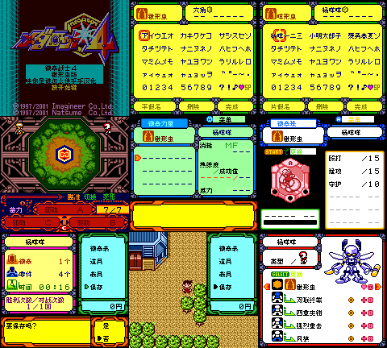

# 徽章战士4 锹形虫版（限定测试版）

[公开反馈](feedback.md) · [报告BUG](https://github.com/shiyi1133/youxi-hanhua-releases/issues/new?template=bug_report.md)

原游戏／实际基底：Medarot 4 - Kuwagata Version

原输入完整SHA-256：`3f01a0b82f9b0a95ceafa3e4d3f87878f9464c526026019c472be023fecb16c3`（4194304字节）。原输入保留其地区、修订、改版或已有汉化基底身份。

## 8px v0.1.0 unchanged

字号范围：普通原生Fusion Pixel 8px限定测试版，CGB，无独立大字。正文13996根入口/10678不同负载，以及零件、机体、徽章力量、人物、物品、曲名和默认名等已定位消费者有提供方静态与诊断覆盖；原生新增有限中文命名键，保留原假名/字母页。

[源码包（完整性未独立确认）](https://github.com/shiyi1133/youxi-hanhua-releases/releases/download/localization-update-20261022-six-games/medarot-4-kuwagata-v0.1.0-8px-source-public.zip) · [补丁包](https://github.com/shiyi1133/youxi-hanhua-releases/releases/download/localization-update-20261022-six-games/medarot-4-kuwagata-v0.1.0-patches-public.zip)

目标完整SHA-256：`e7fdd662c3a5a9313acadc26f2f67638501f649ac84738c0d7871b8a41044494`（4194304字节）。

图证：v0.1.0 普通8px；提供方同最终SHA原生CGB实际九宫格；标题、命名、战斗命令、徽章页、正常SAVE及冷读各自按原报告范围；9原生单帧逐像素核对，维护未新增运行。

## 范围与测试边界

- 普通原生Fusion Pixel 8px限定测试版，CGB，无独立大字。正文13996根入口/10678不同负载，以及零件、机体、徽章力量、人物、物品、曲名和默认名等已定位消费者有提供方静态与诊断覆盖；原生新增有限中文命名键，保留原假名/字母页。
- 商店自然购买/取消/金额数量未测；深层剧情、全部最长变量和特殊界面、全通、实机、联机未验。
- 原标题Logo、版权、日文/拉丁输入页与日文语音保留；未证实可达的图像/诊断遗留继续待核，非全作零漏译保证。
- 仅同一实现者自测；本轮维护未构建源码或运行模拟器。存档仅限提供方本目标正常SAVE/冷读范围，不保证任意旧版或其它原输入兼容。

维护侧独立补丁应用与目标字节一致；18张本批最终九宫格已各自核对9张原生单帧。未执行源码、未新增游戏运行、全流程或实机验收。

公开问题状态与玩家测试记录见[反馈页](feedback.md)。开放不代表正在修复；已关闭也不能单独证明所有症状或完整游戏验收。
