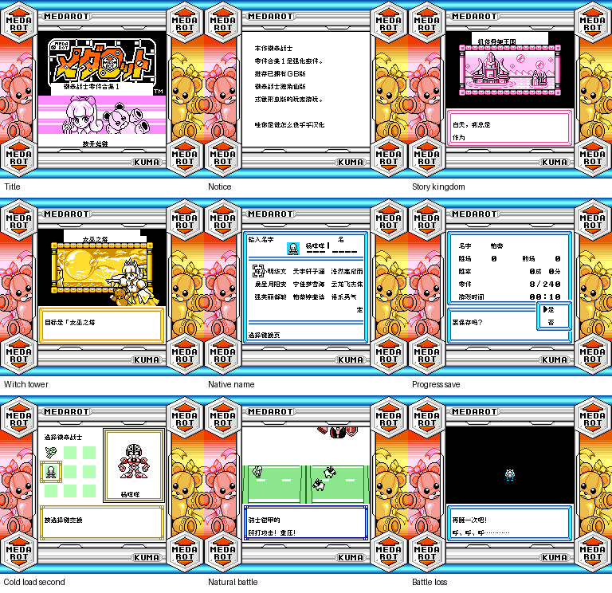

# 徽章战士 零件合集1

原输入：Medarot - Parts Collection (Japan) (SGB Enhanced)

原输入完整SHA256：`590c824ea7db3613258ac5d97b3c32d59691ce9db125c864b19adc044bd4ef89`。此处“原输入”保留改版、既有汉化或地区修订身份，不一律称干净零售ROM。

| 字号 | 当前版本 | 音频 | 输出完整SHA256 |
| --- | --- | --- | --- |
| 8px | v0.1.0 | unchanged | `0522f0b860cd6379234adad86695cd6980b3ff46946672e521fb94ea63033f59` |

## 源码与补丁

- 8px／v0.1.0／unchanged：源码包（完整性未独立确认）：[下载](https://github.com/shiyi1133/youxi-hanhua-releases/releases/download/source-migration-20261022-02a/medarot-parts-collection-1-current-source-dba1f4344a54-public-r01.zip)（ZIP SHA256 `e3245cc82770fd26d34a769df1e75da212b83199130ac55d9550b638690e9deb`）；补丁：[下载](https://github.com/shiyi1133/youxi-hanhua-releases/releases/download/patch-migration-20261022/medarot-parts-collection-1-current-patches.zip)（ZIP SHA256 `448af037557f81053ceb91119c60db0663000c10a3825c504faeaa39219cbde8`）。
  该包已核对对应版本与字节安全；完整修改源码覆盖范围未独立确认。

补丁须直接应用于完整SHA一致的实际原输入；普通字、大字和音乐变体分别核对。公开源码归档不表示本轮重新构建或通过新的运行验收。原作、字体、已有翻译及工具依赖的权利与许可，依各包对应许可保留。

## 范围与验证边界

- 8px／v0.1.0：普通原生8px；无大字版。
  普通原生8px限定测试版。对白、名称及已识别UI汉化；开场、中文机体命名、正常保存与独立冷读、首战进入及失败返回有提供者自测。
  首战未胜利；深层通关、胜利奖励、全零件、全部支线/最长变量、全部技能、商店自然买卖、联机/交换和真实GB/SGB硬件未验证。8字姓名分支只核原生输入/确认，未将该分支保存冷读记通过。诊断原生消费者不是全部内容自然可达证明。原生SGB彩色/外框及日文输入页保留，非事后上色。仅同一实现者自测，无独立人员QA。

本次资料搬运未新增模拟器、实机或全通验收；未记录或未测试的范围不写成通过。问题单开放只表示尚未关闭，已关闭也不单独证明全部场景都修复。

[公开反馈及问题状态](feedback.md) · [报告BUG](https://github.com/shiyi1133/youxi-hanhua-releases/issues/new?template=bug_report.md)

## 对应版本截图

普通8px v0.1.0真实SGB九宫格；提供者同目标原生截图拼接，保留限定测试范围

图像SHA256：`a9467e420834136c0914c8b9532e4bd210ee0b03235fd846466cd5944a909aeb`；绑定ROM SHA256：`0522f0b860cd6379234adad86695cd6980b3ff46946672e521fb94ea63033f59`。

