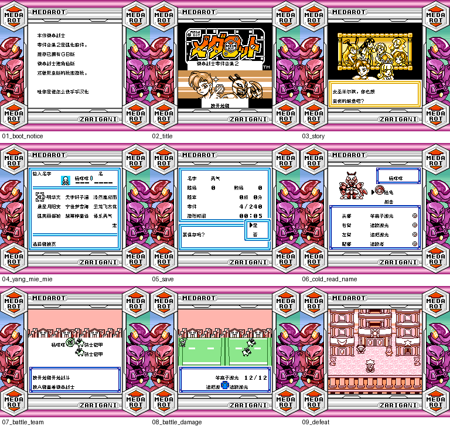

# 徽章战士 零件合集2

原输入：Medarot - Parts Collection 2

原输入完整SHA256：`9a522a7361dbef01a5e299a2ad9372dc293cd103723236a9290ba3f40a3b0ee5`。此处“原输入”保留改版、既有汉化或地区修订身份，不一律称干净零售ROM。

| 字号 | 当前版本 | 音频 | 输出完整SHA256 |
| --- | --- | --- | --- |
| 8px | v0.1.0 | unchanged | `5b9ef4b17af4aa0439f08367e51bbb3297b1b05c87502226d70d8bfa7b9563a3` |

## 源码与补丁

- 8px／v0.1.0／unchanged：源码包（完整性未独立确认）：[下载](https://github.com/shiyi1133/youxi-hanhua-releases/releases/download/source-migration-20261022-02a/medarot-parts-collection-2-current-source-f4731fdbc130-public-r01.zip)（ZIP SHA256 `e2e528d119600b791f9bfff83809a7d55c84a68bde5d1bc17f7017ccd0ca2d66`）；补丁：[下载](https://github.com/shiyi1133/youxi-hanhua-releases/releases/download/patch-migration-20261022/medarot-parts-collection-2-current-patches.zip)（ZIP SHA256 `518e68d868013894ee6ce17f080947beab80ea8bfaf47ff5827f5ef84c080a88`）。
  该包已核对对应版本与字节安全；完整修改源码覆盖范围未独立确认。

补丁须直接应用于完整SHA一致的实际原输入；普通字、大字和音乐变体分别核对。公开源码归档不表示本轮重新构建或通过新的运行验收。原作、字体、已有翻译及工具依赖的权利与许可，依各包对应许可保留。

## 范围与验证边界

- 8px／v0.1.0：Fusion Pixel普通8px，原生SGB调色板与外框；无独立大字版。。
  Fusion Pixel普通8px，原生SGB调色板与外框；无独立大字版。
  首战胜利与奖励、深层全塔及结局未验。
  全部命名入口、最长变量、商店自然购买、联机、实机和日文旧存档迁移未验。
  固定主角初始姓名已中文化，未新增主角改名功能；中文姓名码不保证在日文原版正确显示。
  原作MEDAROT品牌和原作图像/署名保留；SGB测试为mGBA 0.10.5、BIOS关闭，不表示GBC专用着色或实机验收。

本次资料搬运未新增模拟器、实机或全通验收；未记录或未测试的范围不写成通过。问题单开放只表示尚未关闭，已关闭也不单独证明全部场景都修复。

[公开反馈及问题状态](feedback.md) · [报告BUG](https://github.com/shiyi1133/youxi-hanhua-releases/issues/new?template=bug_report.md)

## 对应版本截图

v0.1.0 Fusion Pixel普通8px，原生SGB调色板与外框；无独立大字版。 原生SGB最终ROM自然有限路线，含命名、保存与新进程电池冷读、战斗及败北；诊断字形/列表/UI测试另计，不据此认定首战胜利或通关。

图像SHA256：`fa2e0f913a4fa4cf718f8fd727e0fb749fa97ec5f86f552eed09ab7e8d97c50e`；绑定ROM SHA256：`5b9ef4b17af4aa0439f08367e51bbb3297b1b05c87502226d70d8bfa7b9563a3`。

