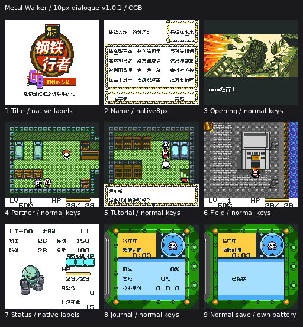
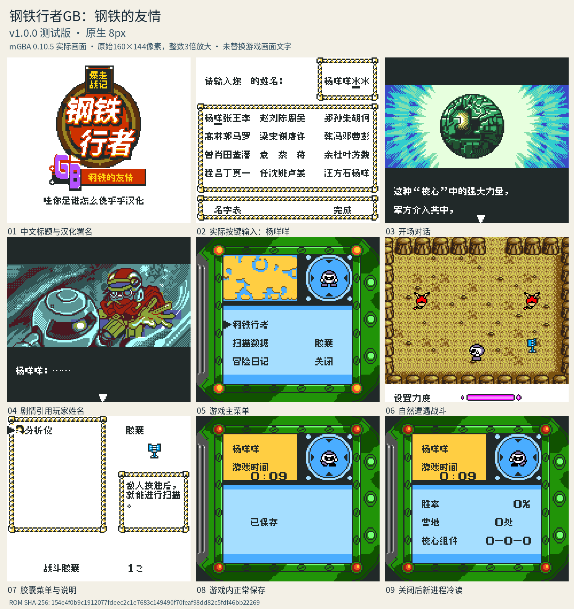

# 爆走战记 钢铁行者GB：钢铁的友情

原输入：爆走戦記 メタルウォーカーGB 鋼鉄の友情 (Bakusou Senki Metal Walker GB - Koutetsu no Yuujou, Japan)

原输入完整SHA256：`6cc7711a07c3da2d1823d9c5132ad52c4cfadb121f996b4be8aa9d99e19c5b82`。此处“原输入”保留改版、既有汉化或地区修订身份，不一律称干净零售ROM。

| 字号 | 当前版本 | 音频 | 输出完整SHA256 |
| --- | --- | --- | --- |
| 8px | v1.0.0测试版 | unchanged | `154e4f0b9c1912077fdeec2c1e7683c149490f70feaf98dd82c5fdf46bb22269` |
| 10px-dialogue | v1.0.1大字号限定修订测试版 | unchanged | `d99a0c1f2dc024b79f10f0effc99cb32fde879f4d2483a8606fae24626174e64` |

## 源码与补丁

- 8px／v1.0.0测试版／unchanged：完整修改源码：[下载](https://github.com/shiyi1133/youxi-hanhua-releases/releases/download/source-migration-20261022/metal-walker-current-source-9381882b35be-public-r02.zip)（ZIP SHA256 `fe1304e8553c178784888f6b4550009c89fbf482f439c537066c0d847efeaa55`）；补丁：[下载](https://github.com/shiyi1133/youxi-hanhua-releases/releases/download/patch-migration-20261022/metal-walker-current-patches.zip)（ZIP SHA256 `c8671ed873d67718c058d56f0cff33918812a6465a43fa1586368ab47649e766`）。
- 10px-dialogue／v1.0.1大字号限定修订测试版／unchanged：完整修改源码：[下载](https://github.com/shiyi1133/youxi-hanhua-releases/releases/download/source-migration-20261022/metal-walker-current-source-e56aff69eec9-public-r02.zip)（ZIP SHA256 `1c6e5d1730800017d9be072c29c9d6fa4bf23b5f55844447c571064c52297686`）；补丁：[下载](https://github.com/shiyi1133/youxi-hanhua-releases/releases/download/patch-migration-20261022/metal-walker-current-patches.zip)（ZIP SHA256 `c8671ed873d67718c058d56f0cff33918812a6465a43fa1586368ab47649e766`）。

补丁须直接应用于完整SHA一致的实际原输入；普通字、大字和音乐变体分别核对。公开源码归档不表示本轮重新构建或通过新的运行验收。原作、字体、已有翻译及工具依赖的权利与许可，依各包对应许可保留。

## 范围与验证边界

- 8px／v1.0.0测试版：8px / 10px-dialogue。
- 10px-dialogue／v1.0.1大字号限定修订测试版：CGB标准对白10px；81条选项与DMG回退8px，菜单/取名等保持8px。

本次资料搬运未新增模拟器、实机或全通验收；未记录或未测试的范围不写成通过。问题单开放只表示尚未关闭，已关闭也不单独证明全部场景都修复。

[公开反馈及问题状态](feedback.md) · [报告BUG](https://github.com/shiyi1133/youxi-hanhua-releases/issues/new?template=bug_report.md)

## 对应版本截图

v1.0.1实际CGB普通对白10px九宫格；菜单/姓名原生8px；原生操作和自建保存，非实机全通

图像SHA256：`f719bff2c59ceb2487fcaaa62d3d7cccef13a82b66060bde21a455c7cc2c46e9`；绑定ROM SHA256：`d99a0c1f2dc024b79f10f0effc99cb32fde879f4d2483a8606fae24626174e64`。

v1.0.0测试版 · 8px · 最终ROM对应模拟器截图

图像SHA256：`0a0ff78cd7441a8fab3fc6da5be6da128a33381b6d8d7ba30b1565ebab17db26`；绑定ROM SHA256：`154e4f0b9c1912077fdeec2c1e7683c149490f70feaf98dd82c5fdf46bb22269`。

