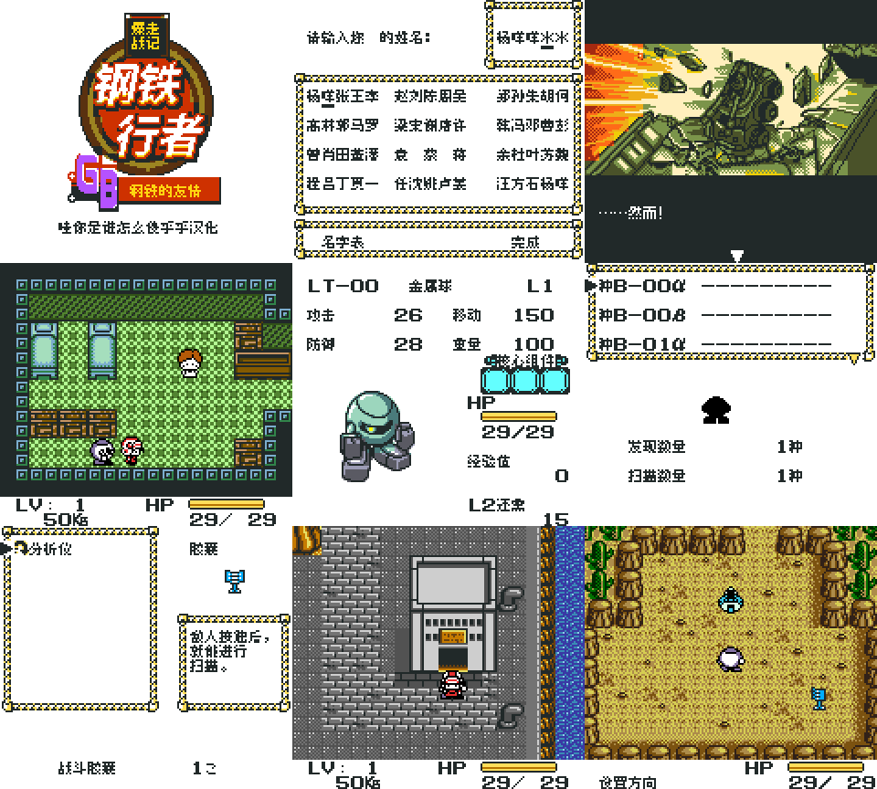
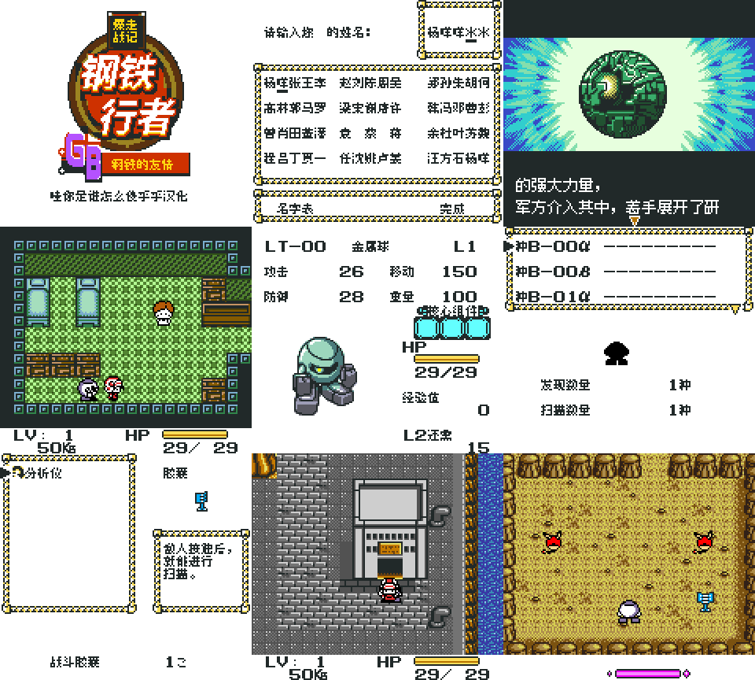

# 爆走战记 钢铁行者GB：钢铁的友情（v1.0.2 排版限定修订测试版）

[公开反馈与未关闭问题](feedback.md) · [报告BUG](https://github.com/shiyi1133/youxi-hanhua-releases/issues/new?template=bug_report.md)

原游戏／实际基底：Bakusou Senki Metal Walker GB - Koutetsu no Yuujou (Japan)。

原输入完整SHA256：`6cc7711a07c3da2d1823d9c5132ad52c4cfadb121f996b4be8aa9d99e19c5b82`（1,048,576字节）。公开仅记录原件哈希，不提供ROM。

[v1.0.2源码净包](https://github.com/shiyi1133/youxi-hanhua-releases/releases/download/metal-walker-v1.0.2/metal-walker-v1.0.2-source-public.zip) · [v1.0.2双字号BPS补丁](https://github.com/shiyi1133/youxi-hanhua-releases/releases/download/metal-walker-v1.0.2/metal-walker-v1.0.2-patches-public.zip) · [本版说明](release-notes-v1.0.2.md)

源码ZIP SHA256：`240ecce3585dee29e906c4a4cf01746a66e65e2c817cdd401daa69962f504823`；补丁ZIP SHA256：`9a52d2a6ba1383bfdb0873beac8805c7cf3df8d3e4ac5175db75016b53f74dc9`。

| 字号 | 实际范围 | 目标完整SHA256 |
| --- | --- | --- |
| 8px | 原生普通8px，普通对白与原生菜单各自核验 | `40d976528c9d9f6af38e94bd70e2fb12c4af8be3fa3351be8f2ddee194d63c6e` |
| 10px-dialogue | CGB标准对白10px；81条选择项、菜单/取名及DMG回退8px | `0e49cde2c8655e96e0d95ed142c6f21458bba70d8e7952369a8dc17d76b2ea71` |

2379处源换行由提供方逐项审阅：派生排版去除859处纯布局换行，1520处语义/控制分段保留；两字号独立重排，38条原生菜单说明重排。10px另修第14列地址进位。

维护已核两份BPS应用于精确原输入后的结果与已发布最终目标完全一致。本次公开搬运未执行源码、未重建或新增运行测试，源码语义完整性尚未独立确认。第三方版权、字体及工具许可随包保留。

## 对应最终ROM真实截图

v1.0.2 8px 最终ROM真实九宫格；所列自然开场/输入/保存与受控文本、菜单检查分开；非自然全剧情、真机或全通。

图像完整SHA256：`06d9038c3f7e03deef006a88b0cd3fa8afde7e91172db4ba6fb82079cc2dbc12`。

v1.0.2 10px-dialogue 最终ROM真实九宫格；所列自然开场/输入/保存与受控文本、菜单检查分开；非自然全剧情、真机或全通。大字只用于CGB标准对白，其余范围保持8px。

图像完整SHA256：`0f42feaf18978c97175509744ae2a37a83624094ac9210cdf8a1842771b0ada6`。

## 测试边界与BUG状态

- 纯文本959条/字号为同最终ROM新鲜开场调用帧的显式指针夹具，不表示959处剧情自然到达；467条变量、选择及其它事件上下文未逐场景验收。
- 全部163条说明的直接/排队两入口全表检查为LCD关闭夹具，另有自然胶囊状态机及密集说明检查；两种证据分开。
- 提供方自然开场、取名及删除重输、普通保存、新OS进程电池冷读、口令与长变量等待等回归记录保留；本次搬运未新增运行或源码重建。
- 全剧情、全部动态值/后期事件、联机、全通、实机及任意跨版存档兼容未验收。
- 大字只覆盖CGB标准对白；81条选项、菜单/取名和DMG回退仍8px，大字可能更易拖慢、闪屏或刷新残留。
- 既有大字闪烁、黄字/残留和两字号文字音效反馈仍开放，玩家实际版本和ROM字节未明确；本次修订不能代替这些反馈的逐项复现和验收。

此前公开源码、补丁、截图与标签均保留为历史入口；旧版报告不直接算作新版全部重测。
