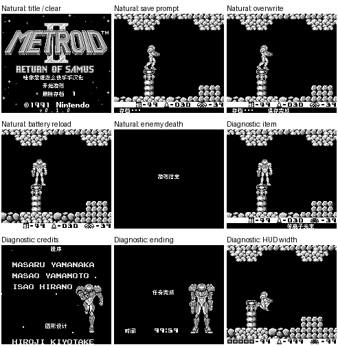

# 银河战士2 萨姆斯归来

原输入：Metroid II - Return of Samus (World)

原输入完整SHA256：`3080bcc2eb9965de463f5f4e02f0dabbb13b060e1654a18da8b50948c10af4a6`。此处“原输入”保留改版、既有汉化或地区修订身份，不一律称干净零售ROM。

| 字号 | 当前版本 | 音频 | 输出完整SHA256 |
| --- | --- | --- | --- |
| 8px | v0.1.0 | unchanged | `4f79f0011ba2b9931836867eacc209aac214a5aa339c9fa6b0de5c10841a5ae9` |

## 源码与补丁

- 8px／v0.1.0／unchanged：源码包（完整性未独立确认）：[下载](https://github.com/shiyi1133/youxi-hanhua-releases/releases/download/source-migration-20261022-02a/metroid-2-current-source-4103e4b0e7c8-public-r01.zip)（ZIP SHA256 `fe0789e34aa81bd107071c803d7116898eb0b93b81706300f0e812d5c4598670`）；补丁：[下载](https://github.com/shiyi1133/youxi-hanhua-releases/releases/download/patch-migration-20261022/metroid-2-current-patches.zip)（ZIP SHA256 `45d2ec51b544ca5c033153b6612390346076c4b42a0fc6f241e8f6c6c5dd28b6`）。
  该包已核对对应版本与字节安全；完整修改源码覆盖范围未独立确认。

补丁须直接应用于完整SHA一致的实际原输入；普通字、大字和音乐变体分别核对。公开源码归档不表示本轮重新构建或通过新的运行验收。原作、字体、已有翻译及工具依赖的权利与许可，依各包对应许可保留。

## 范围与验证边界

- 8px／v0.1.0：Fusion Pixel原生8px；DMG灰阶。无适用大字版。。
  UE/World Rev0输入的普通原生8px限定验证版；标题/存档/16道具文本/HUD/结束和职员表文字，保留原Logo及作者名；DMG灰阶，原作没有SGB增强、对白取名/商店/多人，也无10px。ROM256KB扩512KB，保留MBC1与8KB电池SAV布局。
  首个Alpha胜利
  全部敌人/区域
  所有道具自然取得
  完整通关
  全部旧档/即时状态
  实机/闪存卡
  第三方模拟器

本次资料搬运未新增模拟器、实机或全通验收；未记录或未测试的范围不写成通过。问题单开放只表示尚未关闭，已关闭也不单独证明全部场景都修复。

[公开反馈及问题状态](feedback.md) · [报告BUG](https://github.com/shiyi1133/youxi-hanhua-releases/issues/new?template=bug_report.md)

## 对应版本截图

银河战士2 萨姆斯归来 v0.1.0 8px；Fusion Pixel原生8px；DMG灰阶。无适用大字版。；最终ROM真实九宫格（自然/诊断/续行边界按本说明）

图像SHA256：`0b851472659b4b7989df39ef991ef969ace950e14882fe0f33bea70e32a78583`；绑定ROM SHA256：`4f79f0011ba2b9931836867eacc209aac214a5aa339c9fa6b0de5c10841a5ae9`。

