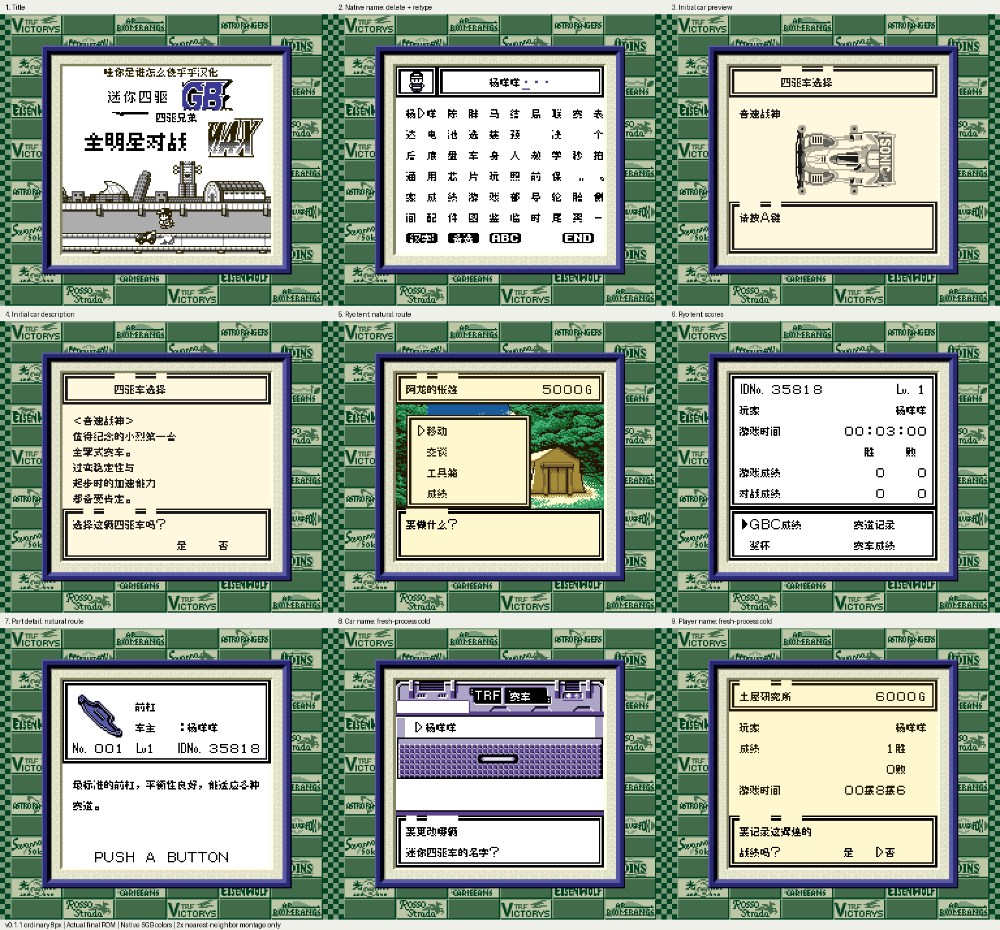

# 四驱兄弟：全明星对战

原输入：Mini Yonku GB 2 (Japan; requester filename and MINI4WD GB2 header identity)

原输入完整SHA256：`947961a18107e7a6fb4bbb892858e4ca724e3fd1272df016713440c36a1232a0`。此处“原输入”保留改版、既有汉化或地区修订身份，不一律称干净零售ROM。

| 字号 | 当前版本 | 音频 | 输出完整SHA256 |
| --- | --- | --- | --- |
| 8px | v0.1.1限定测试版 | unchanged | `3844aaa2843eea34a62f24ae133a2c1c0ac1fae1ec471288868b4eba74f03fd9` |

## 源码与补丁

- 8px／v0.1.1限定测试版／unchanged：源码包（完整性未独立确认）：[下载](https://github.com/shiyi1133/youxi-hanhua-releases/releases/download/source-migration-20261022-02b/mini-yonku-gb-2-current-source-23b39ad82f63-public-r01.zip)（ZIP SHA256 `a44f7cee39e42e4f2d0289d7a167683f7c1f63fed32b72d4285272b0b8fab39e`）；补丁：[下载](https://github.com/shiyi1133/youxi-hanhua-releases/releases/download/patch-migration-20261022/mini-yonku-gb-2-current-patches.zip)（ZIP SHA256 `65b89d77e0e73ad519e24ba0bdb4262f8294ee28cd25825ed324ee2e58fe46fb`）。
  该包已核对对应版本与字节安全；完整修改源码覆盖范围未独立确认。

补丁须直接应用于完整SHA一致的实际原输入；普通字、大字和音乐变体分别核对。公开源码归档不表示本轮重新构建或通过新的运行验收。原作、字体、已有翻译及工具依赖的权利与许可，依各包对应许可保留。

## 范围与验证边界

- 8px／v0.1.1限定测试版：普通8px点阵汉化；原生英文/假名及未覆盖图形按实际版本保留。。
  修复开场切换、车名、帐篷成绩三个已反馈显示场景。
  提供方自然路径覆盖开场、初始车辆、成绩、首次获胜、取名和电池存档冷启动；73车名矩阵为受控诊断，不代表自然解锁全车。
  原生SGB边框和调色保持；无全流程、实机或联机验收。
  本维护会话仅独立静态、BPS还原、文件校验和九宫格像素核验；未执行附件代码、未运行模拟器或复测游戏。
  提供方限定路线验证；维护独立核完整SHA、补丁和截图，未运行附包代码或游戏。
  未声明实机、全流程通关或全部旧存档兼容。

本次资料搬运未新增模拟器、实机或全通验收；未记录或未测试的范围不写成通过。问题单开放只表示尚未关闭，已关闭也不单独证明全部场景都修复。

[公开反馈及问题状态](feedback.md) · [报告BUG](https://github.com/shiyi1133/youxi-hanhua-releases/issues/new?template=bug_report.md)

## 对应版本截图

四驱兄弟：全明星对战 v0.1.1限定测试版 普通8px；提供方最终ROM画面，维护实际查看九宫格，不代表维护重跑游戏。

图像SHA256：`ede9000a8454727179a2f0012fc065973854480e3000703df133b24d499368cb`；绑定ROM SHA256：`3844aaa2843eea34a62f24ae133a2c1c0ac1fae1ec471288868b4eba74f03fd9`。

