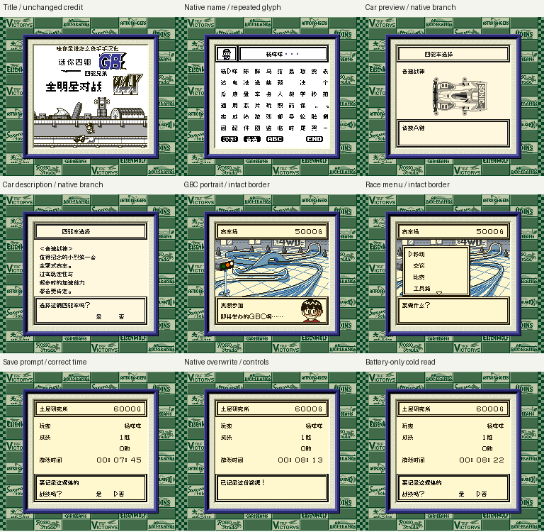

# 四驱兄弟：全明星对战 v0.1.2（限定测试版）

[源码与补丁Release](https://github.com/shiyi1133/youxi-hanhua-releases/releases/tag/mini-yonku-gb-2-v0.1.2) · [公开反馈](feedback.md) · [报告BUG](https://github.com/shiyi1133/youxi-hanhua-releases/issues/new?template=bug_report.md)

原游戏／实际输入：Mini Yonku GB 2 (Japan; requester filename and MINI4WD GB2 header identity)

原输入完整 SHA-256：`947961a18107e7a6fb4bbb892858e4ca724e3fd1272df016713440c36a1232a0`（1048576字节）。

范围：普通8px限定修复Issue76记录页游戏时间分隔符乱码与扩展中文绘制破坏文字框上横线；27字节改动，不改计时算法、存档布局和既有教学内容。

## 8px v0.1.2 / unchanged

字号范围：普通8px限定修复Issue76记录页游戏时间分隔符乱码与扩展中文绘制破坏文字框上横线；27字节改动，不改计时算法、存档布局和既有教学内容。

目标完整 SHA-256：`7521f52b0c067dd76b21c0aa9f53d946c45482d3eb2d78302b00629ab6d30011`（1048576字节）。

补丁：`mini-yonku-gb2-v0.1.2-8px-from-original.bps`，SHA-256 `e77d4f7ff7562e33813e7829ec6725ded381ea07117072bbefa1fcc3910afd27`。

[源码（完整性未独立确认）](https://github.com/shiyi1133/youxi-hanhua-releases/releases/download/mini-yonku-gb-2-v0.1.2/mini-yonku-gb-2-v0.1.2-complete-source.zip) · [补丁包](https://github.com/shiyi1133/youxi-hanhua-releases/releases/download/mini-yonku-gb-2-v0.1.2/mini-yonku-gb-2-v0.1.2-patches.zip)

普通8px限定修复Issue76记录页游戏时间分隔符乱码与扩展中文绘制破坏文字框上横线；27字节改动，不改计时算法、存档布局和既有教学内容。；提供方对应最终ROM图证，具体自然/诊断类别见原图标签及材料；非维护运行、全通或实机验收。

## 测试及限制

提供方自然范围：提供方报告的自然/正常按键流程，维护未重跑。

提供方诊断范围：提供方明确标注的受控消费者、解锁或边界测试，不能冒充自然到达。

保存边界：仅按具体版本材料，不推定所有旧存档兼容。

维护本轮独立核原输入、补丁逐字节还原、ZIP/CRC、Source安全与原图字节；未执行提供方源码、未重建或运行ROM，未宣称独立人员QA、实机或全流程验收。

- 未验证：维护仅独立核用户输入ZIP/ROM完整SHA、补丁逐字节还原、ZIP成员/CRC与源包静态材料；未执行提供者源码、重建工程或运行ROM。
- 未验证：运行、自然按键、受控诊断、保存/新进程冷读等范围以所附提供方报告分别为据，不冒充维护重跑、独立人员QA、玩家验收、实机或全流程通关。
- 未验证：使用前备份普通存档；不跨ROM版本/字号套用即时状态，旧电池兼容仅按提供方实际样本说明。
- 未验证：发布勘误：本Release早先ROM包及补丁包内README的一行范围摘要誊写有误，以此更正说明为准：普通8px限定修复Issue76记录页游戏时间分隔符乱码与扩展中文绘制破坏文字框上横线；27字节改动，不改计时算法、存档布局和既有教学内容。 ROM及补丁字节和完整SHA256未变；保留原ZIP及回执，不替换资产、不另造游戏新版，也不扩大运行验收。
