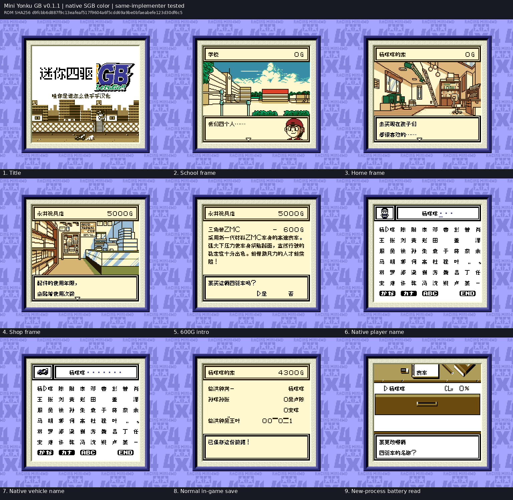

# 四驱兄弟GB初代

原输入：Mini Yonku GB (Japan; requester filename and MINI4WD GB header identity)

原输入完整SHA256：`ae6a24d204f5aabc20378977890aa7e5743027255a676315ce5e8766c7a78d52`。此处“原输入”保留改版、既有汉化或地区修订身份，不一律称干净零售ROM。

| 字号 | 当前版本 | 音频 | 输出完整SHA256 |
| --- | --- | --- | --- |
| 8px | v0.1.1限定测试版 | unchanged | `d9fcbb6d887f9c13eafeaf517f9604a6f5cdd69a9be0bfaeabefe123d30df6c5` |

## 源码与补丁

- 8px／v0.1.1限定测试版／unchanged：源码包（完整性未独立确认）：[下载](https://github.com/shiyi1133/youxi-hanhua-releases/releases/download/source-migration-20261022-02b/mini-yonku-gb-current-source-d069ed0d178c-public-r01.zip)（ZIP SHA256 `439310c8460175b54be284aecbc4a47d3325dedfc14b8973737e988bf3d2952d`）；补丁：[下载](https://github.com/shiyi1133/youxi-hanhua-releases/releases/download/patch-migration-20261022/mini-yonku-gb-current-patches.zip)（ZIP SHA256 `5c1cc1a88b881e6ce132d5e68509886bdd704ac722b971666daabf63a21f6aca`）。
  该包已核对对应版本与字节安全；完整修改源码覆盖范围未独立确认。

补丁须直接应用于完整SHA一致的实际原输入；普通字、大字和音乐变体分别核对。公开源码归档不表示本轮重新构建或通过新的运行验收。原作、字体、已有翻译及工具依赖的权利与许可，依各包对应许可保留。

## 范围与验证边界

- 8px／v0.1.1限定测试版：Fusion Pixel原生普通8px正文/姓名，10px仅既有烘焙标题素材；保留原生SGB边框与配色，未新增10px运行版。。
  共享文本框顶边叠加选择器及600G初始车辆独立压缩介绍12页的限定修复。
  提供方自然SGB新开局学校/家/商店及5款可自然到达车辆介绍；总12页其中7页只经原生压缩渲染器受控诊断，不称全部自然购买。
  玩家6字符/车辆10字符重复输入、超长、删除重输、正常保存及新Python进程只载电池冷读为提供方证据。
  保存统计页状态标签异常已在v0.1.0存在且像素未改，本版未修该已知残留。
  未测后期全部赛道剧情、原日文历史存档、联机/实机。维护端未运行模拟器。
  提供方限定路线验证；维护独立核完整SHA、补丁和截图，未运行附包代码或游戏。
  未声明实机、全流程通关或全部旧存档兼容。

本次资料搬运未新增模拟器、实机或全通验收；未记录或未测试的范围不写成通过。问题单开放只表示尚未关闭，已关闭也不单独证明全部场景都修复。

[公开反馈及问题状态](feedback.md) · [报告BUG](https://github.com/shiyi1133/youxi-hanhua-releases/issues/new?template=bug_report.md)

## 对应版本截图

四驱兄弟GB初代 v0.1.1限定测试版 普通8px；提供方最终ROM画面，维护实际查看九宫格，不代表维护重跑游戏。

图像SHA256：`c2c00f9061b504bcaf7daa1fcb0d8366077e136cd185049071ebcee2fd06b5e3`；绑定ROM SHA256：`d9fcbb6d887f9c13eafeaf517f9604a6f5cdd69a9be0bfaeabefe123d30df6c5`。

