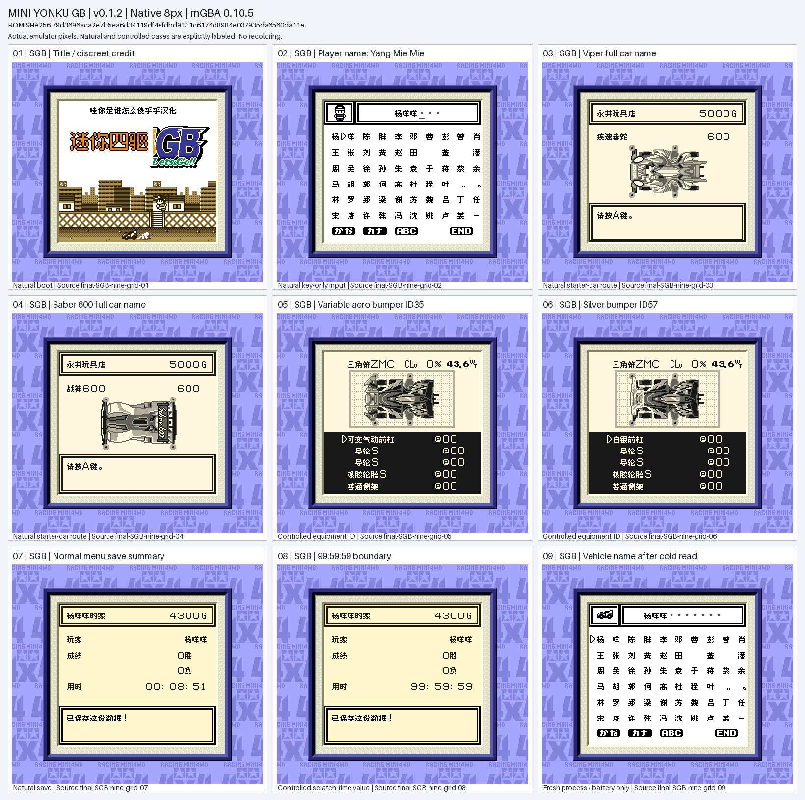

# 四驱兄弟GB初代 v0.1.2（限定测试版）

[源码与补丁Release](https://github.com/shiyi1133/youxi-hanhua-releases/releases/tag/mini-yonku-gb-v0.1.2) · [公开反馈](feedback.md) · [报告BUG](https://github.com/shiyi1133/youxi-hanhua-releases/issues/new?template=bug_report.md)

原游戏／实际输入：Mini Yonku GB (Japan; requester filename and MINI4WD GB header identity)

原输入完整SHA-256：`ae6a24d204f5aabc20378977890aa7e5743027255a676315ce5e8766c7a78d52`（524288字节）。

范围：普通原生8px限定修复测试版：配件预览队列终止符与白银前杠精灵目录、12车型名称裁切、18空槽标签、GB1保存页标签和时间数字；保留原生SGB边框及主体标题图案。

## 8px v0.1.2

字号范围：Fusion Pixel普通原生8px正文/命名；10px字源仅烘焙标题素材，无独立大字ROM；原生SGB和实际DMG证据分列。

目标完整SHA-256：`79d3696aca2e7b5ea6d34119df4efdbd9131c6174d8984e037935da6560da11e`（524288字节）。

补丁：`mini-yonku-gb-v0.1.2-8px.bps`，SHA-256 `f161d09cb7544ec991643e33efd31b029c06e37a4d607609daa1c4c852ae63dd`。

[源码（完整性未独立确认）](https://github.com/shiyi1133/youxi-hanhua-releases/releases/download/mini-yonku-gb-v0.1.2/mini-yonku-gb-v0.1.2-8px-SOURCE-public.zip) · [补丁包](https://github.com/shiyi1133/youxi-hanhua-releases/releases/download/mini-yonku-gb-v0.1.2/mini-yonku-gb-v0.1.2-8px-PATCH-public.zip)

v0.1.2普通8px最终ROM的原生SGB九宫格，各原生256×224帧仅2倍整数放大；第5/6格为受控配件ID，第8格为临时时间边界诊断，其余按提供方自然/电池冷读记录；非维护重跑或全流程验收。

## 测试及限制

提供者自然路径：提供方同一最终ROM自测：纯按键新开局、五种初期车型、玩家6字及车辆10字的删除/重输、正常保存；新进程仅载battery的SGB/DMG冷读。

提供者诊断路径：提供方受控诊断：12车型名称/介绍原生消费者；空槽加29种前杠ID置换后走正常选择/取消/再入；保存摘要临时字段00:00:00、09:09:09、99:59:59，不等于自然解锁全部或实际游玩99小时。

保存边界：未据原件SRAM或空存档推定保存冷读成功。

同一实现者自测，不是独立人员QA；维护未新增ROM运行或源码重建，未宣称实机或完整通关。

- 未验证：维护独立核完整SHA、BPS逐字节、源包CRC/清单/许可证和九宫格像素；未执行提供者代码、重建工程或运行ROM。
- 未验证：未验证实机、联机、CGB模型、全流程、所有高级配件自然购买、结尾职员表或全部旧存档兼容。
- 未验证：#118报告实际ROM版本未知；只确认已复现的配件展示乱行/图块损坏及白银前杠分支，静图不能证明永久卡死；二代#76不在本作修复范围。
- 核对补丁还原、资产完整SHA和截图字节不等于全部游戏功能验收。

