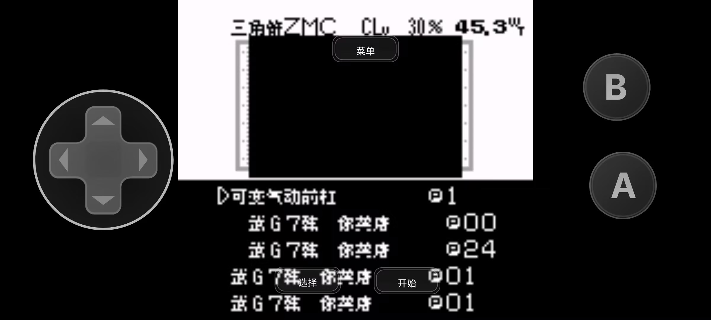

# 四驱兄弟GB初代：公开反馈

以下为已公开证据摘录，不能自动当成已经复现或修复。下载／存档分享地址、本机路径或项目署名文字省略时逐条标记。

## 154040542987

80楼 · 球总好学 · [原回帖](https://tieba.baidu.com/p/11092365551?pid=154040542987#154040542987)

> @哇你是谁怎么傻乎乎 0.1.0 8px，文本框的上面那条横条显示不全（框框上面那条横线断掉了），画面上方的文本框和画面下方的文本框都有此现象

[玩家公开图片](https://tiebapic.baidu.com/forum/pic/item/5d23dd3f8794a4c2a5def22c48f41bd5ac6e3967.jpg)（玩家反馈图，不作当前最终ROM运行证明）

[玩家公开图片](https://tiebapic.baidu.com/forum/pic/item/8418062442a7d9333855f174eb4bd11372f00167.jpg)（玩家反馈图，不作当前最终ROM运行证明）

[玩家公开图片](https://tiebapic.baidu.com/forum/pic/item/0c3fadc27d1ed21bd4343be2eb6eddc450da3f67.jpg)（玩家反馈图，不作当前最终ROM运行证明）

[玩家公开图片](https://tiebapic.baidu.com/forum/pic/item/b270bffd5266d016ede48b2fd12bd40734fa3567.jpg)（玩家反馈图，不作当前最终ROM运行证明）

[玩家公开图片](https://tiebapic.baidu.com/forum/pic/item/855f12d5ad6eddc48f1aa1fc7fdbb6fd53663367.jpg)（玩家反馈图，不作当前最终ROM运行证明）

[玩家公开图片](https://tiebapic.baidu.com/forum/pic/item/3d565b66d01609244ed8b71c920735fae7cd3467.jpg)（玩家反馈图，不作当前最终ROM运行证明）

[玩家公开图片](https://tiebapic.baidu.com/forum/pic/item/6d6672899e510fb3e2e462909f33c895d0430c67.jpg)（玩家反馈图，不作当前最终ROM运行证明）

[玩家公开图片](https://tiebapic.baidu.com/forum/pic/item/5bbd0024ab18972b33c715cda0cd7b899f510a67.jpg)（玩家反馈图，不作当前最终ROM运行证明）

[玩家公开图片](https://tiebapic.baidu.com/forum/pic/item/f02297510fb30f24ac67f9048e95d143ac4b0367.jpg)（玩家反馈图，不作当前最终ROM运行证明）

## 154040555442

80楼 · 球总好学 · [原回帖](https://tieba.baidu.com/p/11092365551?pid=154040555442#154040555442)

> 0.1.0 8px，在游戏初期选择哪一辆初始四驱车时，选择其中一辆后的车辆介绍页面，文本语句不通或疑似乱码

[玩家公开图片](https://tiebapic.baidu.com/forum/pic/item/391cd9a20cf431adb227563e0d36acaf2fdd986f.jpg)（玩家反馈图，不作当前最终ROM运行证明）

[玩家公开图片](https://tiebapic.baidu.com/forum/pic/item/d229bbb7d0a20cf44965ebd830094b36adaf996f.jpg)（玩家反馈图，不作当前最终ROM运行证明）

[玩家公开图片](https://tiebapic.baidu.com/forum/pic/item/1c76a844ad345982c77ff0954af431adcaef846f.jpg)（玩家反馈图，不作当前最终ROM运行证明）

[玩家公开图片](https://tiebapic.baidu.com/forum/pic/item/b2aa283fb80e7becd22f16e6692eb9389a506b6f.jpg)（玩家反馈图，不作当前最终ROM运行证明）

## 154045268956

78楼 · 球总好学 · [原回帖](https://tieba.baidu.com/p/11092365551?pid=154045268956#154045268956)

> 8px 1.0.1，标题画面的logo或者图片请优化，这样在原图片上直接挖空，写上中文名，中文名在图片中，但这几个汉字无底色，在观感上logo和图片未统一，有割裂感，可考虑保留原本的游戏名字和图片，在原logo和图片下方用小字写上中文游戏名

## 154045274541

78楼 · 球总好学 · [原回帖](https://tieba.baidu.com/p/11092365551?pid=154045274541#154045274541)

> @哇你是谁怎么傻乎乎 如果不能接受保留原日文游戏名（大字），也可考虑直接把这个游戏的英文版的英文logo（带图片）挖过来，在原游戏名（大字）下方以小字写上中文游戏名

## 154045745920

78楼 · 球总好学 · [原回帖](https://tieba.baidu.com/p/11092365551?pid=154045745920#154045745920)

> 8px 1.0.1，标题画面的logo和图片不要汉化（我看了，效果，特别是图片观感不太好），用小字在logo和logo图片下方写上中文游戏名

## 154045749051

80楼 · 球总好学 · [原回帖](https://tieba.baidu.com/p/11092365551?pid=154045749051#154045749051)

> 8px 0.1.1，标题画面的logo和图片不要汉化（我看了，效果，特别是图片观感不太好），用小字在logo和logo图片下方写上中文游戏名

## 154045750753

81楼 · 球总好学 · [原回帖](https://tieba.baidu.com/p/11092365551?pid=154045750753#154045750753)

> 8px 0.1.1，标题画面的logo和图片不要汉化（我看了，效果，特别是图片观感不太好），用小字在logo和logo图片下方写上中文游戏名

## 154047314465

163楼 · 折影的十字架 · [原回帖](https://tieba.baidu.com/p/11092365551?pid=154047314465#154047314465)

> 建议标题和push start不用进行汉化，这样开头画面会美观不少

## 154047556312

163楼 · 球总好学 · [原回帖](https://tieba.baidu.com/p/11092365551?pid=154047556312#154047556312)

> 是的 有些汉化了能接受，有些欠佳

## 154048088976

163楼 · 折影的十字架 · [原回帖](https://tieba.baidu.com/p/11092365551?pid=154048088976#154048088976)

> 比如gb上的沙加三部曲的开头画面的标题

## 154048162179

163楼 · 球总好学 · [原回帖](https://tieba.baidu.com/p/11092365551?pid=154048162179#154048162179)

> 要具体看什么游戏，有些游戏标题画面汉化出来还行，而有些欠佳。欠佳的我建议保留原logo和logo图片，在下方加小字的中文游戏名

## 154048167425

163楼 · 球总好学 · [原回帖](https://tieba.baidu.com/p/11092365551?pid=154048167425#154048167425)

> @哇你是谁怎么傻乎乎 标题画面汉化得还可以的我就不会提，我觉得欠佳的我会在专门楼层里面提出

## 154045369877

80楼 · 球总好学 · [原回帖](https://tieba.baidu.com/p/11092365551?pid=154045369877#154045369877)

> 8px 0.1.1，游戏开始后，一开始需要购买一辆四驱车，在选择哪一辆的界面，这两辆车选择后的下一个页面会显示四驱车的全身图案，四驱车全身图案的左上方按理是显示车子的名字，一辆车的这个地方只显示了“蛇”，文本显示不全。另一辆车的此处为空白。请修复

## 登记时问题状态（历史）

- [待复现] 四驱兄弟GB v0.1.0普通8px：文本框顶边缺段及初始车介绍异常：已关闭；公开问题单待单独建档。
- 玩家建议三游戏保留原Logo及图像，把中文名另列下方；马网另提英文Logo候选。：开放；公开问题单待单独建档。
- 购初始车辆后两张全身图上方名称一辆仅显示“蛇”、另一辆空白。：开放；公开问题单待单独建档。

问题单开放不等于正在修复；关闭不自动代表所有报告症状全部验收。玩家实际ROM SHA未知时仍保留未知，当前版本的参考SHA见[游戏页面](README.md)。

## 20261023-1616 公开反馈补充

230楼 · dick20090101 · [原回帖](https://tieba.baidu.com/p/11092365551?pid=154061474399#154061474399)

> 早上好，四驱兄弟GB初代，您的汉化版本玩过了，换零件的时候会黑屏导致游戏没法游玩，影响游戏体验，可以优化一下吗

- 四驱兄弟GB初代：更换零件时展示区域黑屏、列表异常，玩家称无法继续：开放待核。

[已公开登记答复](https://tieba.baidu.com/p/11092365551?pid=154062972399#154062972399)：@dick20090101 换零件黑屏已记录，请补ROM完整文件名或版本。

玩家实际输入/输出SHA保持未知；本次为反馈登记和信息答复，未新增维护运行复现、修复或完整流程验收。

<!-- bounded-progress:manual-six-20261024-2129-git-only-five -->
## Git已发布的限定修复进展（2026-10-25）

Git版本与修复用例已核验；网盘尚未同步本次目标，不将网盘旧ROM记作已更新。贴吧交付通知另行等待，ONIⅤ原有通知暂停保持。

- `problem-6969c5ef348cf4d0`：原反馈定位范围已关闭。v0.1.2 / 8px 限定测试版；[公开版本](https://github.com/shiyi1133/youxi-hanhua-releases/releases/tag/mini-yonku-gb-v0.1.2)。
  已核对：12个车型名称按原生裁切矩形定位，修复全身图上方只剩蛇、600或缺字。；维护独立逐像素核对12张原生消费者截图与最终ROM字体；五种初期车辆为提供方自然按键路线，其余为明确诊断入口。
  保留：未声称全部车辆自然解锁、全流程或实机通过；玩家实际ROM完整哈希仍未知。
  证据边界：提供方同一实施者的最终SGB/DMG运行记录；维护独立核BPS、ROM资产、截图字形和trace字节，并实际查看旧/新图；维护未新增运行或重建。
- `problem-ef215518e85b0e53`：原反馈定位范围已关闭。v0.1.2 / 8px 限定测试版；[公开版本](https://github.com/shiyi1133/youxi-hanhua-releases/releases/tag/mini-yonku-gb-v0.1.2)。
  已核对：配件预览补齐20格行并保留队列终止符；旧v0.1.1 ID35实际trace出现315次错误MBC写入，最终v0.1.2为零且有10个真实packet。；撤销覆盖原生精灵目录的误补丁，168项指针与原件逐字节一致；白银前杠分支及18个空槽类别标签修正。；空前杠槽与29种前杠受控ID后正常选择、取消、重入；30份trace均非空完成，最终截图展示完整车辆与列表。
  保留：报告ROM文件名、版本和字号未提供，玩家实际输入输出完整SHA未知。；原反馈静图不能证明持续卡死；本次仅关闭已复现配件预览/列表用例，不声称所有hang根因、同一玩家设备、自然高级配件购买或实机验收。
  证据边界：提供方同一实施者的最终SGB/DMG运行记录；维护独立核BPS、ROM资产、截图字形和trace字节，并实际查看旧/新图；维护未新增运行或重建。

同一实施者自测与维护字节、补丁和原帧检查分别记录；没有新增维护ROM运行、玩家复测、全通或实机验收。原话、报告版本、图片、玩家未知SHA、收件答复及历史保留。

## 20261025-1619 公开反馈更新

按当前实际未关闭问题去重：纯BUG 0 项，建议/覆盖等 1 项，分类待核 0 项。开放不代表正在修复。

玩家实际完整ROM字节未知时仍保留未知；自然流程、原生消费者诊断及静态证据分别记录，不外推实机或全流程。
