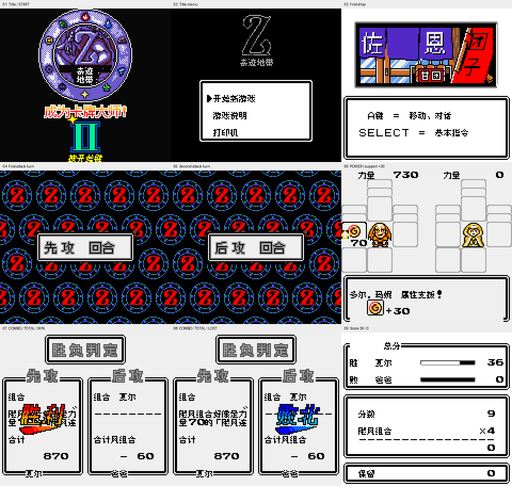
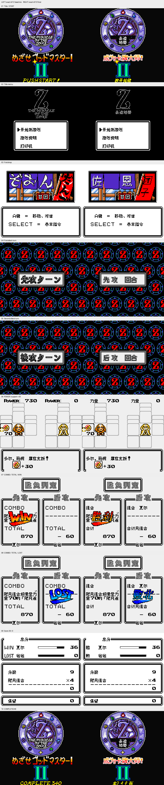
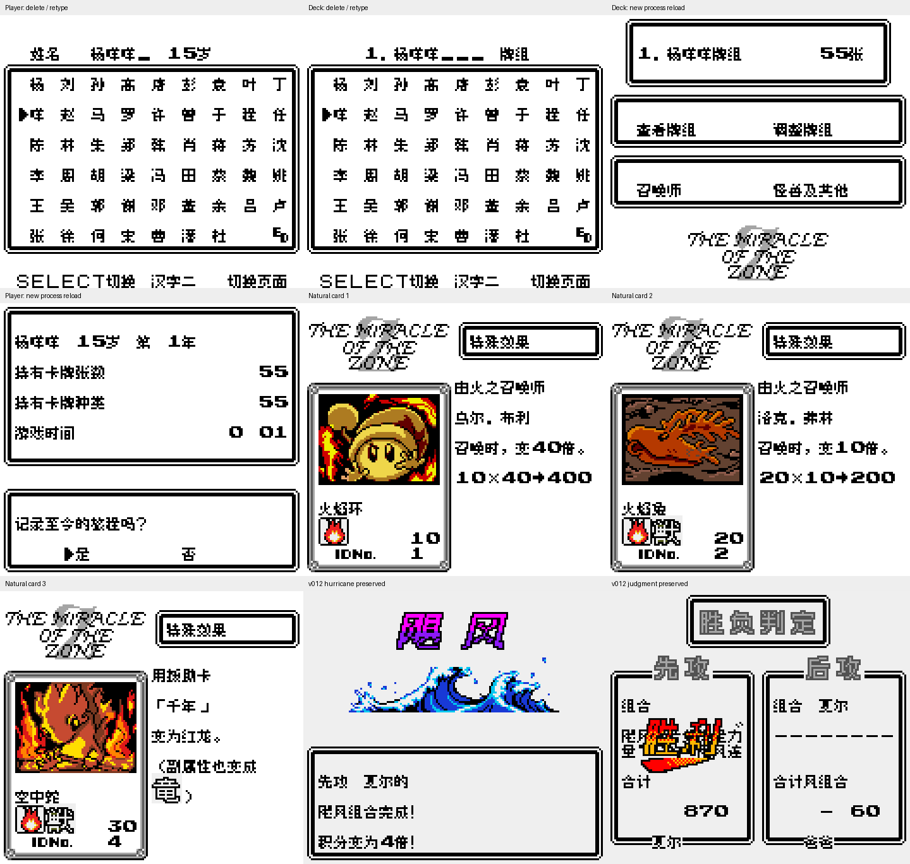

# 大贝兽物语外传 奇迹地带2

原输入：Daikaijuu Monogatari: The Miracle of the Zone II

原输入完整SHA256：`9d9af105172d5b72d9c1e7ca09fc56cde33c607d840932b465ae2a5221c2f4a8`。此处“原输入”保留改版、既有汉化或地区修订身份，不一律称干净零售ROM。

| 字号 | 当前版本 | 音频 | 输出完整SHA256 |
| --- | --- | --- | --- |
| 8px | v0.1.3限定修复测试版 | unchanged | `db626b33fa8365b2158a2c57c2d6d3940ce4042932d8b52768f604756864ed94` |

## 源码与补丁

- 8px／v0.1.3限定修复测试版／unchanged：源码包（完整性未独立确认）：[下载](https://github.com/shiyi1133/youxi-hanhua-releases/releases/download/source-migration-20261022-04/miracle-of-the-zone-2-current-scope-source-public-r01.zip)（ZIP SHA256 `b160a3a93579be1970b2aa35f0cd701140fd13b10c1dca81d6babf0e814a24fa`）；补丁：[下载](https://github.com/shiyi1133/youxi-hanhua-releases/releases/download/patch-migration-20261022/miracle-of-the-zone-2-current-patches.zip)（ZIP SHA256 `294d4668494951ce0bd994b6be0e63a3dae5dffdc5bc750ef9c0ef3d2b48cc9a`）。
  该包已核对对应版本与字节安全；完整修改源码覆盖范围未独立确认。

补丁须直接应用于完整SHA一致的实际原输入；普通字、大字和音乐变体分别核对。公开源码归档不表示本轮重新构建或通过新的运行验收。原作、字体、已有翻译及工具依赖的权利与许可，依各包对应许可保留。

## 范围与验证边界

- 8px／v0.1.3限定修复测试版：普通原生8px；现有较大图形字保留，非单独大字版。。
  教程先攻/后攻回合提示、力量、组合/合计、胜利/败北及计分胜/败的限定补译；原生标题/副标题、按开始键、全340张及菜单题字；最初店招已识别文字补译；保留v0.1.1卡面修复与v0.1.2人名/联动句等修订；相对v0.1.2仅12允许区间6165字节变化
  限定补译测试版；不是整作残日文/英文清零，既有反馈保持open。既有反馈已关闭卡画范围保持，不因本次重复发关闭评论。
  深层招牌/组合特效、DRAW、VS及牌组底部另一小型英文标志等仍可能保留；不无限追深层效果。
  104常用姓名字库；主角最多4字/牌组最多6字，不是完整输入法。
  未验全通、所有普通战斗胜负/死亡、全商店/全组合/最长变量、通信/红外/打印、实机和全部旧档。
  同一实现者提供方自测/清洁重建报告；维护仅安全ZIP/全SHA/独立BPS/既有原帧像素核验，没有重建、模拟器或实机运行。

本次资料搬运未新增模拟器、实机或全通验收；未记录或未测试的范围不写成通过。问题单开放只表示尚未关闭，已关闭也不单独证明全部场景都修复。

[公开反馈及问题状态](feedback.md) · [报告BUG](https://github.com/shiyi1133/youxi-hanhua-releases/issues/new?template=bug_report.md)

## 对应版本截图

对应版本的原始截图；此导出未新增运行或通关验收。

图像SHA256：`80830587efdd7e3b10a2fad0c6643bec860870646aafba098ea57decfe4e7858`；绑定ROM SHA256：`db626b33fa8365b2158a2c57c2d6d3940ce4042932d8b52768f604756864ed94`。

旧版本与当前修复测试版的真实对比，按图内原版本标签区分。

图像SHA256：`c23a2699517297ec6b52a040337a007c7d6667df81dcab09011a06722900e5d7`；绑定ROM SHA256：`db626b33fa8365b2158a2c57c2d6d3940ce4042932d8b52768f604756864ed94`。

旧版本与当前修复测试版的真实对比，按图内原版本标签区分。

图像SHA256：`30ce320e574cabfe26c5a64172e561b76425949ede235d533aec32fd3d683e56`；绑定ROM SHA256：`db626b33fa8365b2158a2c57c2d6d3940ce4042932d8b52768f604756864ed94`。

