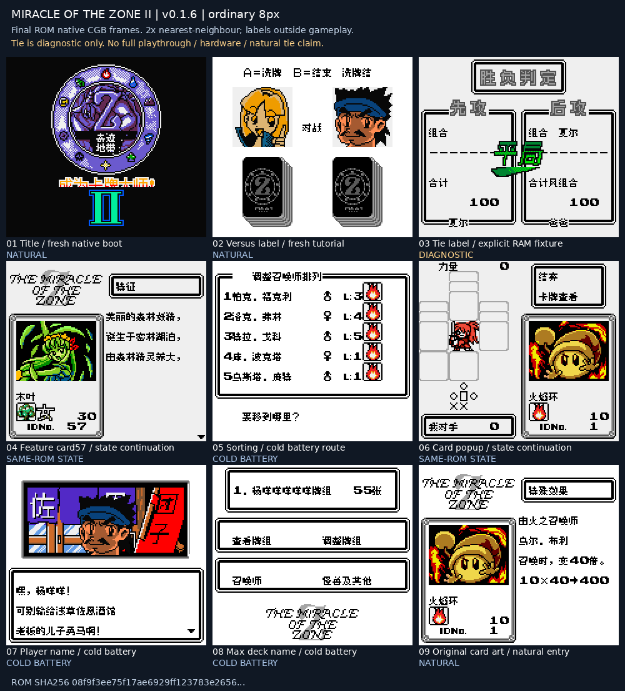

# 大贝兽物语外传 奇迹地带2 v0.1.6（限定测试版）

[源码与补丁Release](https://github.com/shiyi1133/youxi-hanhua-releases/releases/tag/miracle-of-the-zone-2-v0.1.6) · [公开反馈](feedback.md) · [报告BUG](https://github.com/shiyi1133/youxi-hanhua-releases/issues/new?template=bug_report.md)

原游戏／实际输入：Daikaijuu Monogatari: The Miracle of the Zone II

原输入完整 SHA-256：`9d9af105172d5b72d9c1e7ca09fc56cde33c607d840932b465ae2a5221c2f4a8`（1048576字节）。

范围：VS图字译对战、DRAW结果图译平局，保留44块重叠资源尾块；v0.1.5停止推荐。

## 8px v0.1.6 / unchanged

字号范围：普通8px；本批不新增大字号。

目标完整 SHA-256：`08f9f3ee75f17ae6929ff123783e265679e9c2aa589691398e0888727a16843c`（1048576字节）。

补丁：`miracle-of-the-zone-2-v0.1.6-8px.bps`，SHA-256 `2157227684cdd2ef604c7daafe775971e8e9b109451783117a2ffb820b5014ea`。

[源码（完整性未独立确认）](https://github.com/shiyi1133/youxi-hanhua-releases/releases/download/miracle-of-the-zone-2-v0.1.6/miracle-of-the-zone-2-v0.1.6-SOURCE-public.zip) · [补丁包](https://github.com/shiyi1133/youxi-hanhua-releases/releases/download/miracle-of-the-zone-2-v0.1.6/miracle-of-the-zone-2-v0.1.6-PATCH-public.zip)

v0.1.6 / 8px / unchanged 最终ROM提供者实际画面；真实九格，按提供者场景分别保留自然和诊断边界。维护未运行、未全通或实机验收。

## 测试及限制

提供方自然范围：提供者自测：最终ROM自然命名/教程/普通保存新进程冷读；自然查看前三卡。

提供方诊断范围：提供者诊断：平局选择器、273卡图与44块别名加载为明确原生消费者诊断，不是自然全收集。

保存边界：仅按具体版本材料，不推定所有旧存档兼容。

维护本轮独立核原输入、补丁逐字节还原、ZIP/CRC、Source安全与原图字节；未执行提供方源码、未重建或运行ROM，未宣称独立人员QA、实机或全流程验收。

- 未验证：维护仅做数据/字节与独立补丁验证，未执行提供者源码或ROM，未独立重建。
- 未验证：v0.1.5是已知不推荐的中间本地版本，保留历史而不作为当前入口。
- 未验证：教程下边框和更深层残文未修；未自然平局/全通/实机/通信及任意旧档验收。
- 未验证：截图为CGB最终ROM；SGB仅提供者开机边框有限检查。
