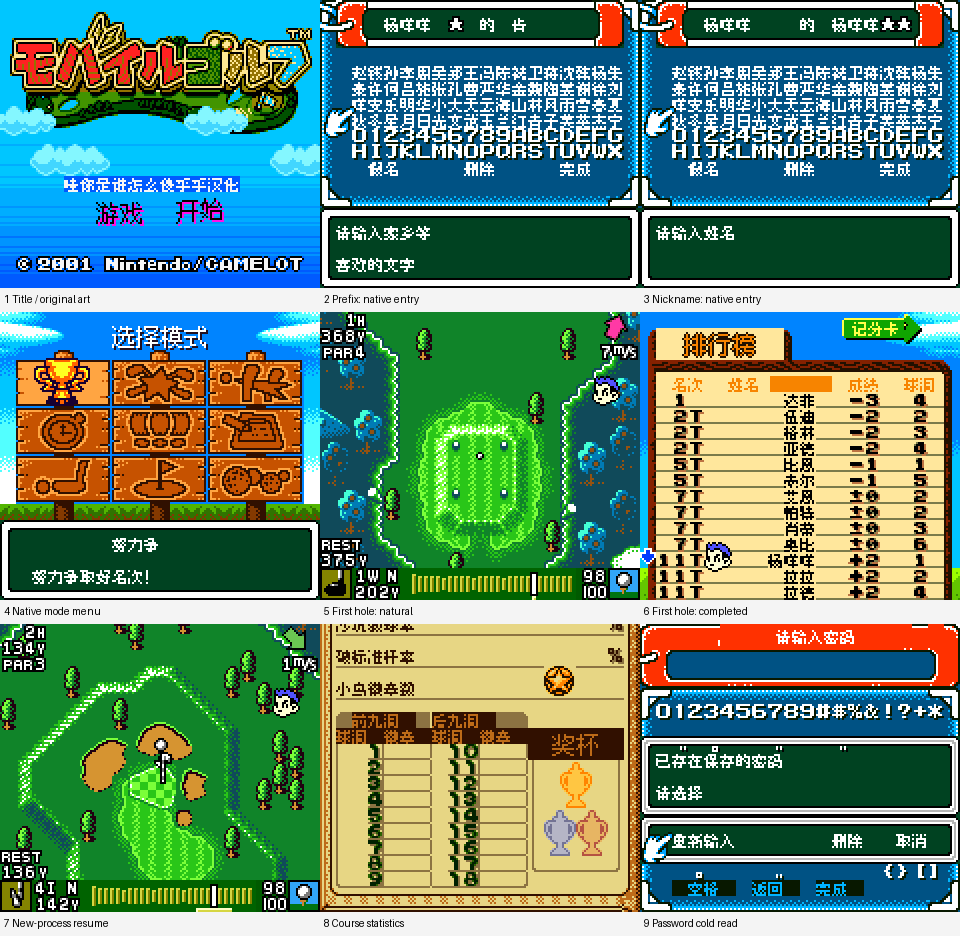

# 迷你高尔夫 Mobile Golf

原输入：Mobile Golf (Japan)

原输入完整SHA256：`8990e1ca43048b3f0d19954850e67ecfa549e5b050d0816f2135f9a582fbd3b2`。此处“原输入”保留改版、既有汉化或地区修订身份，不一律称干净零售ROM。

| 字号 | 当前版本 | 音频 | 输出完整SHA256 |
| --- | --- | --- | --- |
| 8px | v0.1.0 | unchanged | `874e01a9915c9a3cda48095301e3e41e7113acffe8337656972f83e84721b567` |

## 源码与补丁

- 8px／v0.1.0／unchanged：源码包（完整性未独立确认）：[下载](https://github.com/shiyi1133/youxi-hanhua-releases/releases/download/source-migration-20261022-04/mobile-golf-current-scope-source-public-r01.zip)（ZIP SHA256 `0289d488614a0dfa24e8e51ffa2ee9b427ad8061d12e220c088009bc736b79cc`）；补丁：[下载](https://github.com/shiyi1133/youxi-hanhua-releases/releases/download/patch-migration-20261022/mobile-golf-current-patches.zip)（ZIP SHA256 `1bd96b41086bdace11c6e899533afd663e447a8eabe5cfc9d4cb0f57b705c983`）。
  该包已核对对应版本与字节安全；完整修改源码覆盖范围未独立确认。

补丁须直接应用于完整SHA一致的实际原输入；普通字、大字和音乐变体分别核对。公开源码归档不表示本轮重新构建或通过新的运行验收。原作、字体、已有翻译及工具依赖的权利与许可，依各包对应许可保留。

## 范围与验证边界

- 8px／v0.1.0：对白及菜单原生普通8px；部分图片标题为12px素材，不是大字版。。
  七个原生文本库3134项，2657项中文替换；对白/菜单原生8px，原窗口图片标签部分12px素材。取名前缀及昵称各最多5字；支持常用姓氏/名字及咩，另保留原假名/数字/符号页。条目数不等于全流程覆盖率。
  普通8px限定测试版；本次没有10px或12px对白版。图片标题的12px字形不构成大字版。
  未通关、未覆盖所有球洞/比赛/解锁/全部对白；无实机、双机、Mobile Adapter服务端或下载赛事验收。
  联网10字姓名和电话号码的完整自然登记/保存/远端接受未验证；移动密码维持ASCII。
  原标题美术、人物/球场插画、版权及必要英文/数字/单位/原密码字符保留。
  建议使用独立新存档；原版/旧候选存档和深层解锁/联网数据兼容性未全面验证。
  提供方报告与截图属提供方运行证据；维护方仅静态核验、补丁独立应用与截图原生像素核验，未重建源码或重新运行ROM。

本次资料搬运未新增模拟器、实机或全通验收；未记录或未测试的范围不写成通过。问题单开放只表示尚未关闭，已关闭也不单独证明全部场景都修复。

[公开反馈及问题状态](feedback.md) · [报告BUG](https://github.com/shiyi1133/youxi-hanhua-releases/issues/new?template=bug_report.md)

## 对应版本截图

迷你高尔夫 Mobile Golf v0.1.0 普通8px限定测试版；同SHA最终ROM真实九格，部分菜单同ROM状态续行；未全通/实机/联网验收。

图像SHA256：`d6d36dbcb1d26d0d732787758022aa0706c0cff5322780521fed5b3f76fa6d8c`；绑定ROM SHA256：`874e01a9915c9a3cda48095301e3e41e7113acffe8337656972f83e84721b567`。

