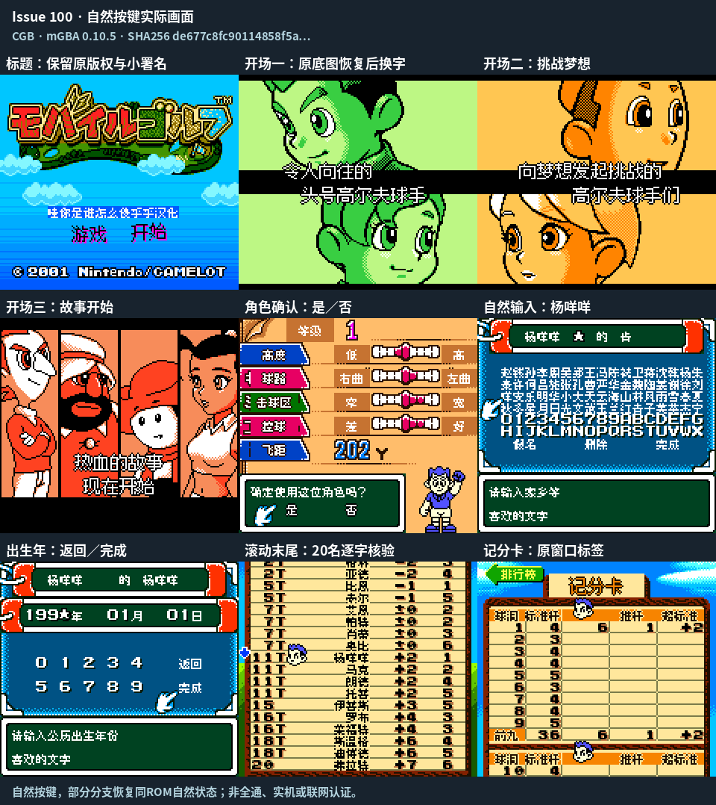
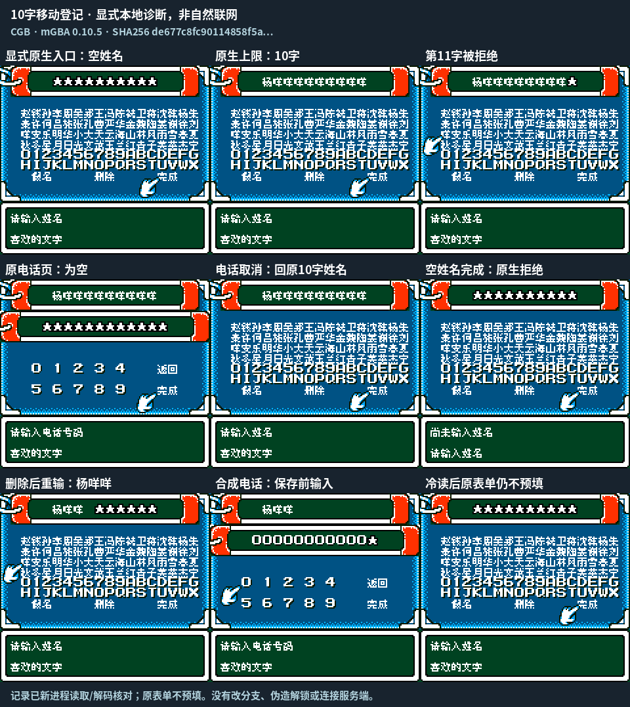
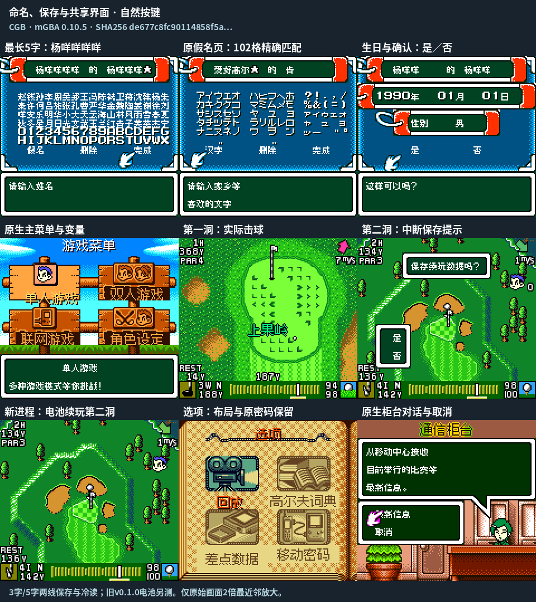

# 迷你高尔夫 Mobile Golf v0.1.1（限定测试版）

[源码与补丁Release](https://github.com/shiyi1133/youxi-hanhua-releases/releases/tag/mobile-golf-v0.1.1) · [公开反馈](feedback.md) · [报告BUG](https://github.com/shiyi1133/youxi-hanhua-releases/issues/new?template=bug_report.md)

原游戏／实际输入：Mobile Golf (Japan)

原输入完整 SHA-256：`8990e1ca43048b3f0d19954850e67ecfa549e5b050d0816f2135f9a582fbd3b2`（4194304字节）。

范围：普通8px开场字幕、确认/命名、生日性别、排行榜姓名重复及计分卡标签限定修复；移动表单为诊断。

## 8px v0.1.1 / unchanged

字号范围：普通8px开场字幕、确认/命名、生日性别、排行榜姓名重复及计分卡标签限定修复；移动表单为诊断。

目标完整 SHA-256：`de677c8fc90114858f5a34182a9f63042bf0f042111e3070bf7ebc38b6281e94`（4194304字节）。

补丁：`mobile-golf-v0.1.1-8px.bps`，SHA-256 `652738135a1e148a6f73368c8b8451a8c2eec98547dcb42425d281ebefdeae0f`。

[源码（完整性未独立确认）](https://github.com/shiyi1133/youxi-hanhua-releases/releases/download/mobile-golf-v0.1.1/mobile-golf-v0.1.1-complete-source.zip) · [补丁包](https://github.com/shiyi1133/youxi-hanhua-releases/releases/download/mobile-golf-v0.1.1/mobile-golf-v0.1.1-patches.zip)

普通8px开场字幕、确认/命名、生日性别、排行榜姓名重复及计分卡标签限定修复；移动表单为诊断。；提供方对应最终ROM图证，具体自然/诊断类别见原图标签及材料；非维护运行、全通或实机验收。

普通8px开场字幕、确认/命名、生日性别、排行榜姓名重复及计分卡标签限定修复；移动表单为诊断。；提供方对应最终ROM图证，具体自然/诊断类别见原图标签及材料；非维护运行、全通或实机验收。

普通8px开场字幕、确认/命名、生日性别、排行榜姓名重复及计分卡标签限定修复；移动表单为诊断。；提供方对应最终ROM图证，具体自然/诊断类别见原图标签及材料；非维护运行、全通或实机验收。

## 测试及限制

提供方自然范围：提供方报告的自然/正常按键流程，维护未重跑。

提供方诊断范围：提供方明确标注的受控消费者、解锁或边界测试，不能冒充自然到达。

保存边界：仅按具体版本材料，不推定所有旧存档兼容。

维护本轮独立核原输入、补丁逐字节还原、ZIP/CRC、Source安全与原图字节；未执行提供方源码、未重建或运行ROM，未宣称独立人员QA、实机或全流程验收。

- 未验证：维护仅独立核用户输入ZIP/ROM完整SHA、补丁逐字节还原、ZIP成员/CRC与源包静态材料；未执行提供者源码、重建工程或运行ROM。
- 未验证：运行、自然按键、受控诊断、保存/新进程冷读等范围以所附提供方报告分别为据，不冒充维护重跑、独立人员QA、玩家验收、实机或全流程通关。
- 未验证：使用前备份普通存档；不跨ROM版本/字号套用即时状态，旧电池兼容仅按提供方实际样本说明。
