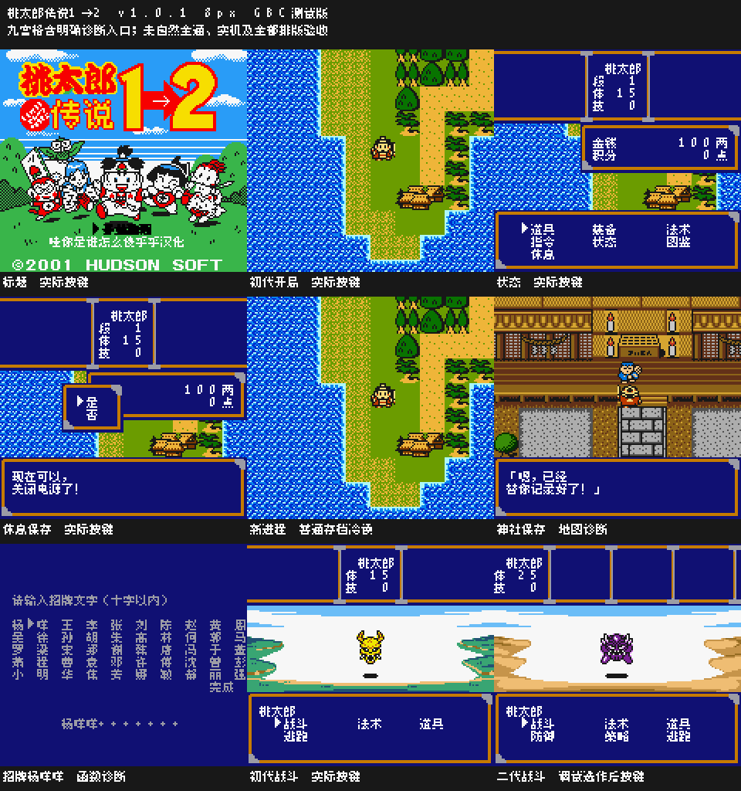
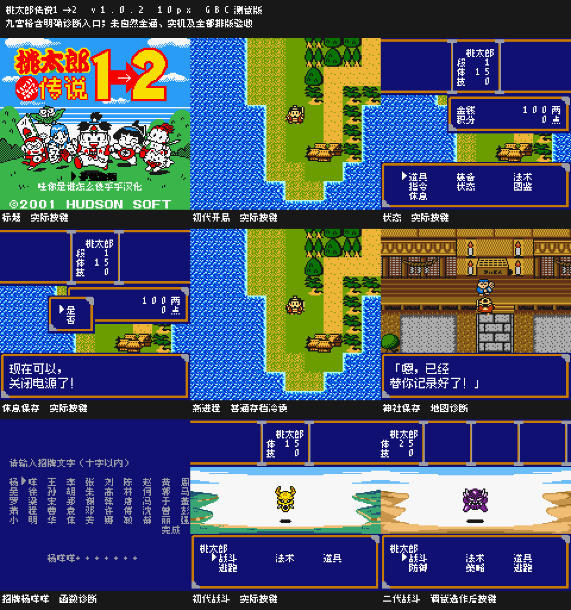

# 桃太郎传说1→2

原输入：Momotarou Densetsu 1→2 (Japan, revision 0)

原输入完整SHA256：`7d0d8bdb9c52e381862277271e3e0fe474af69cf9ea92053147cdfb1de32785b`。此处“原输入”保留改版、既有汉化或地区修订身份，不一律称干净零售ROM。

| 字号 | 当前版本 | 音频 | 输出完整SHA256 |
| --- | --- | --- | --- |
| 8px | v1.0.1 | unchanged | `b0962fabbf100396f014f7c4c8dc84fc0c845873d395859cfd8f850a481b3714` |
| 10px-dialogue | v1.0.2 | unchanged | `cde693110a689a8dd12b9b55e3d5cea2f3b4c8f17f87c2bdfd132d3bbe5d6794` |

## 源码与补丁

- 8px／v1.0.1／unchanged：完整修改源码：[下载](https://github.com/shiyi1133/youxi-hanhua-releases/releases/download/source-migration-20261022/momotarou-densetsu-1-2-current-source-e588dc1567cb-public-r02.zip)（ZIP SHA256 `d3fb5fb107808ba3d03cfb0a947f20a0079d1e41c4d53e06dae623537a21874f`）；补丁：[下载](https://github.com/shiyi1133/youxi-hanhua-releases/releases/download/patch-migration-20261022/momotarou-densetsu-1-2-current-patches.zip)（ZIP SHA256 `6f506b07be2974f756a75d150bb7e3492d3c776789cf6cdfb43f1783ebb2ef10`）。
- 10px-dialogue／v1.0.2／unchanged：完整修改源码：[下载](https://github.com/shiyi1133/youxi-hanhua-releases/releases/download/source-migration-20261022/momotarou-densetsu-1-2-current-source-e588dc1567cb-public-r02.zip)（ZIP SHA256 `d3fb5fb107808ba3d03cfb0a947f20a0079d1e41c4d53e06dae623537a21874f`）；补丁：[下载](https://github.com/shiyi1133/youxi-hanhua-releases/releases/download/patch-migration-20261022/momotarou-densetsu-1-2-current-patches.zip)（ZIP SHA256 `6f506b07be2974f756a75d150bb7e3492d3c776789cf6cdfb43f1783ebb2ef10`）。

补丁须直接应用于完整SHA一致的实际原输入；普通字、大字和音乐变体分别核对。公开源码归档不表示本轮重新构建或通过新的运行验收。原作、字体、已有翻译及工具依赖的权利与许可，依各包对应许可保留。

## 范围与验证边界

- 8px／v1.0.1：8px / 10px-dialogue。
- 10px-dialogue／v1.0.2：8px / 10px-dialogue。

本次资料搬运未新增模拟器、实机或全通验收；未记录或未测试的范围不写成通过。问题单开放只表示尚未关闭，已关闭也不单独证明全部场景都修复。

[公开反馈及问题状态](feedback.md) · [报告BUG](https://github.com/shiyi1133/youxi-hanhua-releases/issues/new?template=bug_report.md)

## 对应版本截图

v1.0.1 8px实际GBC九宫格；明确含招牌/神社及二代调试选择诊断；未自然全通/实机

图像SHA256：`574ba2aa413bc3791a2ec2c32d62afbc1522ac51f163cacc4f014480f4f5d695`；绑定ROM SHA256：`b0962fabbf100396f014f7c4c8dc84fc0c845873d395859cfd8f850a481b3714`。

v1.0.2 10px实际GBC九宫格；明确含招牌/神社及二代调试选择诊断；未自然全通/实机

图像SHA256：`ec2688661756c856aeef200df38c8251ba760529d9d935f7427b6ae7813d1626`；绑定ROM SHA256：`cde693110a689a8dd12b9b55e3d5cea2f3b4c8f17f87c2bdfd132d3bbe5d6794`。

