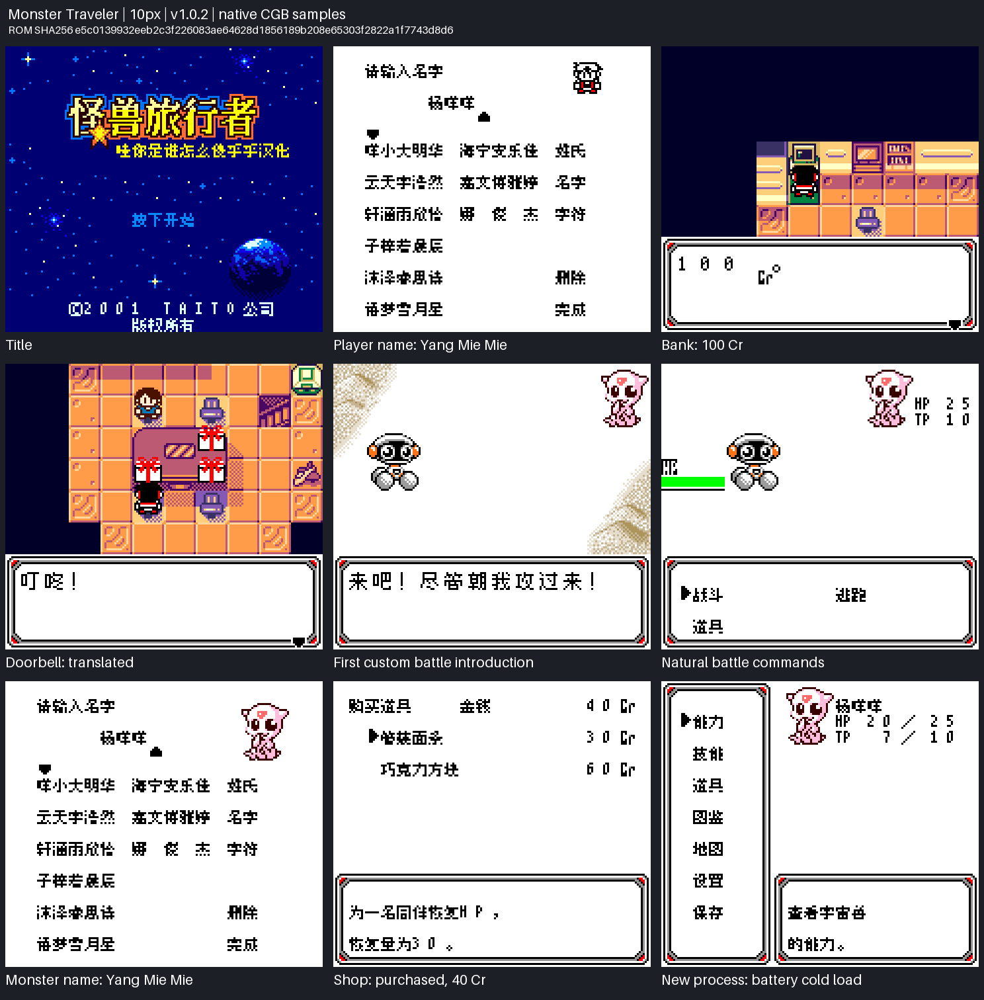

# 怪兽旅行者

原输入：Monster Traveler (Japan) (Rev A)

原输入完整SHA256：`5e567dcde1aa5e5e1fb61e9a614b9ca5fdd0c7748993c3687ae78f8eb7216ce9`。此处“原输入”保留改版、既有汉化或地区修订身份，不一律称干净零售ROM。

| 字号 | 当前版本 | 音频 | 输出完整SHA256 |
| --- | --- | --- | --- |
| 8px | 20261021补译修订测试版 | unchanged | `7448e1ed45732209089ca88623f5adf6e69f5abf36f2734a61acf8000a049c07` |
| 10px-dialogue | v1.0.2补译修订测试版 | unchanged | `e5c0139932eeb2c3f226083ae64628d1856189b208e65303f2822a1f7743d8d6` |

## 源码与补丁

- 8px／20261021补译修订测试版／unchanged：源码包（完整性未独立确认）：[下载](https://github.com/shiyi1133/youxi-hanhua-releases/releases/download/source-migration-20261022-04/monster-traveler-current-scope-source-public-r01.zip)（ZIP SHA256 `22b1a79c0928d4a43174169cdeabf3973d6ef78ae37f5a2550bb5838e93099bf`）；补丁：[下载](https://github.com/shiyi1133/youxi-hanhua-releases/releases/download/patch-migration-20261022/monster-traveler-current-patches.zip)（ZIP SHA256 `7dc16f8c9272a0ccab4f322e2bef916f977f60fb4b7aa985a9aa8d7aa48b5d81`）。
  该包已核对对应版本与字节安全；完整修改源码覆盖范围未独立确认。
- 10px-dialogue／v1.0.2补译修订测试版／unchanged：源码包（完整性未独立确认）：[下载](https://github.com/shiyi1133/youxi-hanhua-releases/releases/download/source-migration-20261022-04/monster-traveler-current-scope-source-public-r01.zip)（ZIP SHA256 `22b1a79c0928d4a43174169cdeabf3973d6ef78ae37f5a2550bb5838e93099bf`）；补丁：[下载](https://github.com/shiyi1133/youxi-hanhua-releases/releases/download/patch-migration-20261022/monster-traveler-current-patches.zip)（ZIP SHA256 `7dc16f8c9272a0ccab4f322e2bef916f977f60fb4b7aa985a9aa8d7aa48b5d81`）。
  该包已核对对应版本与字节安全；完整修改源码覆盖范围未独立确认。

补丁须直接应用于完整SHA一致的实际原输入；普通字、大字和音乐变体分别核对。公开源码归档不表示本轮重新构建或通过新的运行验收。原作、字体、已有翻译及工具依赖的权利与许可，依各包对应许可保留。

## 范围与验证边界

- 8px／20261021补译修订测试版：普通8px；原生菜单、命名及动态字段保持8px。
  本轮补译及10px币种修订测试交付，不属于旧既有反馈四处字尾排版输出本身；新通知政策核验另记。
  本版仍为补译修订测试版，没有全流程通关或全游戏零遗漏验收。
  77个入口为45自定义开战、25拒逃、5漏提正文与2错位指针；只自然覆盖首个自定义开战，25拒逃未逐场自然触发。
  新10px修正26处Cr编码；旧8px币种本来正确。菜单、命名、动态姓名/数字和密集字段保持8px；未宣称既有反馈姓名位置问题修复。
  提供方已测双版自然开场、杨咩咩命名/删除重输/长度限制、首战、哈妮剧情/出村/道路野战逃跑、购物与使用道具、正常电池保存及新进程冷读。8px训练中心仅教学，未把它算训练升级。
  提供方完整源码净环境重建与静态/诊断记录属于提供方证据；维护会话本轮不执行包内源码、不重建、不新跑模拟器。
  原始旧版对照帧未单独附包；前后对照左列仅提供方证据，新版右列及双版九宫格均与包内原帧逐RGB匹配。
  219远引用中70目标有42地图入口见证、28局部结构证据；未穷尽后期/NPC/旧换行语义/动态变量极值、实机、联机或任意旧存档兼容。
  使用CGB模式；先备份电池存档，即时状态不可跨版或字号混用。大字更易拖慢、刷新残留，遇到请反馈。
- 10px-dialogue／v1.0.2补译修订测试版：仅标准对白10px；菜单、命名、动态姓名/数字及密集字段仍为8px。
  本轮补译及10px币种修订测试交付，不属于旧既有反馈四处字尾排版输出本身；新通知政策核验另记。
  本版仍为补译修订测试版，没有全流程通关或全游戏零遗漏验收。
  77个入口为45自定义开战、25拒逃、5漏提正文与2错位指针；只自然覆盖首个自定义开战，25拒逃未逐场自然触发。
  新10px修正26处Cr编码；旧8px币种本来正确。菜单、命名、动态姓名/数字和密集字段保持8px；未宣称既有反馈姓名位置问题修复。
  提供方已测双版自然开场、杨咩咩命名/删除重输/长度限制、首战、哈妮剧情/出村/道路野战逃跑、购物与使用道具、正常电池保存及新进程冷读。8px训练中心仅教学，未把它算训练升级。
  提供方完整源码净环境重建与静态/诊断记录属于提供方证据；维护会话本轮不执行包内源码、不重建、不新跑模拟器。
  原始旧版对照帧未单独附包；前后对照左列仅提供方证据，新版右列及双版九宫格均与包内原帧逐RGB匹配。
  219远引用中70目标有42地图入口见证、28局部结构证据；未穷尽后期/NPC/旧换行语义/动态变量极值、实机、联机或任意旧存档兼容。
  使用CGB模式；先备份电池存档，即时状态不可跨版或字号混用。大字更易拖慢、刷新残留，遇到请反馈。

本次资料搬运未新增模拟器、实机或全通验收；未记录或未测试的范围不写成通过。问题单开放只表示尚未关闭，已关闭也不单独证明全部场景都修复。

[公开反馈及问题状态](feedback.md) · [报告BUG](https://github.com/shiyi1133/youxi-hanhua-releases/issues/new?template=bug_report.md)

## 对应版本截图

20261021补译修订测试版；普通8px；原生菜单、命名及动态字段保持8px；最终ROM提供方自然CGB九宫格，18原帧逐RGB核准，非全通

图像SHA256：`f0a1518eb447032b699ab15d10b35c0906b604db4fd17c852bb3a1343d8039e7`；绑定ROM SHA256：`7448e1ed45732209089ca88623f5adf6e69f5abf36f2734a61acf8000a049c07`。

v1.0.2补译修订测试版；仅标准对白10px；菜单、命名、动态姓名/数字及密集字段仍为8px；最终ROM提供方自然CGB九宫格，18原帧逐RGB核准，非全通

图像SHA256：`c1fa76727b2cb5debd2087a815a73d74cd9219c5352ff35d261cb2c1b858ae11`；绑定ROM SHA256：`e5c0139932eeb2c3f226083ae64628d1856189b208e65303f2822a1f7743d8d6`。

