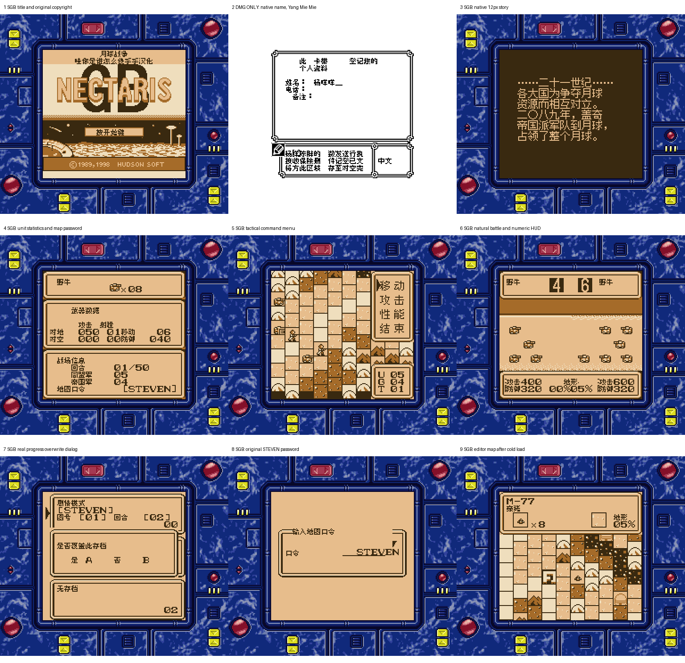

# 月球战争（Nectaris GB）

原输入：Nectaris GB (Japan) (SGB Enhanced); requester archive/cartridge header identity

原输入完整SHA256：`a890dd16d6120f386795d43da3527f2a0b6710abbd424fac7833b09400674f5b`。此处“原输入”保留改版、既有汉化或地区修订身份，不一律称干净零售ROM。

| 字号 | 当前版本 | 音频 | 输出完整SHA256 |
| --- | --- | --- | --- |
| native8px-12px | v1.0.0 | unchanged | `82ea44390551e97c3ac118904ef2c38bbaa82e0b701eb0ad1a9872a06518d30f` |

## 源码与补丁

- native8px-12px／v1.0.0／unchanged：完整修改源码：[下载](https://github.com/shiyi1133/youxi-hanhua-releases/releases/download/source-migration-20261022/nectaris-gb-current-source-c24f321e2a93-public-r02.zip)（ZIP SHA256 `92214959fe5f009dec5e68bb9161ee935ede299c65921f702e45d979dfc0c723`）；补丁：[下载](https://github.com/shiyi1133/youxi-hanhua-releases/releases/download/patch-migration-20261022/nectaris-gb-current-patches.zip)（ZIP SHA256 `b9636a53b8c48f6e93bb840dde073ea9ae3f8b1bbaed56bc49b50c89dbfd20ce`）。

补丁须直接应用于完整SHA一致的实际原输入；普通字、大字和音乐变体分别核对。公开源码归档不表示本轮重新构建或通过新的运行验收。原作、字体、已有翻译及工具依赖的权利与许可，依各包对应许可保留。

## 范围与验证边界

- native8px-12px／v1.0.0：原生8px菜单/HUD/姓名＋原有约12px剧情/16×16命令框；无独立大字。
  主界面、菜单/HUD、单位/战斗/剧情/地图编辑与DMG GBKISS有限中文输入；有限测试发布，保留地图口令/品牌/英文名
  全地图/战役与结局未自然验收
  实机/双机红外/GBKISS LINK/第三方程序互通未验
  全部地形/单位/数值组合未穷举
  原生GBKISS有限字表非任意Unicode输入
  提供方同实现者测试，维护无动态/源码运行

本次资料搬运未新增模拟器、实机或全通验收；未记录或未测试的范围不写成通过。问题单开放只表示尚未关闭，已关闭也不单独证明全部场景都修复。

[公开反馈及问题状态](feedback.md) · [报告BUG](https://github.com/shiyi1133/youxi-hanhua-releases/issues/new?template=bug_report.md)

## 对应版本截图

v1.0.0普通原生8px/12px真实九格：8原生SGB（标题/剧情/数值/菜单/战斗/覆盖/口令/编辑冷读），第2格仅DMG GBKISS原生命名；提供方原生按键/电池来源，维护静态逐格像素核，不是完整流程或实机验收。

图像SHA256：`4fadcc71d7c168181440710add22da10dbaadb4c77bcc8f1f1ae4fc40ddfbe0a`；绑定ROM SHA256：`82ea44390551e97c3ac118904ef2c38bbaa82e0b701eb0ad1a9872a06518d30f`。

