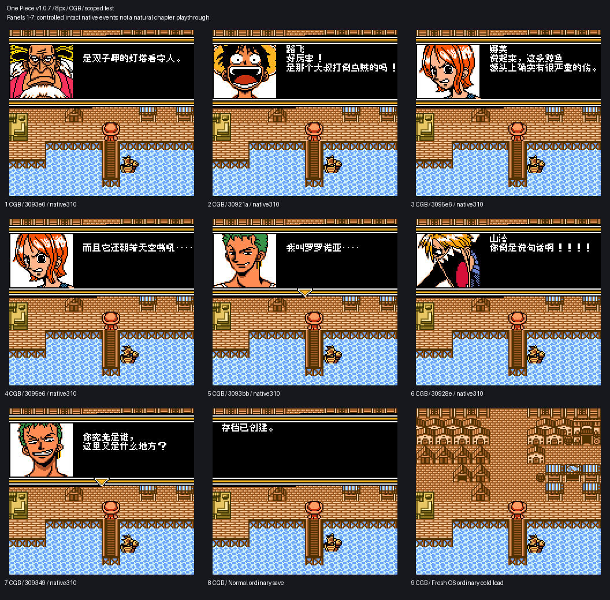
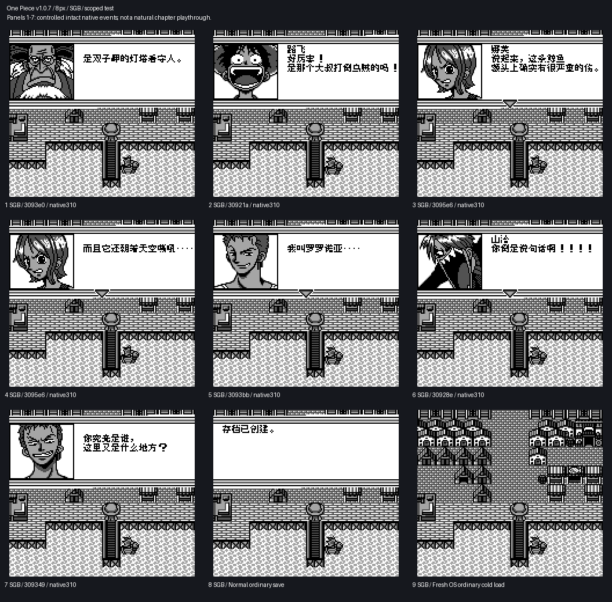
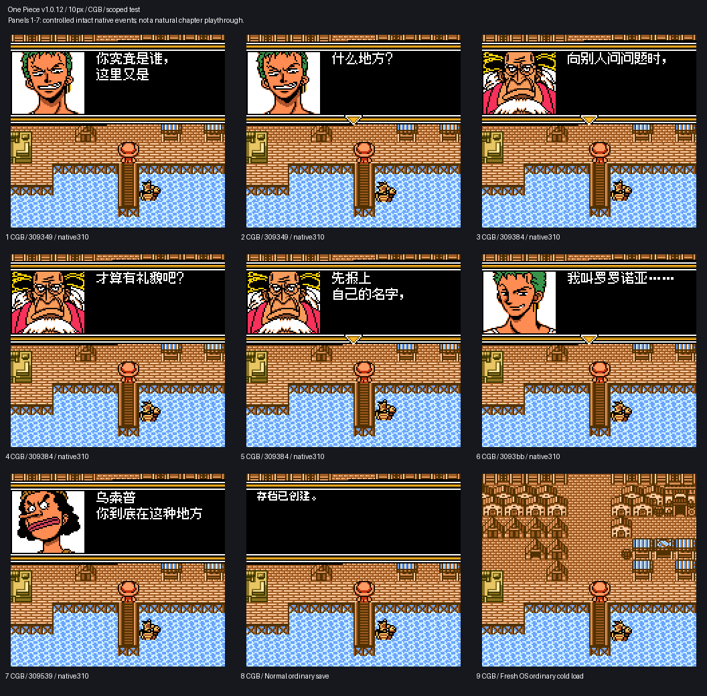
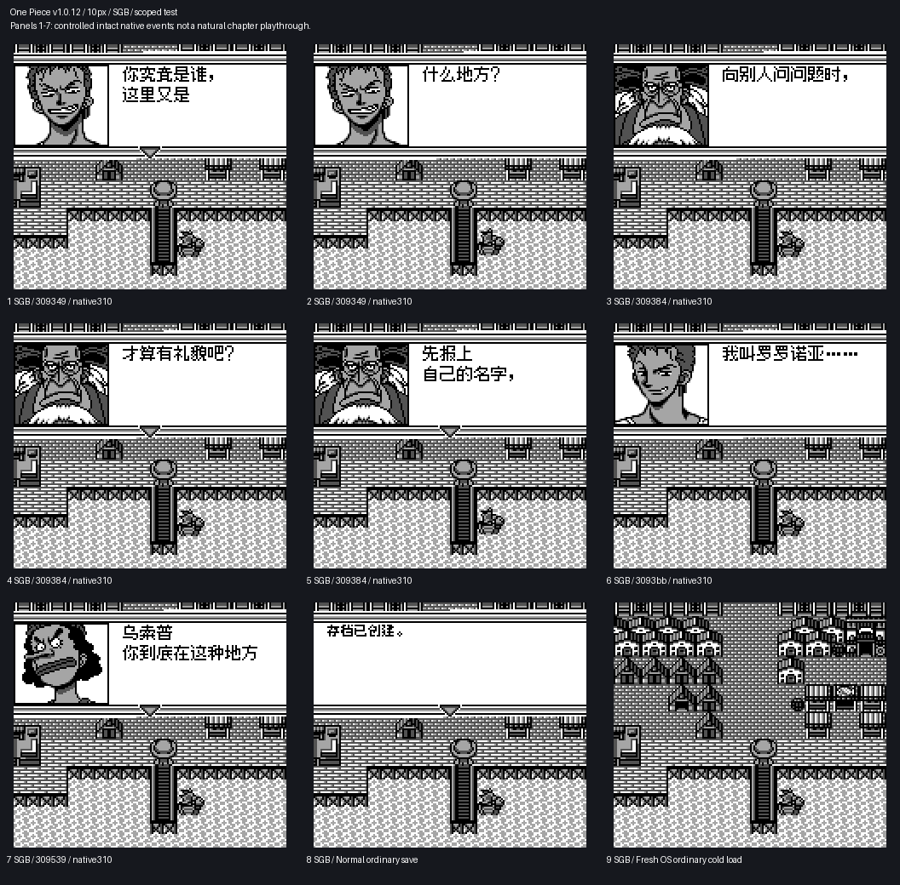

# 海贼王 幻之伟大航路冒险记

原输入：From TV Animation One Piece - Maboroshi no Grand Line Boukenki! (Japan) (SGB Enhanced) (GB Compatible)

原输入完整SHA256：`de6b8d2982bbb53ecbc5db2e7277ac928dbdff01de568400cf2a64dcc5686915`。此处“原输入”保留改版、既有汉化或地区修订身份，不一律称干净零售ROM。

| 字号 | 当前版本 | 音频 | 输出完整SHA256 |
| --- | --- | --- | --- |
| 8px | v1.0.7测试版 | unchanged | `b226b1244208d66ac6f8a90c7cd555426332c1393ee7c41a5b0c001fa55c643c` |
| 10px-dialogue | v1.0.12大字号测试版 | unchanged | `3c1108bc53856227e63bcfc3dabae22c5a5742791a486fba79a6a9b558b1c764` |

## 源码与补丁

- 8px／v1.0.7测试版／unchanged：源码包（完整性未独立确认）：[下载](https://github.com/shiyi1133/youxi-hanhua-releases/releases/download/source-migration-20261022-02b/one-piece-grand-line-current-source-99ef3e6ff01e-public-r01.zip)（ZIP SHA256 `8163b3b068a9b7da41c78d110e2d41fc4db4f2fb17074a2457df3b3465cf7a1f`）；补丁：[下载](https://github.com/shiyi1133/youxi-hanhua-releases/releases/download/patch-migration-20261022/one-piece-grand-line-current-patches.zip)（ZIP SHA256 `a333eed8cd509e3f26a4d3cea35e3331cd6dc13910a6c52c0946cd546c224415`）。
  该包已核对对应版本与字节安全；完整修改源码覆盖范围未独立确认。
- 10px-dialogue／v1.0.12大字号测试版／unchanged：源码包（完整性未独立确认）：[下载](https://github.com/shiyi1133/youxi-hanhua-releases/releases/download/source-migration-20261022-02b/one-piece-grand-line-current-source-516fa7d5fb84-public-r01.zip)（ZIP SHA256 `183b216992277c2d07c1714d2a626c8b0dc7a95ac41cdefc1d302afd88a700b8`）；补丁：[下载](https://github.com/shiyi1133/youxi-hanhua-releases/releases/download/patch-migration-20261022/one-piece-grand-line-current-patches.zip)（ZIP SHA256 `a333eed8cd509e3f26a4d3cea35e3331cd6dc13910a6c52c0946cd546c224415`）。
  该包已核对对应版本与字节安全；完整修改源码覆盖范围未独立确认。

补丁须直接应用于完整SHA一致的实际原输入；普通字、大字和音乐变体分别核对。公开源码归档不表示本轮重新构建或通过新的运行验收。原作、字体、已有翻译及工具依赖的权利与许可，依各包对应许可保留。

## 范围与验证边界

- 8px／v1.0.7测试版：native8px / 10px-dialogue:6582fullybig+5mixed;11originalPAGE native8 exceptions retained。
- 10px-dialogue／v1.0.12大字号测试版：native8px / 10px-dialogue:6582fullybig+5mixed;11originalPAGE native8 exceptions retained。

本次资料搬运未新增模拟器、实机或全通验收；未记录或未测试的范围不写成通过。问题单开放只表示尚未关闭，已关闭也不单独证明全部场景都修复。

[公开反馈及问题状态](feedback.md) · [报告BUG](https://github.com/shiyi1133/youxi-hanhua-releases/issues/new?template=bug_report.md)

## 对应版本截图

8px v1.0.7 CGB实际九宫格；前7格受控原生入口、后2格正常保存/电池冷读；SGB默认配色，非自然完整章节

图像SHA256：`7ec24a13758e019a7926b28b62271ec8abca67357314bc1441fd99234847f937`；绑定ROM SHA256：`b226b1244208d66ac6f8a90c7cd555426332c1393ee7c41a5b0c001fa55c643c`。

8px v1.0.7 SGB实际九宫格；前7格受控原生入口、后2格正常保存/电池冷读；SGB默认配色，非自然完整章节

图像SHA256：`5a772e90a6db8cc9c09e537a238597eb19d58723917722bb4619597a82fd29cf`；绑定ROM SHA256：`b226b1244208d66ac6f8a90c7cd555426332c1393ee7c41a5b0c001fa55c643c`。

10px-dialogue v1.0.12 CGB实际九宫格；前7格受控原生入口、后2格正常保存/电池冷读；SGB默认配色，非自然完整章节

图像SHA256：`ae3e37126eca7579b5ee16337f34a42f64824a3d4e3b8913e9a58e47fc7837df`；绑定ROM SHA256：`3c1108bc53856227e63bcfc3dabae22c5a5742791a486fba79a6a9b558b1c764`。

10px-dialogue v1.0.12 SGB实际九宫格；前7格受控原生入口、后2格正常保存/电池冷读；SGB默认配色，非自然完整章节

图像SHA256：`abc288ae6d5b0333ed8cb6b21d24eb382c99cc4a23e4802927f95155f1ad5263`；绑定ROM SHA256：`3c1108bc53856227e63bcfc3dabae22c5a5742791a486fba79a6a9b558b1c764`。

