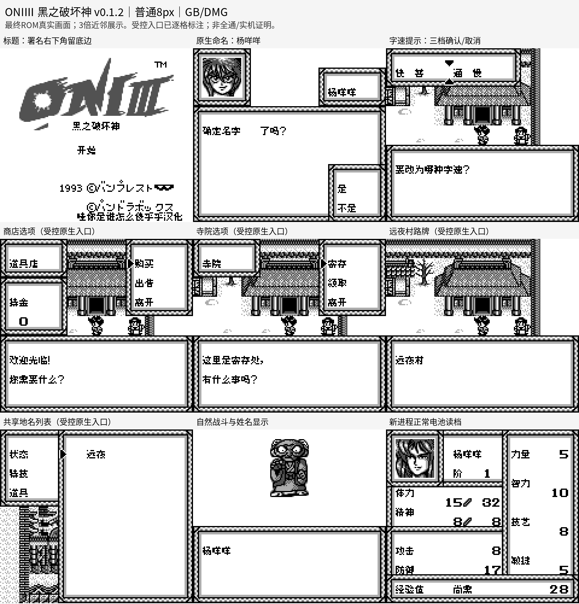

# ONIⅢ黑之破坏神 v0.1.2（限定测试版）

[源码与补丁Release](https://github.com/shiyi1133/youxi-hanhua-releases/releases/tag/oni-iii-v0.1.2) · [公开反馈](feedback.md) · [报告BUG](https://github.com/shiyi1133/youxi-hanhua-releases/issues/new?template=bug_report.md)

原游戏／实际输入：Oni III - Kuro no Hakaishin (Japan)

原输入完整SHA-256：`6905fbdd67f1113b7b75064d329e1fec1a9434af28f91910e8b5a15c4e6210b0`（262144字节）。

范围：普通8px限定修复：字速提示、商店/寺院选项、反馈中的远夜村路牌，及共享地名后缀/远夜目的地。保留既有默认姓名修复；标题署名移到右下留底边。

## 8px v0.1.2

字号范围：普通8px；原生GB/DMG灰度，无原生SGB支持，无另行10px大字ROM；九宫格为原生160×144画面三倍近邻展示。

目标完整SHA-256：`6001900aee1b73c3abca0baf3e3dffa1fefc96d23b565c68ea33939b9d6b1933`（524288字节）。

补丁：`ONI-III-v0.1.2-8px.bps`，SHA-256 `41b0817a6639f8c91eaf72c354d34147df403d787098a0836697d78abc3edfef`。

[源码（完整性未独立确认）](https://github.com/shiyi1133/youxi-hanhua-releases/releases/download/oni-iii-v0.1.2/oni-iii-v0.1.2-8px-SOURCE-public.zip) · [补丁包](https://github.com/shiyi1133/youxi-hanhua-releases/releases/download/oni-iii-v0.1.2/oni-iii-v0.1.2-8px-PATCH-public.zip)

ONIⅢ黑之破坏神 v0.1.2 普通8px最终ROM提供者真实九宫格；自然与受控场景逐格标明，原生像素精确核对；不代表维护重跑、实机或全通。

## 测试及限制

提供者自然路径：提供者自然按键自测：字速三档预览/确认/取消/重入；两次杨咩咩命名、重复/删除重输；序章至第一章、战斗/升级、正常保存及新OS进程冷读，默认常叶丸首段和有/无存档标题。

提供者诊断路径：提供者受控原生入口：道具店、武器店、寺院三项选择及B取消；远夜村路牌、城下町/町/村/空后缀和远夜目的地返回地图37；八默认姓名模板。不是自然到店或重访报告地点。

保存边界：未据原件SRAM或空存档推定保存冷读成功。

同一实现者自测，不是独立人员QA；维护未新增ROM运行或源码重建，未宣称实机或完整通关。

- 未验证：维护独立核原输入、BPS还原、完整SHA、ZIP/CRC/白名单及九格像素；未执行提供者源码、未独立重建或新增游戏运行。
- 未验证：Issue140仅所列消费者局部补译；其它城镇地名本体未全覆盖，“普通”字距建议未改，整项覆盖反馈继续open。
- 未验证：自然抵达报告店铺/寺院/远夜村、完整交易/存取、后六角色自然入队、原口令实际使用、全流程与实机未验；Issue8和Issue72不在本包范围。
- 未验证：v0.1.1自建电池样本在本版冷读为提供者自测，不保证全部历史档/其它汉化/地区兼容。
- 核对补丁还原、资产完整SHA和截图字节不等于全部游戏功能验收。

