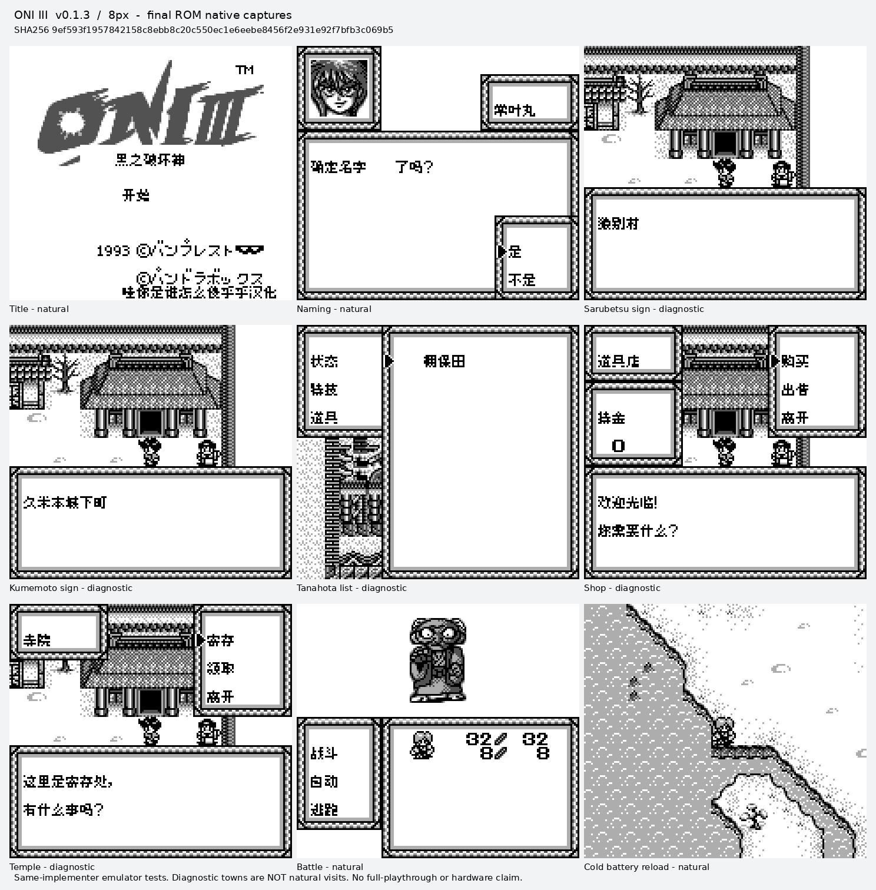

# ONIⅢ黑之破坏神 v0.1.3（限定测试版）

[源码与补丁Release](https://github.com/shiyi1133/youxi-hanhua-releases/releases/tag/oni-iii-v0.1.3) · [公开反馈](feedback.md) · [报告BUG](https://github.com/shiyi1133/youxi-hanhua-releases/issues/new?template=bug_report.md)

原游戏／实际输入：Oni III - Kuro no Hakaishin (Japan)

原输入完整 SHA-256：`6905fbdd67f1113b7b75064d329e1fec1a9434af28f91910e8b5a15c4e6210b0`（262144字节）。

范围：普通8px独立地名表、路牌/传送列表及一处对白地点误译限定修订；未新增大字。

## 8px v0.1.3 / unchanged

字号范围：普通8px独立地名表、路牌/传送列表及一处对白地点误译限定修订；未新增大字。

目标完整 SHA-256：`9ef593f1957842158c8ebb8c20c550ec1e6eebe8456f2e931e92f7bfb3c069b5`（524288字节）。

补丁：`ONI-III-v0.1.3-8px.bps`，SHA-256 `39959e88dcc4ce364db1c8b1184289167b6c181ed37780406676f6a5c65886b2`。

[源码（完整性未独立确认）](https://github.com/shiyi1133/youxi-hanhua-releases/releases/download/oni-iii-v0.1.3/oni-iii-v0.1.3-complete-source.zip) · [补丁包](https://github.com/shiyi1133/youxi-hanhua-releases/releases/download/oni-iii-v0.1.3/oni-iii-v0.1.3-patches.zip)

普通8px独立地名表、路牌/传送列表及一处对白地点误译限定修订；未新增大字。；提供方对应最终ROM图证，具体自然/诊断类别见原图标签及材料；非维护运行、全通或实机验收。

## 测试及限制

提供方自然范围：提供方报告的自然/正常按键流程，维护未重跑。

提供方诊断范围：提供方明确标注的受控消费者、解锁或边界测试，不能冒充自然到达。

保存边界：仅按具体版本材料，不推定所有旧存档兼容。

维护本轮独立核原输入、补丁逐字节还原、ZIP/CRC、Source安全与原图字节；未执行提供方源码、未重建或运行ROM，未宣称独立人员QA、实机或全流程验收。

- 未验证：维护仅独立核用户输入ZIP/ROM完整SHA、补丁逐字节还原、ZIP成员/CRC与源包静态材料；未执行提供者源码、重建工程或运行ROM。
- 未验证：运行、自然按键、受控诊断、保存/新进程冷读等范围以所附提供方报告分别为据，不冒充维护重跑、独立人员QA、玩家验收、实机或全流程通关。
- 未验证：使用前备份普通存档；不跨ROM版本/字号套用即时状态，旧电池兼容仅按提供方实际样本说明。
