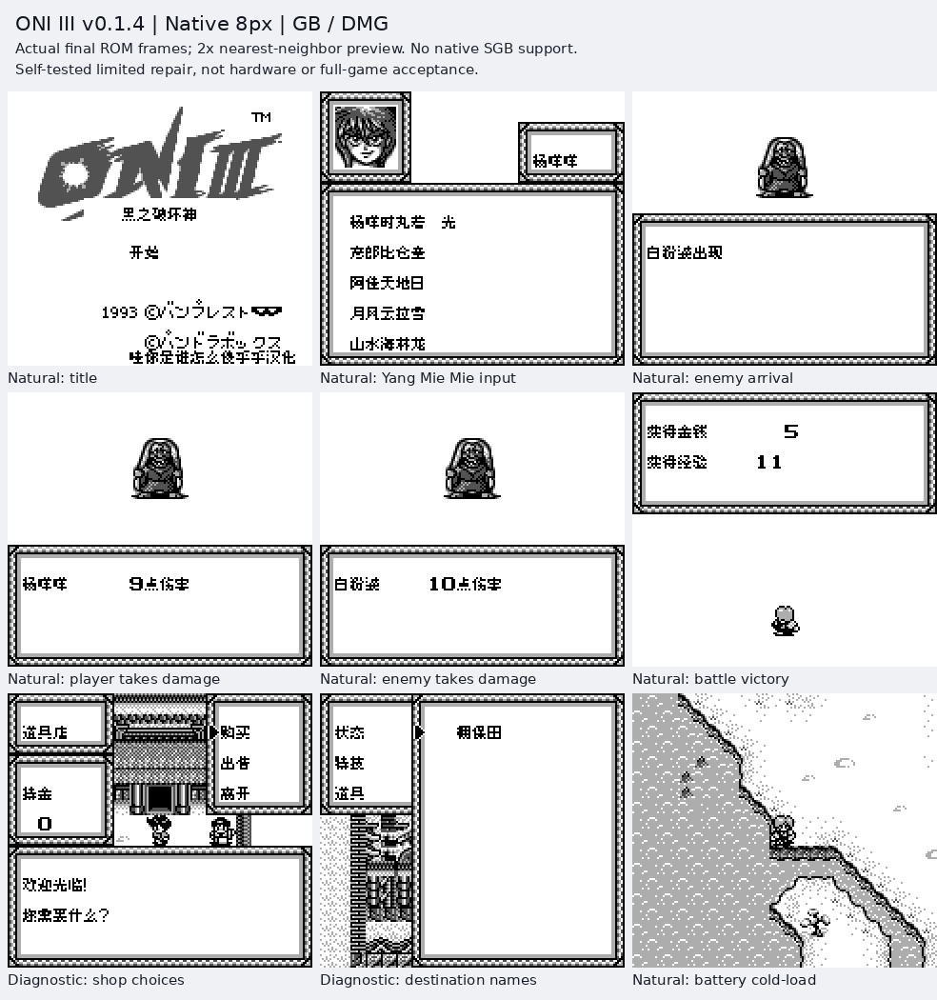

# ONIⅢ黑之破坏神 v0.1.4（限定测试版）

[源码与补丁Release](https://github.com/shiyi1133/youxi-hanhua-releases/releases/tag/oni-iii-v0.1.4) · [公开反馈](feedback.md) · [报告BUG](https://github.com/shiyi1133/youxi-hanhua-releases/issues/new?template=bug_report.md)

原游戏／实际输入：Oni III - Kuro no Hakaishin (Japan)

原输入完整 SHA-256：`6905fbdd67f1113b7b75064d329e1fec1a9434af28f91910e8b5a15c4e6210b0`（262144字节）。

范围：修正受伤提示中姓名后的日文助词；继承v0.1.3地名、取名和菜单修订。本次普通8px。

## 8px v0.1.4 / unchanged

字号范围：普通原生8px；未新增大字号。

目标完整 SHA-256：`d355e8fa93a20e6a05697937d6a2e2dec85b7f1704827162f2924c6fa9b84983`（524288字节）。

补丁：`ONI-III-v0.1.4-8px.bps`，SHA-256 `1e13c33965de88e431741892e28ae8dc1e3f6a1c76d979346db5798e9549b224`。

[源码（完整性未独立确认）](https://github.com/shiyi1133/youxi-hanhua-releases/releases/download/oni-iii-v0.1.4/oni-iii-v0.1.4-complete-source.zip) · [补丁包](https://github.com/shiyi1133/youxi-hanhua-releases/releases/download/oni-iii-v0.1.4/oni-iii-v0.1.4-PATCH.zip)

修正受伤提示中姓名后的日文助词；继承v0.1.3地名、取名和菜单修订。本次普通8px。 提供方报告v0.1.3与本版自然战斗均实核敌我伤害提示，普通姓名/保存新进程冷读；维护未运行。 商店、30路牌/30目的地入口与999伤害属于有标注的诊断/数值边界，不称自然走遍全部城镇。

## 测试及限制

提供方自然范围：提供方报告v0.1.3与本版自然战斗均实核敌我伤害提示，普通姓名/保存新进程冷读；维护未运行。

提供方诊断范围：商店、30路牌/30目的地入口与999伤害属于有标注的诊断/数值边界，不称自然走遍全部城镇。

保存边界：仅按具体版本材料，不推定所有旧存档兼容。

维护本轮独立核原输入、补丁逐字节还原、ZIP/CRC、Source安全与原图字节；未执行提供方源码、未重建或运行ROM，未宣称独立人员QA、实机或全流程验收。

- 未验证：维护独立核输入ZIP/ROM完整SHA、BPS逐字节还原、ZIP成员CRC与Root实际查看最终图；未执行附件源码或ROM、未独立重建。
- 未验证：提供方自然/受控/静态证据分别记录，不冒充维护运行、独立外部人员QA、玩家实际存档、实机、联机或完整通关验收。
- 未验证：备份原件与普通存档，不跨ROM完整SHA加载即时状态；既有旧Release、标签、引用、原始包与本地历史保留。
- 未验证：Issue140仍保持open，只登记本次伤害助词子项进展；Issue8/72不在此次修复声明。
