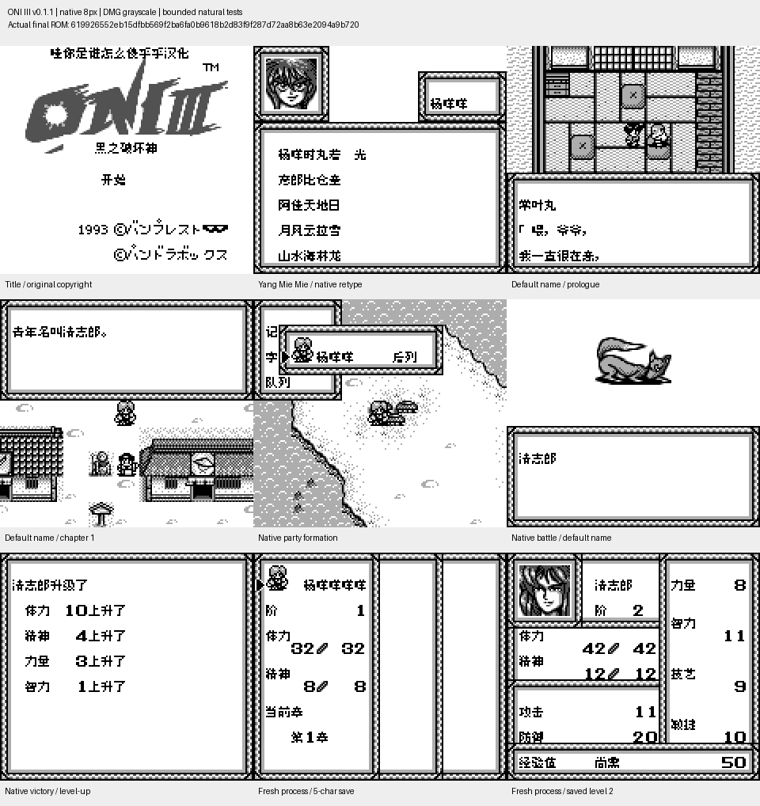

# ONIⅢ黑之破坏神

原输入：Oni III - Kuro no Hakaishin (Japan)

原输入完整SHA256：`6905fbdd67f1113b7b75064d329e1fec1a9434af28f91910e8b5a15c4e6210b0`。此处“原输入”保留改版、既有汉化或地区修订身份，不一律称干净零售ROM。

| 字号 | 当前版本 | 音频 | 输出完整SHA256 |
| --- | --- | --- | --- |
| 8px | v0.1.1限定测试版 | unchanged | `619926552eb15dfbb569f2ba6fa0b9618b2d83f9f287d72aa8b63e2094a9b720` |

## 源码与补丁

- 8px／v0.1.1限定测试版／unchanged：源码包（完整性未独立确认）：[下载](https://github.com/shiyi1133/youxi-hanhua-releases/releases/download/source-migration-20261022-02b/oni-iii-current-source-b4addab6395b-public-r01.zip)（ZIP SHA256 `7a2faf45986b5f80ee7cd9126df7a53349c62f8b17e383595128051ee785c5e1`）；补丁：[下载](https://github.com/shiyi1133/youxi-hanhua-releases/releases/download/patch-migration-20261022/oni-iii-current-patches.zip)（ZIP SHA256 `9629dec1bc8413164fe2195dc84d6621a6bc8c980f81350484495c7e1675d5ea`）。
  该包已核对对应版本与字节安全；完整修改源码覆盖范围未独立确认。

补丁须直接应用于完整SHA一致的实际原输入；普通字、大字和音乐变体分别核对。公开源码归档不表示本轮重新构建或通过新的运行验收。原作、字体、已有翻译及工具依赖的权利与许可，依各包对应许可保留。

## 范围与验证边界

- 8px／v0.1.1限定测试版：普通8px点阵汉化；原生英文/假名及未覆盖图形按实际版本保留。。
  修复主角默认姓名对话中的混合字节消费异常。
  自然默认常叶丸开场及清志郎第一章、取名/战斗/升级/存档冷启动由提供方复测。
  八个默认模板中后六位自然入队未走到；模板全覆盖属受控诊断，无全流程或实机验收。
  本维护会话仅独立静态、BPS还原、文件校验和九宫格像素核验；未执行附件代码、未运行模拟器或复测游戏。
  提供方限定路线验证；维护独立核完整SHA、补丁和截图，未运行附包代码或游戏。
  未声明实机、全流程通关或全部旧存档兼容。

本次资料搬运未新增模拟器、实机或全通验收；未记录或未测试的范围不写成通过。问题单开放只表示尚未关闭，已关闭也不单独证明全部场景都修复。

[公开反馈及问题状态](feedback.md) · [报告BUG](https://github.com/shiyi1133/youxi-hanhua-releases/issues/new?template=bug_report.md)

## 对应版本截图

ONIⅢ黑之破坏神 v0.1.1限定测试版 普通8px；提供方最终ROM画面，维护实际查看九宫格，不代表维护重跑游戏。

图像SHA256：`702bec54761ad8e7e7a9019dbf9a764d069708b79da9246131df397819709d5d`；绑定ROM SHA256：`619926552eb15dfbb569f2ba6fa0b9618b2d83f9f287d72aa8b63e2094a9b720`。

