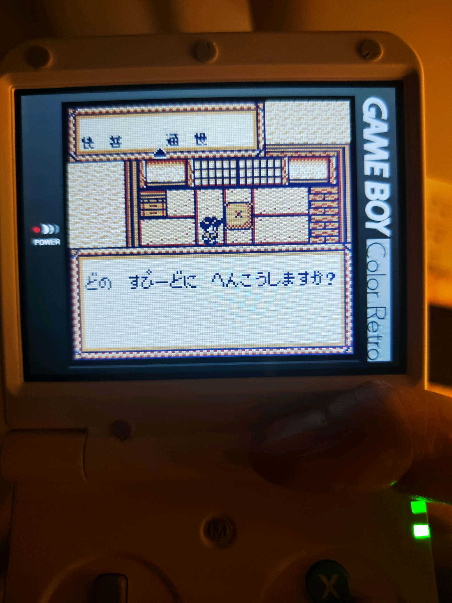
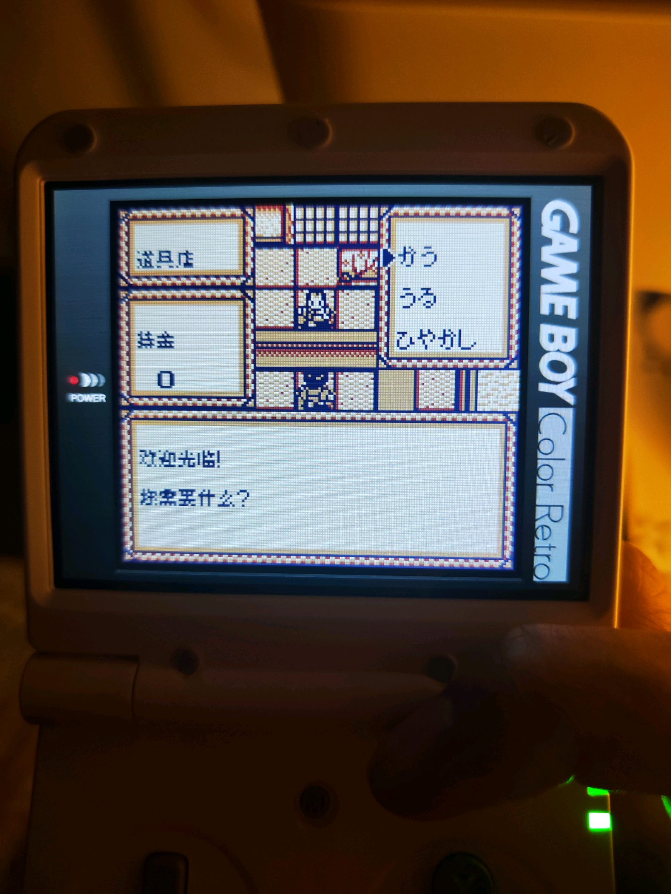
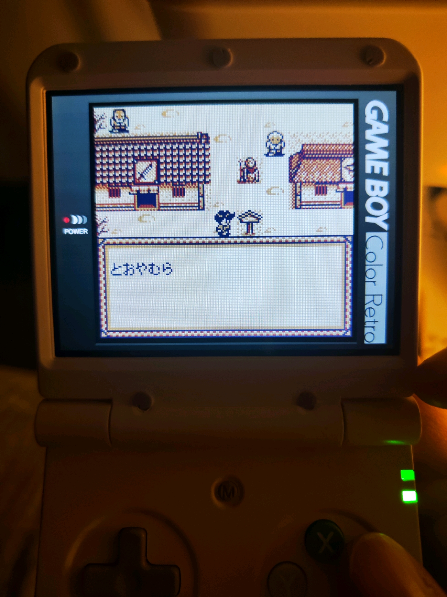
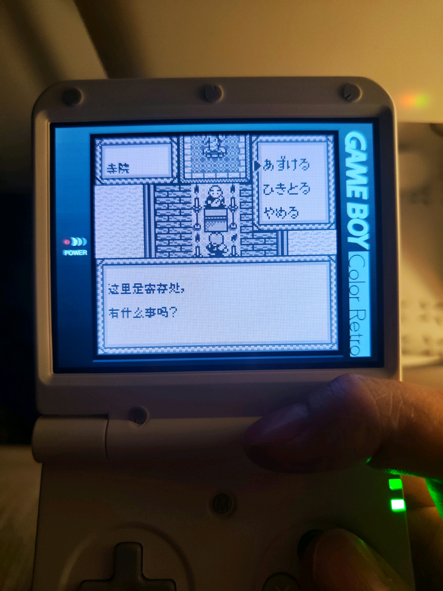
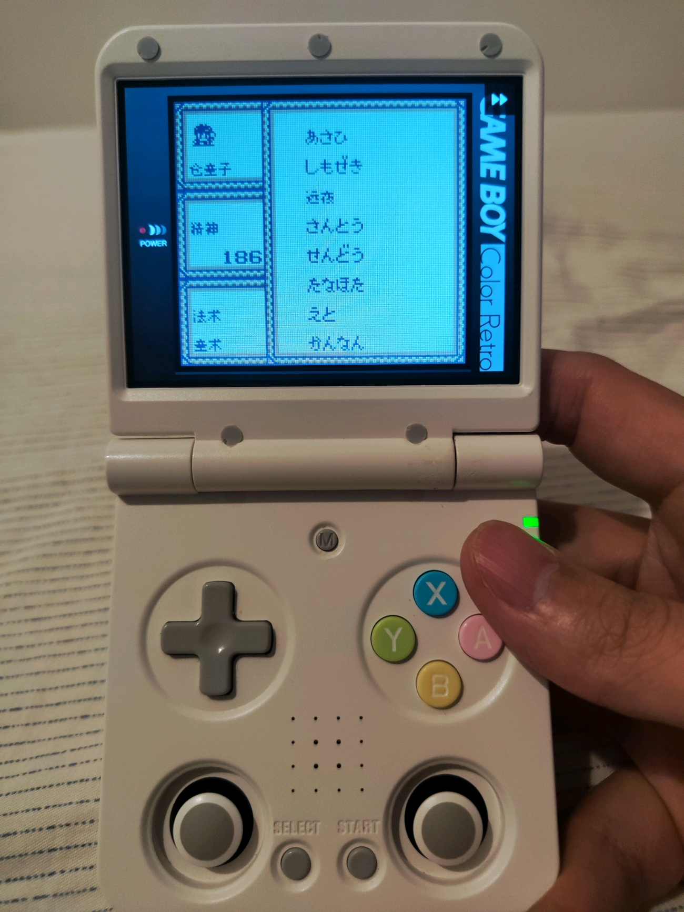
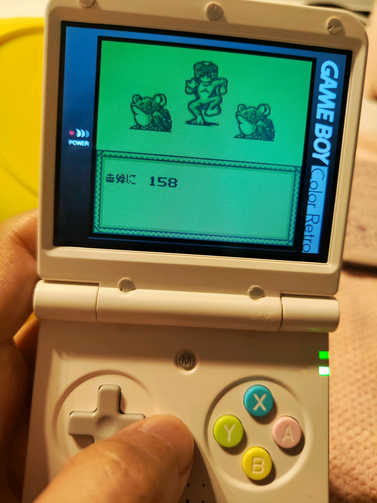

# ONIⅢ黑之破坏神：公开反馈

以下为已公开证据摘录，不能自动当成已经复现或修复。下载／存档分享地址、本机路径或项目署名文字省略时逐条标记。

## 154037793317

71楼 · willzyjno1 · [原回帖](https://tieba.baidu.com/p/11092365551?pid=154037793317#154037793317)

> ONIⅢ主角用默认名，对话中主角名字乱码。

## 154041567549

71楼 · willzyjno1 · [原回帖](https://tieba.baidu.com/p/11092365551?pid=154041567549#154041567549)

> Ⅲ是0.1.0版，Ⅳ和Ⅴ是0.1.1版，Ⅴ整个游戏都拖慢无论哪个画面。

## 154044934292

71楼 · 加勒比瘦子 · [原回帖](https://tieba.baidu.com/p/11092365551?pid=154044934292#154044934292)

> 开场后的村子中间有一个npc的对话第2句显示日文。

## 154046686417

71楼 · Duyes · [原回帖](https://tieba.baidu.com/p/11092365551?pid=154046686417#154046686417)

> 换了一个开源机，字体可以大概看清了，实体机悲剧。开局出了村子里有对话是日文，进第一次变身的三日月山对话，依旧有不少日文bug

## 154047624012

71楼 · Duyes · [原回帖](https://tieba.baidu.com/p/11092365551?pid=154047624012#154047624012)

> @哇你是谁怎么傻乎乎 第一次出现的村子中NPC日文残留和第一次变身的三日月山日文残留，都是ONI5，oni-v-v0.1.2-8px，琥金丸默认主角名能修正吗？烧录器故障可以不用修复，原版就是这样，准确说不算bug，不用特意修改，防止出现莫名bug。

## 154045210375

71楼 · Duyes · [原回帖](https://tieba.baidu.com/p/11092365551?pid=154045210375#154045210375)

> 非常感谢楼主的汉化，这是一部非常棒的游戏，再次感谢楼主！只是这个游戏有没有可能改大一些字体？这个字体有些字真的很难猜是什么字

## 154045323344

71楼 · Duyes · [原回帖](https://tieba.baidu.com/p/11092365551?pid=154045323344#154045323344)

> 抱歉，烧录这块更正一下，MBC5烧录卡阵亡，MBC1烧录卡需要调整到512KBFLASH+32KBSRAM模式可以正常烧录，进入游戏正常！期待大字版

## 154051623166

173楼 · folee000166 · [原回帖](https://tieba.baidu.com/p/11092365551?pid=154051623166#154051623166)

> 可否 gb 汉化伍佑衛門系列 oni 3同 4可否大字

## 154054924756

186楼 · folee000166 · [原回帖](https://tieba.baidu.com/p/11092365551?pid=154054924756#154054924756)

> 必須 12x12啊

## 154054402224

31楼 · folee000166 · [原回帖](https://tieba.baidu.com/p/11092365551?pid=154054402224#154054402224)

> 可否分享 12x12字 oni3同 4

## 154054423977

173楼 · folee000166 · [原回帖](https://tieba.baidu.com/p/11092365551?pid=154054423977#154054423977)

> 全 game boy 系列

## 154054425752

173楼 · folee000166 · [原回帖](https://tieba.baidu.com/p/11092365551?pid=154054425752#154054425752)

> 你仲未搞oni5代，求繁體大字版

## 登记时问题状态（历史）

- [待复现／版本待确认] ONIⅢ：主角使用默认名时，对话中的姓名乱码：已关闭；公开问题单待单独建档。
- 玩家在三部曲共用楼报告开场后村子中间NPC第二句日文。：开放；公开问题单待单独建档。
- 玩家希望字体放大，认为部分现有字难以辨认。：开放；公开问题单待单独建档。

问题单开放不等于正在修复；关闭不自动代表所有报告症状全部验收。玩家实际ROM SHA未知时仍保留未知，当前版本的参考SHA见[游戏页面](README.md)。

## 20261024-1615 公开反馈补充

公开 BUG 入口：[提交反馈](https://github.com/shiyi1133/youxi-hanhua-releases/issues/new/choose)。

71楼 · 吉他手阿室 · [原回帖](https://tieba.baidu.com/p/11092365551?pid=154065566924#154065566924)

> 來反饋下oni3，版本號ONI-III-v0.1.1-8px。1.商店購買介面的買賣離開未漢化。2.寺廟寄存介面未漢化。3.所有村鎮口的地名立牌文字未漢化。4.調整字速介面範例文字未漢化且快普通慢的普通兩字間距過遠較不美觀。 目前剛推到第二章，菜單跟戰鬥速度比四代好非常多，體驗舒服。

- [覆盖反馈] ONIⅢ v0.1.1普通8px：商店、寺庙、地名牌及字速范例残留日文：已记录，开放待核。

[实际公开登记答复](https://tieba.baidu.com/p/11092365551?pid=154066491011#154066491011)：@吉他手阿室 v0.1.1普通8px的商店、寺庙寄存、地名牌和字速范例漏译已记录，“普通”字距建议也记下了，后续排查。

玩家实际ROM完整SHA未知仍保留未知。原图为玩家反馈，不等同维护复现、修复、全流程或实机验收。

<!-- bounded-progress:manual-six-20261024-2129-two-cloud-followup -->
## 已发布版本限定修复进展（2026-10-24）

- `problem-0a437822e7d9deed`：部分完成，继续开放。v0.1.2 / 8px 限定测试版；[公开版本](https://github.com/shiyi1133/youxi-hanhua-releases/releases/tag/oni-iii-v0.1.2)。
  已核对：字速提示、道具/武器店和寺院买卖/寄存选项、远夜村路牌与城下町/町/村/空后缀、远夜目的地显示修正。；字速三档确认/取消/重入属于提供者自然按键；商店/寺院三项及B取消、路牌/传送为受控原生入口，不称自然到店/重访原地点。
  保留：原单称所有村镇地名牌；其它城镇名称本体未全部处理，字速“普通”字距建议也未改，因此#140保持open。；自然到达报告店铺/寺院/远夜村、完整交易/存取流程及全通/实机未验；#34闭合和#8/#72范围不变。
  证据边界：提供者同一实施者自然/受控自测与净重建回执；维护仅独立静态、BPS全字节还原、原帧/网格像素核验，未执行附件源码、未重建或新增ROM运行。提供者自然按键自测：字速三档预览/确认/取消/重入；两次杨咩咩命名、重复/删除重输；序章至第一章、战斗/升级、正常保存及新OS进程冷读，默认常叶丸首段和有/无存档标题。；提供者受控原生入口：道具店、武器店、寺院三项选择及B取消；远夜村路牌、城下町/町/村/空后缀和远夜目的地返回地图37；八默认姓名模板。不是自然到店或重访报告地点。

同一实施者自测和维护的字节/补丁/原帧检查分别记录；未新增维护ROM运行、玩家复测、全通或实机验收。原话、原报告版本、图片、收件答复及历史均保留。ONIⅤ交付通知hold未改变。

## 20261025-1619 公开反馈更新

按当前实际未关闭问题去重：纯BUG 0 项，建议/覆盖等 3 项，分类待核 0 项。开放不代表正在修复。

71楼 · 吉他手阿室 · [原回帖](https://tieba.baidu.com/p/11092365551?pid=154069723421#154069723421)

> 回報oni3，目前版本ONI-III-v0.1.2-8px。 地名目前僅遠夜町有漢化，其他地名尚未漢化。 另敵人名字在登場時正常，但顯示敵人受傷時會在敵人名後多一個日文字。 目前已推進至70%進度左右，尚未遇到任何會影響通關的死機bug，完畢  

- ONIⅢ：地名覆盖与受伤提示后缀：登记时保持开放；当前状态以本页问题元数据为准。
- v0.1.4：此次修正普通8px伤害消息中姓名后残留的日文助词“に”；提供方报告包含敌我伤害自然场景。 地名/路牌/传送等既有修订及受控诊断不等于全地图自然验收；原问题原报告其余反馈仍继续排查。 Git发布已完整回读；网盘新版同步待核验，问题保持开放。

[实际公开答复](https://tieba.baidu.com/p/11092365551?pid=154070367535#154070367535)：地名和受伤提示后的日文已补充记录，感谢持续测试，后续继续核对。

玩家实际完整ROM字节未知时仍保留未知；自然流程、原生消费者诊断及静态证据分别记录，不外推实机或全流程。
