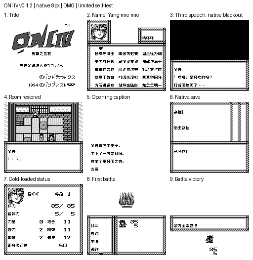

# ONIⅣ鬼神之血族

原输入：Oni IV - Kijin no Ketsuzoku (Japan)

原输入完整SHA256：`ca61b752f44fc0059e6ef328092416a7d62f804e51bf9543941e8b4ea0a24505`。此处“原输入”保留改版、既有汉化或地区修订身份，不一律称干净零售ROM。

| 字号 | 当前版本 | 音频 | 输出完整SHA256 |
| --- | --- | --- | --- |
| 8px | v0.1.2限定测试版 | unchanged | `0b27b9ede35f04aa43410b988e30ea41e9bb6037191bf0051f6ea211f605bfcc` |

## 源码与补丁

- 8px／v0.1.2限定测试版／unchanged：源码包（完整性未独立确认）：[下载](https://github.com/shiyi1133/youxi-hanhua-releases/releases/download/source-migration-20261022-02b/oni-iv-current-source-a07e1e6ee78b-public-r01.zip)（ZIP SHA256 `f958b602b4e016e3928cb3e11d449281052488e6d672fca815efce1ed67f8f96`）；补丁：[下载](https://github.com/shiyi1133/youxi-hanhua-releases/releases/download/patch-migration-20261022/oni-iv-current-patches.zip)（ZIP SHA256 `7322cfe4ff0645a13f548f2814ea50ebda5acd0cd6ee86cc4f649558d09cf06e`）。
  该包已核对对应版本与字节安全；完整修改源码覆盖范围未独立确认。

补丁须直接应用于完整SHA一致的实际原输入；普通字、大字和音乐变体分别核对。公开源码归档不表示本轮重新构建或通过新的运行验收。原作、字体、已有翻译及工具依赖的权利与许可，依各包对应许可保留。

## 范围与验证边界

- 8px／v0.1.2限定测试版：普通8px点阵汉化；原生英文/假名及未覆盖图形按实际版本保留。。
  修复开场第三段对话重用原生黑色字块造成的乱码。
  默认名、杨、五字名三个自然开场路线、首次战斗和电池存档冷启动由提供方复测。
  只跳过字库缓存中的原生黑色tile；未验证所有后期黑屏/文字、实机或全流程。
  本维护会话仅独立静态、BPS还原、文件校验和九宫格像素核验；未执行附件代码、未运行模拟器或复测游戏。
  提供方限定路线验证；维护独立核完整SHA、补丁和截图，未运行附包代码或游戏。
  未声明实机、全流程通关或全部旧存档兼容。

本次资料搬运未新增模拟器、实机或全通验收；未记录或未测试的范围不写成通过。问题单开放只表示尚未关闭，已关闭也不单独证明全部场景都修复。

[公开反馈及问题状态](feedback.md) · [报告BUG](https://github.com/shiyi1133/youxi-hanhua-releases/issues/new?template=bug_report.md)

## 对应版本截图

ONIⅣ鬼神之血族 v0.1.2限定测试版 普通8px；提供方最终ROM画面，维护实际查看九宫格，不代表维护重跑游戏。

图像SHA256：`08115faf13616a036cebb2332a5aa2412fe3154f126e05d88e1d9e8df11d7a54`；绑定ROM SHA256：`0b27b9ede35f04aa43410b988e30ea41e9bb6037191bf0051f6ea211f605bfcc`。

