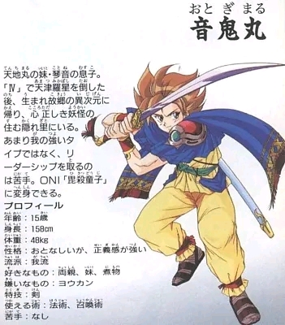
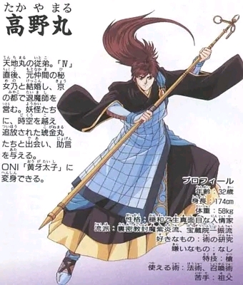

# ONIⅣ鬼神之血族：公开反馈

以下均为公开证据，玩家原话不自动等于维护已复现或已修复。

## 154037796832

71楼 · willzyjno1 · [原回帖](https://tieba.baidu.com/p/11092365551?pid=154037796832#154037796832)

> ONIⅣ游戏开场第三句话就花屏了。

## 154041567549

71楼 · willzyjno1 · [原回帖](https://tieba.baidu.com/p/11092365551?pid=154041567549#154041567549)

> Ⅲ是0.1.0版，Ⅳ和Ⅴ是0.1.1版，Ⅴ整个游戏都拖慢无论哪个画面。

## 154044934292

71楼 · 加勒比瘦子 · [原回帖](https://tieba.baidu.com/p/11092365551?pid=154044934292#154044934292)

> 开场后的村子中间有一个npc的对话第2句显示日文。

## 154046686417

71楼 · Duyes · [原回帖](https://tieba.baidu.com/p/11092365551?pid=154046686417#154046686417)

> 换了一个开源机，字体可以大概看清了，实体机悲剧。开局出了村子里有对话是日文，进第一次变身的三日月山对话，依旧有不少日文bug

## 154047624012

71楼 · Duyes · [原回帖](https://tieba.baidu.com/p/11092365551?pid=154047624012#154047624012)

> @哇你是谁怎么傻乎乎 第一次出现的村子中NPC日文残留和第一次变身的三日月山日文残留，都是ONI5，oni-v-v0.1.2-8px，琥金丸默认主角名能修正吗？烧录器故障可以不用修复，原版就是这样，准确说不算bug，不用特意修改，防止出现莫名bug。

## 154045210375

71楼 · Duyes · [原回帖](https://tieba.baidu.com/p/11092365551?pid=154045210375#154045210375)

> 非常感谢楼主的汉化，这是一部非常棒的游戏，再次感谢楼主！只是这个游戏有没有可能改大一些字体？这个字体有些字真的很难猜是什么字

## 154045323344

71楼 · Duyes · [原回帖](https://tieba.baidu.com/p/11092365551?pid=154045323344#154045323344)

> 抱歉，烧录这块更正一下，MBC5烧录卡阵亡，MBC1烧录卡需要调整到512KBFLASH+32KBSRAM模式可以正常烧录，进入游戏正常！期待大字版

## 154051623166

173楼 · folee000166 · [原回帖](https://tieba.baidu.com/p/11092365551?pid=154051623166#154051623166)

> 可否 gb 汉化伍佑衛門系列 oni 3同 4可否大字

## 154054924756

186楼 · folee000166 · [原回帖](https://tieba.baidu.com/p/11092365551?pid=154054924756#154054924756)

> 必須 12x12啊

## 154054402224

31楼 · folee000166 · [原回帖](https://tieba.baidu.com/p/11092365551?pid=154054402224#154054402224)

> 可否分享 12x12字 oni3同 4

## 154054423977

173楼 · folee000166 · [原回帖](https://tieba.baidu.com/p/11092365551?pid=154054423977#154054423977)

> 全 game boy 系列

## 154054425752

173楼 · folee000166 · [原回帖](https://tieba.baidu.com/p/11092365551?pid=154054425752#154054425752)

> 你仲未搞oni5代，求繁體大字版

## 154054053147

71楼 · 吉他手阿室 · [原回帖](https://tieba.baidu.com/p/11092365551?pid=154054053147#154054053147)

> oni4 v0.12版本，平時菜單打開約百分之五十機率拖慢卡頓，戰鬥中遭敵人狀態攻擊時血量那邊顯示不正常，其他過程中如有遇到問題我再來反饋。 主角默認名不知是否可以改為音鬼丸，記得以前看說明書漢字是這個名字，感謝up漢化的付出

## 154057843413

71楼 · 吉他手阿室 · [原回帖](https://tieba.baidu.com/p/11092365551?pid=154057843413#154057843413)

> 目前oni4只有一個檔，Oni IV - Kijin no Ketsuzoku (Japan) - zh-CN v0.1.2 8px 卡頓發生點都在進戰鬥時跟平時a鍵打開菜單時幾乎都會有卡頓拖慢。 還有個顯示異常的小bug： 是a鍵進菜單時，血量跟最大血量間的斜線顯示會變國字”年“或“錦”。 下面圖一圖二是戰鬥受到異常狀態的顯示，只要受到敵人使用毒或混亂等狀態攻擊就會出現。 圖三是菜單狀態的顯示異常，正常錦那個字應該顯示成圖四的“/”才對。 目前約遊玩三分之一進度，尚無惡性bug。

[玩家公开图片](https://tiebapic.baidu.com/forum/pic/item/35a26263f6246b600782e373adf81a4c500fa250.jpg)（玩家反馈图）

[玩家公开图片](https://tiebapic.baidu.com/forum/pic/item/2aefa4345982b2b7e26f68c377adcbef77099b74.jpg)（玩家反馈图）

[玩家公开图片](https://tiebapic.baidu.com/forum/pic/item/2fa442fbfbedab64b4821cc7b136afc378311e74.jpg)（玩家反馈图）

[玩家公开图片](https://tiebapic.baidu.com/forum/pic/item/c90cd033c895d1430386b52435f082025baf0774.jpg)（玩家反馈图）

## 问题状态

- [待复现／版本待确认] ONIⅣ：开场第三句话出现花屏：已关闭；公开Issue待单独建档。
- 玩家在三部曲共用楼报告开场后村子中间NPC第二句日文。：开放；公开Issue待单独建档。
- 玩家希望字体放大，认为部分现有字难以辨认。：开放；公开Issue待单独建档。
- 同一反馈含两个待复现子项：平时打开菜单约50%概率拖慢；遭敌人状态攻击时HP区域显示异常。默认名「音鬼丸」另列建议，不计作已证BUG。；同一报告者明确文件Oni IV - Kijin no Ketsuzoku (Japan) - zh-CN v0.1.2 8px，进入战斗及A键菜单拖慢；毒/混乱等状态攻击后数值/角色显示异常；HP与最大HP间斜线显示年或锦。：开放；公开Issue待单独建档。

## 已公开答复

- [原答复](https://tieba.baidu.com/p/11092365551?pid=154059393367#154059393367)：@吉他手阿室 v0.1.2 8px的毒/混乱后显示、HP斜线和菜单/进战斗拖慢已补充记录，文件名和截图都收到了，后续排查。

实际玩家ROM SHA未知时保持未知；当前参考版本SHA不能冒充玩家字节。

## 20261022-0814 公开反馈补充

71楼 · 吉他手阿室 · [原回帖](https://tieba.baidu.com/p/11092365551?pid=154059170832#154059170832)

> 反饋一下人名資訊，一樣是Oni IV - Kijin no Ketsuzoku (Japan) - zh-CN v0.1.2 8px這個檔案。 oni4裡面開頭提到主角“御珈丸”實際漢字確認為“音鬼丸”，且提到主角的妹妹時名字是“命”，說明書裡的日文漢字是“御琴”，她還是五代雙女主之一。 還有主角母親要主角去岩國村找“姬乃”，這個姬乃是二代主角高野丸的妻子，日文漢字如圖三是“秘女乃”。 找完秘女乃後去的迷宮在江戶城村民說尼寺，但同伴新兵衛又說尼姑庵。 開頭要陪遺忘仙人去製作回憶丹的迷宮在迷宮旁村鎮村民說是叫家老洞窟，但遺忘仙人說火狼洞窟。 遊戲中村落的翻譯幾乎都是“鎮”，從遊戲中規模來看，如能改為“村”或“町”可能更有和風味且符合時代背景，僅建議。 以上兩個迷宮譯名跟主要角色人名看是否能在下次改版中能將其統一，感謝up

- 三个人名与两处迷宫译名待核；村/町另为玩家风格建议，未批准全局替换。：开放待核；未新增维护复现或修复结论。
- [已公开答复](https://tieba.baidu.com/p/11092365551?pid=154059682810#154059682810)：@吉他手阿室 三个人名和两处迷宫译名已登记，说明书图片收到；“村／町”的用词作为建议保留，后续核对。

玩家输入/输出完整SHA仍未知；文件名说明不能代替实际ROM字节核验。
