# ONIⅣ鬼神之血族：公开反馈

以下均为公开证据，玩家原话不自动等于维护已复现或已修复。

## 154037796832

71楼 · willzyjno1 · [原回帖](https://tieba.baidu.com/p/11092365551?pid=154037796832#154037796832)

> ONIⅣ游戏开场第三句话就花屏了。

## 154041567549

71楼 · willzyjno1 · [原回帖](https://tieba.baidu.com/p/11092365551?pid=154041567549#154041567549)

> Ⅲ是0.1.0版，Ⅳ和Ⅴ是0.1.1版，Ⅴ整个游戏都拖慢无论哪个画面。

## 154044934292

71楼 · 加勒比瘦子 · [原回帖](https://tieba.baidu.com/p/11092365551?pid=154044934292#154044934292)

> 开场后的村子中间有一个npc的对话第2句显示日文。

## 154046686417

71楼 · Duyes · [原回帖](https://tieba.baidu.com/p/11092365551?pid=154046686417#154046686417)

> 换了一个开源机，字体可以大概看清了，实体机悲剧。开局出了村子里有对话是日文，进第一次变身的三日月山对话，依旧有不少日文bug

## 154047624012

71楼 · Duyes · [原回帖](https://tieba.baidu.com/p/11092365551?pid=154047624012#154047624012)

> @哇你是谁怎么傻乎乎 第一次出现的村子中NPC日文残留和第一次变身的三日月山日文残留，都是ONI5，oni-v-v0.1.2-8px，琥金丸默认主角名能修正吗？烧录器故障可以不用修复，原版就是这样，准确说不算bug，不用特意修改，防止出现莫名bug。

## 154045210375

71楼 · Duyes · [原回帖](https://tieba.baidu.com/p/11092365551?pid=154045210375#154045210375)

> 非常感谢楼主的汉化，这是一部非常棒的游戏，再次感谢楼主！只是这个游戏有没有可能改大一些字体？这个字体有些字真的很难猜是什么字

## 154045323344

71楼 · Duyes · [原回帖](https://tieba.baidu.com/p/11092365551?pid=154045323344#154045323344)

> 抱歉，烧录这块更正一下，MBC5烧录卡阵亡，MBC1烧录卡需要调整到512KBFLASH+32KBSRAM模式可以正常烧录，进入游戏正常！期待大字版

## 154051623166

173楼 · folee000166 · [原回帖](https://tieba.baidu.com/p/11092365551?pid=154051623166#154051623166)

> 可否 gb 汉化伍佑衛門系列 oni 3同 4可否大字

## 154054924756

186楼 · folee000166 · [原回帖](https://tieba.baidu.com/p/11092365551?pid=154054924756#154054924756)

> 必須 12x12啊

## 154054402224

31楼 · folee000166 · [原回帖](https://tieba.baidu.com/p/11092365551?pid=154054402224#154054402224)

> 可否分享 12x12字 oni3同 4

## 154054423977

173楼 · folee000166 · [原回帖](https://tieba.baidu.com/p/11092365551?pid=154054423977#154054423977)

> 全 game boy 系列

## 154054425752

173楼 · folee000166 · [原回帖](https://tieba.baidu.com/p/11092365551?pid=154054425752#154054425752)

> 你仲未搞oni5代，求繁體大字版

## 154054053147

71楼 · 吉他手阿室 · [原回帖](https://tieba.baidu.com/p/11092365551?pid=154054053147#154054053147)

> oni4 v0.12版本，平時菜單打開約百分之五十機率拖慢卡頓，戰鬥中遭敵人狀態攻擊時血量那邊顯示不正常，其他過程中如有遇到問題我再來反饋。 主角默認名不知是否可以改為音鬼丸，記得以前看說明書漢字是這個名字，感謝up漢化的付出

## 154057843413

71楼 · 吉他手阿室 · [原回帖](https://tieba.baidu.com/p/11092365551?pid=154057843413#154057843413)

> 目前oni4只有一個檔，Oni IV - Kijin no Ketsuzoku (Japan) - zh-CN v0.1.2 8px 卡頓發生點都在進戰鬥時跟平時a鍵打開菜單時幾乎都會有卡頓拖慢。 還有個顯示異常的小bug： 是a鍵進菜單時，血量跟最大血量間的斜線顯示會變國字”年“或“錦”。 下面圖一圖二是戰鬥受到異常狀態的顯示，只要受到敵人使用毒或混亂等狀態攻擊就會出現。 圖三是菜單狀態的顯示異常，正常錦那個字應該顯示成圖四的“/”才對。 目前約遊玩三分之一進度，尚無惡性bug。

[玩家公开图片](https://tiebapic.baidu.com/forum/pic/item/35a26263f6246b600782e373adf81a4c500fa250.jpg)（玩家反馈图）

[玩家公开图片](https://tiebapic.baidu.com/forum/pic/item/2aefa4345982b2b7e26f68c377adcbef77099b74.jpg)（玩家反馈图）

[玩家公开图片](https://tiebapic.baidu.com/forum/pic/item/2fa442fbfbedab64b4821cc7b136afc378311e74.jpg)（玩家反馈图）

[玩家公开图片](https://tiebapic.baidu.com/forum/pic/item/c90cd033c895d1430386b52435f082025baf0774.jpg)（玩家反馈图）

## 问题状态

- [待复现／版本待确认] ONIⅣ：开场第三句话出现花屏：已关闭；公开Issue待单独建档。
- 玩家在三部曲共用楼报告开场后村子中间NPC第二句日文。：开放；公开Issue待单独建档。
- 玩家希望字体放大，认为部分现有字难以辨认。：开放；公开Issue待单独建档。
- 同一反馈含两个待复现子项：平时打开菜单约50%概率拖慢；遭敌人状态攻击时HP区域显示异常。默认名「音鬼丸」另列建议，不计作已证BUG。；同一报告者明确文件Oni IV - Kijin no Ketsuzoku (Japan) - zh-CN v0.1.2 8px，进入战斗及A键菜单拖慢；毒/混乱等状态攻击后数值/角色显示异常；HP与最大HP间斜线显示年或锦。：开放；公开Issue待单独建档。

## 已公开答复

- [原答复](https://tieba.baidu.com/p/11092365551?pid=154059393367#154059393367)：@吉他手阿室 v0.1.2 8px的毒/混乱后显示、HP斜线和菜单/进战斗拖慢已补充记录，文件名和截图都收到了，后续排查。

实际玩家ROM SHA未知时保持未知；当前参考版本SHA不能冒充玩家字节。

## 20261022-0814 公开反馈补充

71楼 · 吉他手阿室 · [原回帖](https://tieba.baidu.com/p/11092365551?pid=154059170832#154059170832)

> 反饋一下人名資訊，一樣是Oni IV - Kijin no Ketsuzoku (Japan) - zh-CN v0.1.2 8px這個檔案。 oni4裡面開頭提到主角“御珈丸”實際漢字確認為“音鬼丸”，且提到主角的妹妹時名字是“命”，說明書裡的日文漢字是“御琴”，她還是五代雙女主之一。 還有主角母親要主角去岩國村找“姬乃”，這個姬乃是二代主角高野丸的妻子，日文漢字如圖三是“秘女乃”。 找完秘女乃後去的迷宮在江戶城村民說尼寺，但同伴新兵衛又說尼姑庵。 開頭要陪遺忘仙人去製作回憶丹的迷宮在迷宮旁村鎮村民說是叫家老洞窟，但遺忘仙人說火狼洞窟。 遊戲中村落的翻譯幾乎都是“鎮”，從遊戲中規模來看，如能改為“村”或“町”可能更有和風味且符合時代背景，僅建議。 以上兩個迷宮譯名跟主要角色人名看是否能在下次改版中能將其統一，感謝up

- 三个人名与两处迷宫译名待核；村/町另为玩家风格建议，未批准全局替换。：开放待核；未新增维护复现或修复结论。
- [已公开答复](https://tieba.baidu.com/p/11092365551?pid=154059682810#154059682810)：@吉他手阿室 三个人名和两处迷宫译名已登记，说明书图片收到；“村／町”的用词作为建议保留，后续核对。

玩家输入/输出完整SHA仍未知；文件名说明不能代替实际ROM字节核验。

## 20261024-0412 公开反馈补充

公开 BUG 入口：[提交反馈](https://github.com/shiyi1133/youxi-hanhua-releases/issues/new/choose)。

71楼 · 吉他手阿室 · [原回帖](https://tieba.baidu.com/p/11092365551?pid=154062894676#154062894676)

> 繼續反饋oni4，檔案一樣Oni IV - Kijin no Ketsuzoku (Japan) - zh-CN v0.1.2 8px這個。 圖一二是狀態列斜線的不正常與正常顯示，偶爾會正常，目前不清楚原因為何。 圖三是岩國村神社的對話，其他地方顯示京都城的地名此對話變成“京城的城堡”，可在下次更新統一。 圖四是對同伴使用法術時游標異常。 圖五是被狀態攻擊時顯示異常，但大概經過京都城劇情後的戰役遭受攻擊時的狀態顯示變為圖六正常顯示了，目前目前至遊戲約三分之二處為止都正常顯示。 遊戲中九州的城堡“久米本城”可以正名為夈元城，夈字發音同齋戒的齋。 目前實際遊玩較為影響體驗的只有進菜單時卡頓，以及菜單與戰鬥中選擇法術時會較為嚴重的卡頓拖慢，其他部分皆正常。 這一兩天會將它盡速通關，感謝。

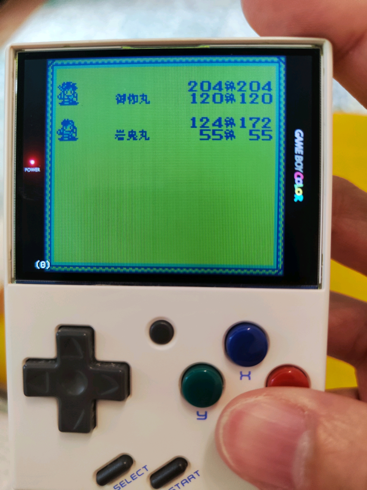

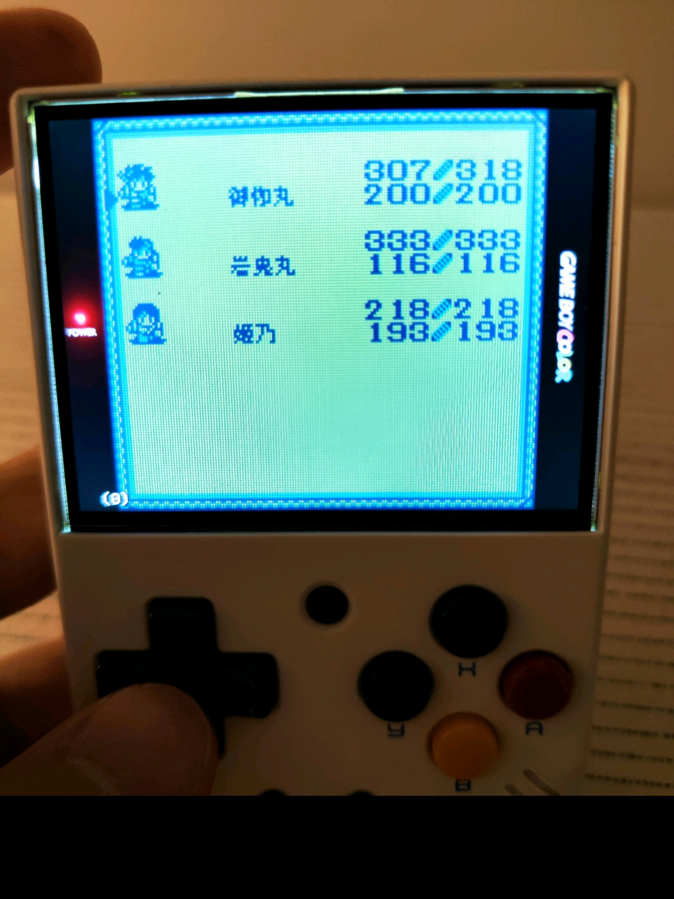

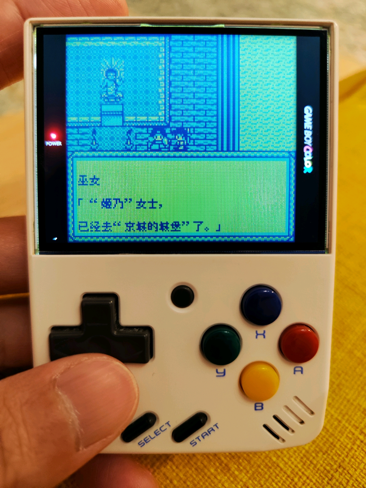

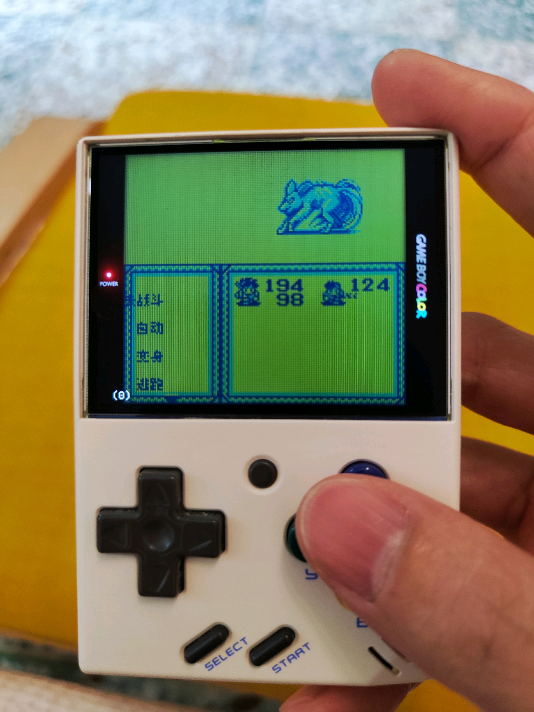

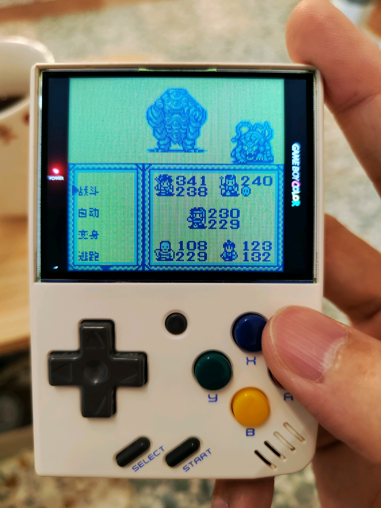

71楼 · 吉他手阿室 · [原回帖](https://tieba.baidu.com/p/11092365551?pid=154063246519#154063246519)

> 補充oni4，剛忘了一個，如下列兩圖所示，頭部防具最低階的兩個，分別是防禦10跟防禦16的兩項防具，防禦力不同但翻譯名稱都是頭巾，如果可以適當的將其中一個改為頭帶做個區分較好。

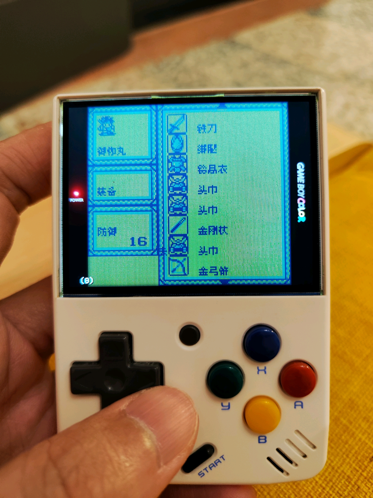

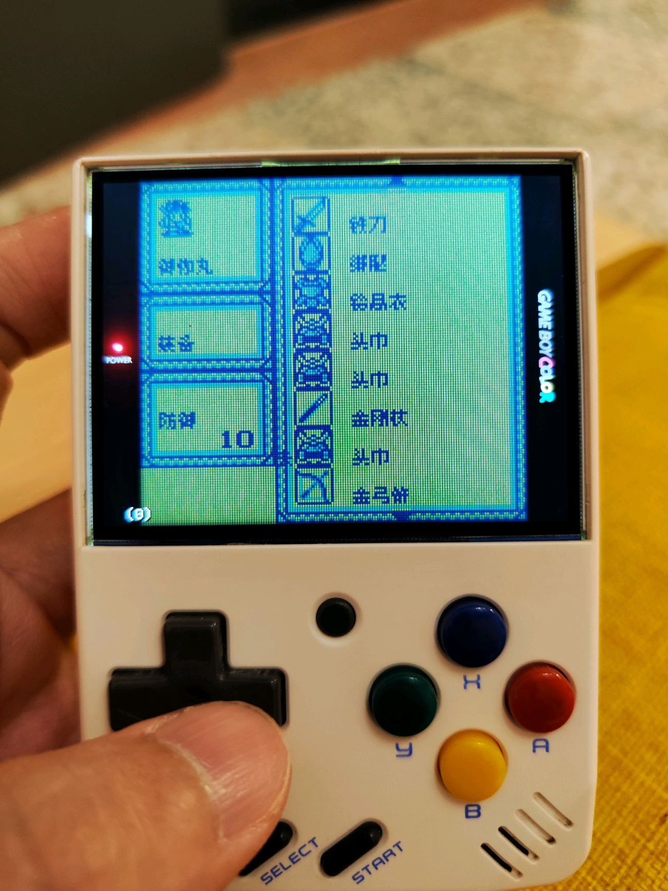

71楼 · 吉他手阿室 · [原回帖](https://tieba.baidu.com/p/11092365551?pid=154063558744#154063558744)

> 關於oni4的人名地名稍微補充整合一下： 01.第一個同伴岩鬼丸->雁木丸。02.忘卻鎮->忘卻町。03.火狼洞窟/家老洞窟->彼廊洞窟。04.遠矢村->遠野村。05.夕陽鎮->夕日町。06.田岳村->多掛村。07.地縛里->地張之里。08.白館鎮->泊立町。09.同伴“姬乃”->秘女乃。10.久米本城->夈元城。 11.主角妹妹本名“命”->御琴。12.主角原名“御珈丸”->音鬼丸。 以上為上網找中文日文攻略整合的資料，供up改版時參考。

71楼 · 吉他手阿室 · [原回帖](https://tieba.baidu.com/p/11092365551?pid=154064248278#154064248278)

> 回報oni4，全流程正常通關無惡性bug，全技能習得，全最強裝備取得，也打完隱王拿草薙劍。 缺點一樣是菜單與戰鬥時進法術或裝備等菜單拖慢問題而已。 建議人名“妖鬼郎”->妖奇老。物品名“叢云劍”->天叢云劍。 感謝漢化

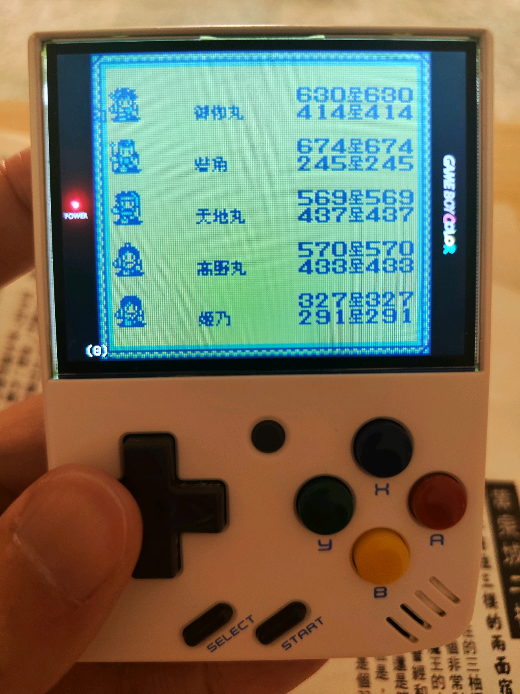

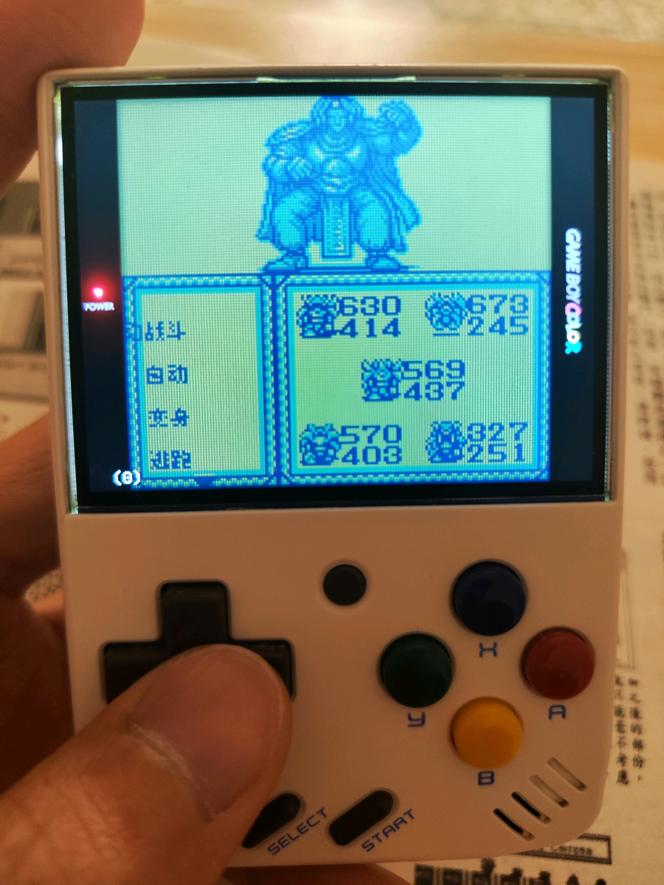

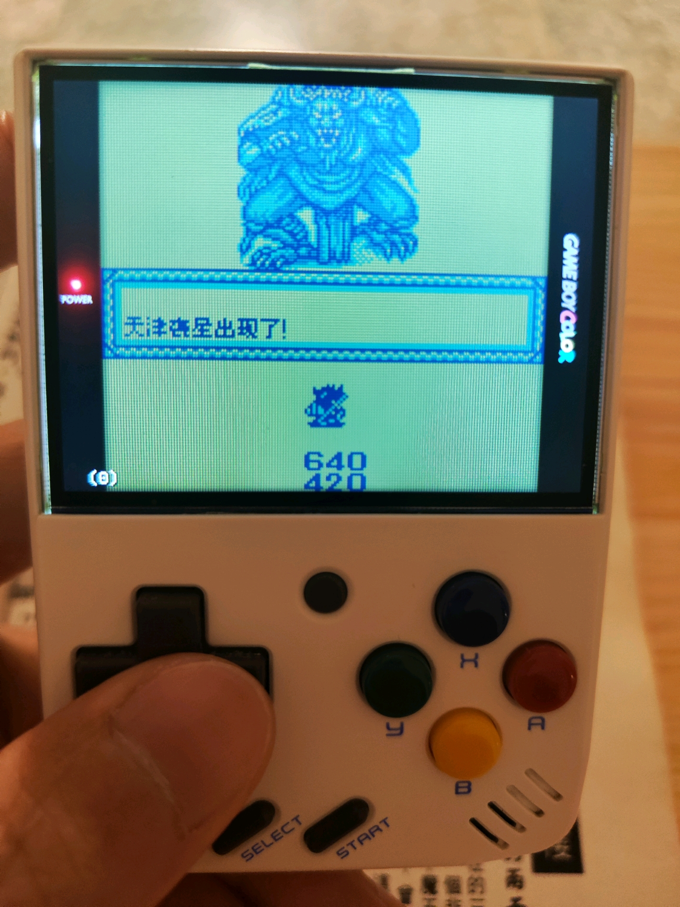

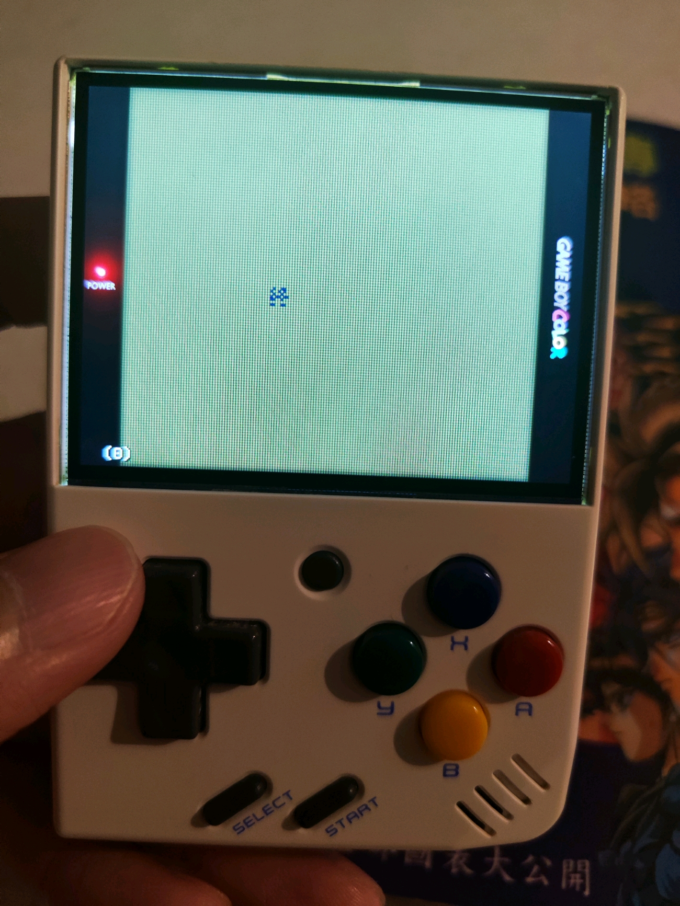

- ONIⅣ v0.1.2普通8px：状态显示、菜单/法术拖慢及玩家通关反馈：已记录，开放待核。
- [BUG待复现] ONIⅣ v0.1.2普通8px：对同伴施法时光标显示异常：已记录，开放待核。
- ONIⅣ v0.1.2普通8px：新增人地名校准资料与同名装备建议：已记录，开放待核。

[已公开登记答复](https://tieba.baidu.com/p/11092365551?pid=154064806157#154064806157)：@吉他手阿室 状态栏、法术游标、菜单拖慢及人名地名、装备译名建议已一起记录。感谢你反馈全流程通关，后续继续排查剩余问题。

除另注已实收核验的译版 ROM 外，玩家实际输入/输出 SHA 未核定。图片与通关描述仅为玩家反馈；本次没有新增维护运行复现、修复或完整流程验收。

## 20261025-1619 公开反馈更新

按当前实际未关闭问题去重：纯BUG 2 项，建议/覆盖等 2 项，分类待核 0 项。开放不代表正在修复。

- 原案同伴施法目标选择箭头字形损坏（记录版本：v0.1.4）：限定证据已核验；原报告范围关闭；该证据不代表当前最新版或整作全通。
- v014菜单186→56/状态176→57/分类53→25/列表32→14帧等限定改善，不等于全场景零卡顿。状态消费者恢复但自然敌方毒/混乱、持续/恢复未全测，原问题尚不能全部关闭。（记录版本：v0.1.4）：限定证据已核验；保持开放；该证据不代表当前最新版或整作全通。
- 20已证术语消费者继承保留；御琴等仍缺原说明书/脚本一级原字证，未将攻略建议全部应用；最新v014明确未增加未经核定译名。（记录版本：v0.1.4）：限定证据已核验；保持开放；该证据不代表当前最新版或整作全通。

玩家实际完整ROM字节未知时仍保留未知；自然流程、原生消费者诊断及静态证据分别记录，不外推实机或全流程。
