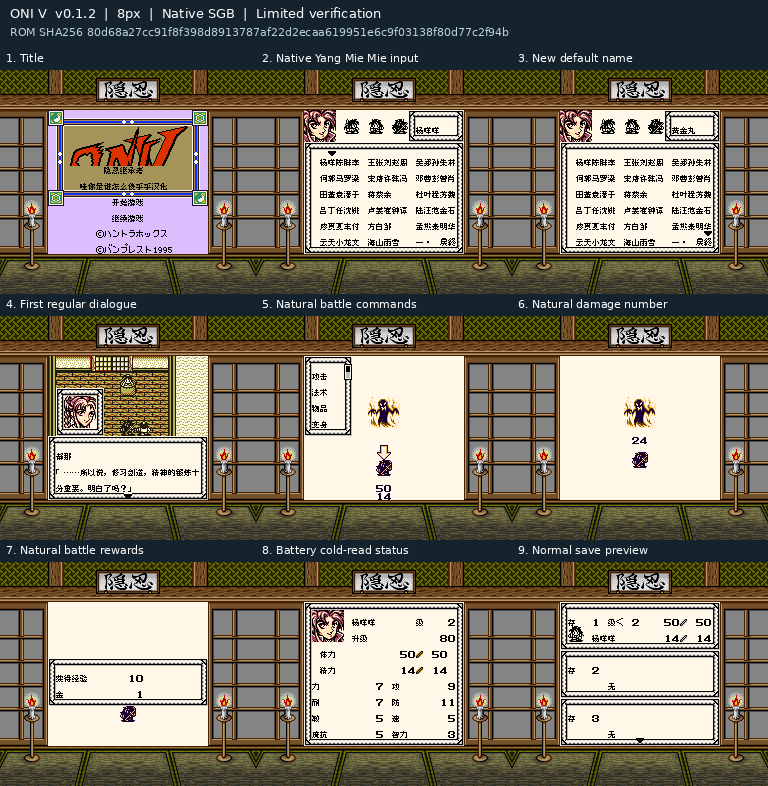

# ONIⅤ隐忍继承者

原输入：Oni V - Oni wo Tsugumono (Japan) (SGB Enhanced)

原输入完整SHA256：`870f83f781c103925f206f35b71cdda6a0493e5b4c70d70b49cade145c35f127`。此处“原输入”保留改版、既有汉化或地区修订身份，不一律称干净零售ROM。

| 字号 | 当前版本 | 音频 | 输出完整SHA256 |
| --- | --- | --- | --- |
| 8px | v0.1.2限定测试版 | unchanged | `80d68a27cc91f8f398d8913787af22d2ecaa619951e6c9f03138f80d77c2f94b` |

## 源码与补丁

- 8px／v0.1.2限定测试版／unchanged：源码包（完整性未独立确认）：[下载](https://github.com/shiyi1133/youxi-hanhua-releases/releases/download/source-migration-20261022-02b/oni-v-current-source-d1a3af95451a-public-r01.zip)（ZIP SHA256 `0e339e8640baee4ca4b31a28182972ea84bcb115270956cc382f4f09cc9bcf64`）；补丁：[下载](https://github.com/shiyi1133/youxi-hanhua-releases/releases/download/patch-migration-20261022/oni-v-current-patches.zip)（ZIP SHA256 `8e2d890d54fcd460671aa6518d5213b922f542c6f0256a651d09d92e330cf0cd`）。
  该包已核对对应版本与字节安全；完整修改源码覆盖范围未独立确认。

补丁须直接应用于完整SHA一致的实际原输入；普通字、大字和音乐变体分别核对。公开源码归档不表示本轮重新构建或通过新的运行验收。原作、字体、已有翻译及工具依赖的权利与许可，依各包对应许可保留。

## 范围与验证边界

- 8px／v0.1.2限定测试版：普通8px点阵汉化；原生英文/假名及未覆盖图形按实际版本保留。。
  默认名改为黄金丸，降低取名、开场滚屏和首次对话的额外耗帧。
  提供方三个自然样本原版/旧版/新版帧数分别为8/1685/189、1075/1626/1014、156/521/150；不同语言文字量不同，非全游戏等速结论。
  商店、后期滚屏和71快速文本ABI场景属受控诊断；全屏普遍慢的广泛反馈未穷尽，既有反馈保持open。
  自然首次战斗/取名/保存冷启动有提供方记录；未全通、未实机。
  本维护会话仅独立静态、BPS还原、文件校验和九宫格像素核验；未执行附件代码、未运行模拟器或复测游戏。
  提供方限定路线验证；维护独立核完整SHA、补丁和截图，未运行附包代码或游戏。
  未声明实机、全流程通关或全部旧存档兼容。

本次资料搬运未新增模拟器、实机或全通验收；未记录或未测试的范围不写成通过。问题单开放只表示尚未关闭，已关闭也不单独证明全部场景都修复。

[公开反馈及问题状态](feedback.md) · [报告BUG](https://github.com/shiyi1133/youxi-hanhua-releases/issues/new?template=bug_report.md)

## 对应版本截图

ONIⅤ隐忍继承者 v0.1.2限定测试版 普通8px；提供方最终ROM画面，维护实际查看九宫格，不代表维护重跑游戏。

图像SHA256：`885e64cd8216cf1f971f772247e597c22412d5dfb75d07ebd342494f8177b89a`；绑定ROM SHA256：`80d68a27cc91f8f398d8913787af22d2ecaa619951e6c9f03138f80d77c2f94b`。

