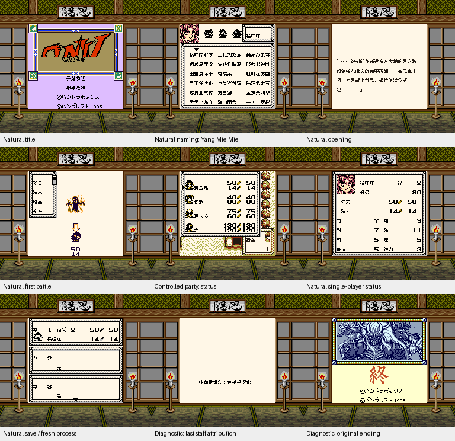

# ONIⅤ隐忍继承者 v0.1.3（限定测试版）

[源码与补丁Release](https://github.com/shiyi1133/youxi-hanhua-releases/releases/tag/oni-v-v0.1.3) · [公开反馈](feedback.md) · [报告BUG](https://github.com/shiyi1133/youxi-hanhua-releases/issues/new?template=bug_report.md)

原游戏／实际输入：Oni V - Oni wo Tsugumono (Japan) (SGB Enhanced)

原输入完整SHA-256：`870f83f781c103925f206f35b71cdda6a0493e5b4c70d70b49cade145c35f127`（262144字节）。

范围：普通8px限定修复：角色状态总览短中文姓名旁地图图块残留，共用角色窗口改为原生内部清空并画边框。标题显眼署名移到原职员表后的独立小字页。

## 8px v0.1.3

字号范围：普通8px，原生GB/SGB增强；主九宫格为原生256×224 SGB画面，无伪着色或独立大字版。

目标完整SHA-256：`553ffe52bc594ea49ada9a8ad83dac3f7b2529754ac503799fa5f44da5da336b`（524288字节）。

补丁：`oni-v-v0.1.3-8px.bps`，SHA-256 `501722ac23d10d8bbda77886c66e5ac87a5784672a9fc49d91430730473092da`。

[源码（完整性未独立确认）](https://github.com/shiyi1133/youxi-hanhua-releases/releases/download/oni-v-v0.1.3/oni-v-v0.1.3-8px-SOURCE-public.zip) · [补丁包](https://github.com/shiyi1133/youxi-hanhua-releases/releases/download/oni-v-v0.1.3/oni-v-v0.1.3-8px-PATCH-public.zip)

ONIⅤ隐忍继承者 v0.1.3 普通8px最终ROM提供者真实九宫格；自然与受控场景逐格标明，原生像素精确核对；不代表维护重跑、实机或全通。

## 测试及限制

提供者自然路径：提供者自然按键自测：默认黄金丸、杨咩咩重复/删除重输、80格键盘、原生第六字与取消重进；首战、正常保存及新进程仅电池冷读；只读字体/缓存观察器零失败。

提供者诊断路径：提供者使用原生初始化器构造额外队员后置入正常电池冷读会话；精确v0.1.2受控四人状态残留可复现、原版同夹具无残留，v0.1.3 SGB二/三/四人与DMG二人的状态/法术/特技列表空白、选择、关闭还原及重入通过。商店与职员表/结尾均原生处理器诊断入口，不是自然到店或通关。

保存边界：未据原件SRAM或空存档推定保存冷读成功。

同一实现者自测，不是独立人员QA；维护未新增ROM运行或源码重建，未宣称实机或完整通关。

- 未验证：维护独立核原输入、BPS还原、完整SHA、ZIP/CRC/白名单及九格像素；未执行提供者源码、未独立重建或新增游戏运行。
- 未验证：第四种物品/技能目标选择消费者仅静态确认共用入口，未穷尽触发组合；自然取得全部队员、全部后期菜单/技能、全流程、实机、联机和全部历史档兼容未验。
- 未验证：本包不自动关闭#36拖慢或#88其它界面问题；#106可仅按短中文姓名状态残留这一已验证用例作限定修复结论，玩家完整ROM SHA与复测未知。
- 未验证：提供者自测及空目录重建不是独立人员QA；旧版历史证据不自动算本版重跑。
- 核对补丁还原、资产完整SHA和截图字节不等于全部游戏功能验收。

