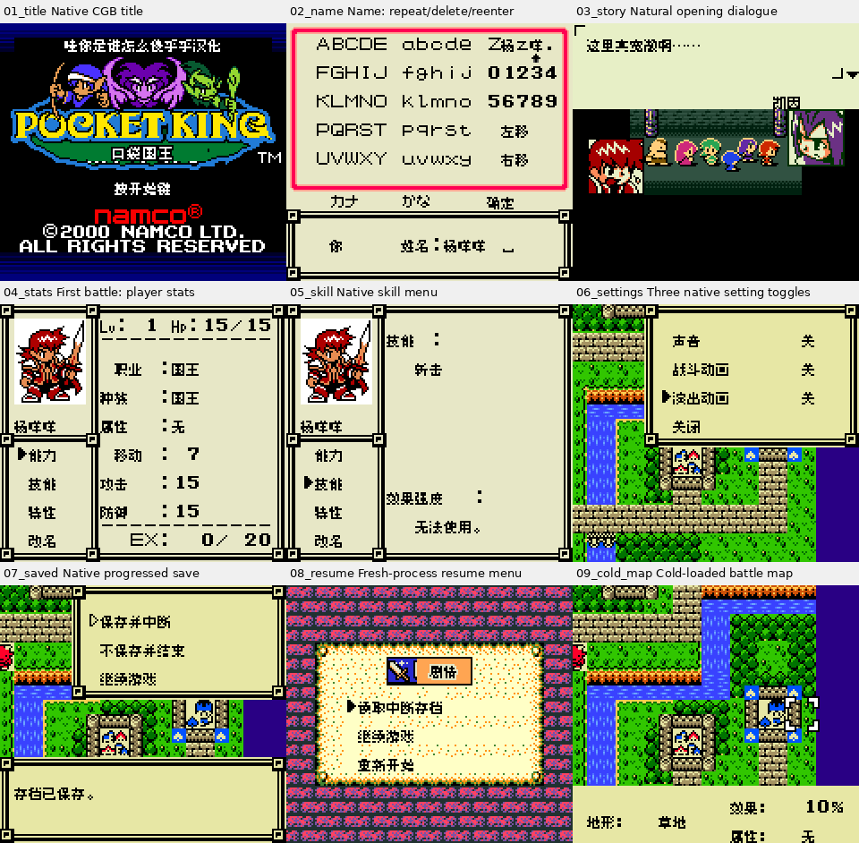
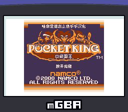
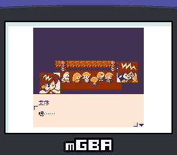

# 口袋国王（限定测试版）

[公开反馈](feedback.md) · [报告BUG](https://github.com/shiyi1133/youxi-hanhua-releases/issues/new?template=bug_report.md)

原游戏／实际基底：Pocket King (Japan) (SGB Enhanced) (GB Compatible)

原输入完整SHA-256：`e4b58f6f2b645155258e043c271f4c8b7a765235861870ac373b48177523e7ba`（2097152字节，日本Rev0实际用户输入）。

## v0.1.0 8px

字号范围：普通原生8px中文点阵；Fusion Pixel；艺术Logo/技术ASCII及原生假名等按交付实际范围保留。

[源码包（语义完整性未独立确认）](https://github.com/shiyi1133/youxi-hanhua-releases/releases/download/pocket-king-v0.1.0/pocket-king-v0.1.0-8px-source-public.zip) · [补丁包](https://github.com/shiyi1133/youxi-hanhua-releases/releases/download/pocket-king-v0.1.0/pocket-king-v0.1.0-8px-patches-public.zip)

目标完整SHA-256：`3e8b0004f70c1ce45df0b0aca5a4c83e6abde97da27c106e44b717fb367728db`（4194304字节）。

v0.1.0 普通8px最终ROM真实CGB九宫格；原生160×144画面按最近邻2×展示，非大字版；提供者自然路径含同ROM自身即时状态续接，正常电池冷读单列，非全通。

口袋国王 v0.1.0 普通8px；实际mGBA SGB模型32开场标题，含默认模拟器边框；仅提供者SGB开场证据，后续战斗/全流程/实体SGB未测。

口袋国王 v0.1.0 普通8px；实际mGBA SGB模型32开场剧情，含默认模拟器边框；仅提供者SGB开场证据，后续战斗/全流程/实体SGB未测。

## 范围与测试边界

普通8px中文测试版；提供者记录自然CGB首战、国王/战士改名、菜单设置、正常保存及新进程冷读；原生SGB仅开场。

- 首关胜利、全流程、深层分支、全部技能/道具/召唤组合、最长变量/分页边界、实机/联机及原日版存档导入未验；原生SGB证据使用默认模拟器边框且仅开场；本维护未执行源码或新增运行测试。

提供方结构化自测摘要见[对应版本记录](provider-selftest.json)，保留自然、诊断、静态及未测边界；不表示本轮维护新增运行或源码重建。本次源码语义完整性保持未知。

开放问题不等于正在修复；有限验证不表示完整游戏、全部变量边界或真机验收。
