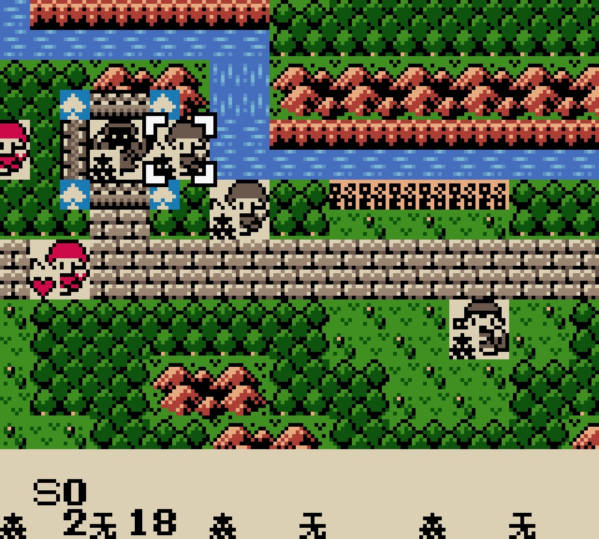
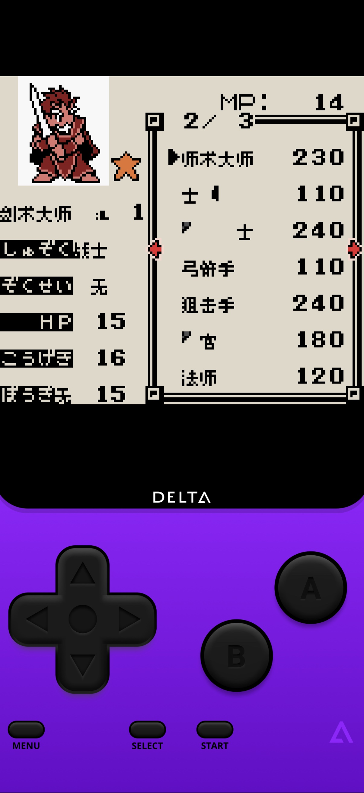
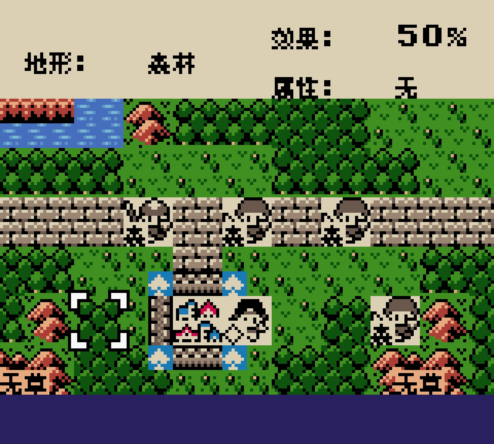
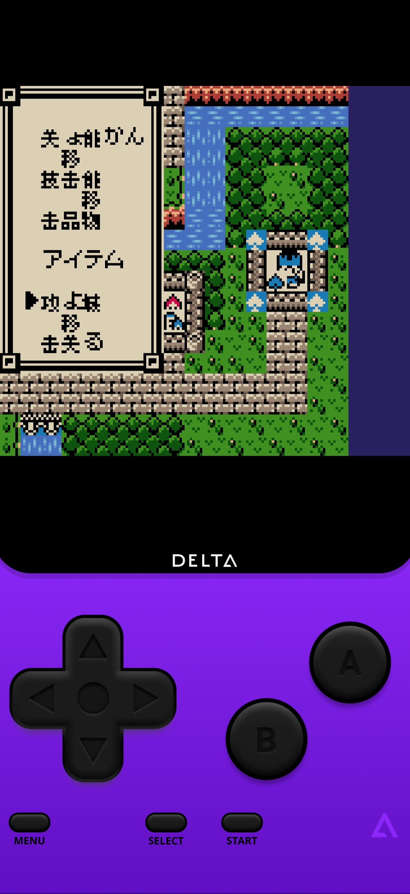
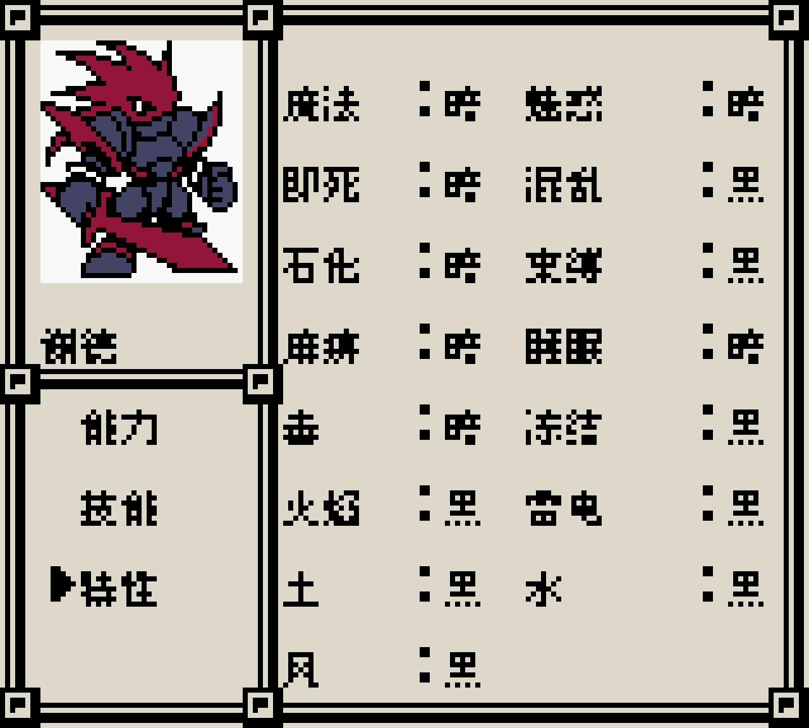

# 口袋国王：公开需求与反馈

以下为公开证据，不构成新的用户授权；玩家原话不自动表示维护已复现或已修复。

147楼 · 恩膝盖 · [原回帖](https://tieba.baidu.com/p/11092365551?pid=154044735608#154044735608)

> 这游戏能汉化吗？

[原需求公开图片](https://tiebapic.baidu.com/forum/pic/item/3795b83533fa828b003c99e4bb1f4134960a5ac1.jpg)（玩家原件/需求证据，不是本次汉化测试证明）

[原需求公开图片](https://tiebapic.baidu.com/forum/pic/item/aeb49ccad1c8a78679354e092109c93d71cf50c1.jpg)（玩家原件/需求证据，不是本次汉化测试证明）

147楼 · 恩膝盖 · [原回帖](https://tieba.baidu.com/p/11092365551?pid=154047529185#154047529185)

> 通过百度网盘分享的文件：新建文件夹

省略原ROM下载来源、提取码及外链客户端参数；保留需求文字，完整公开原文见原楼。

## 后续交付通知

[已公开通知](https://tieba.baidu.com/p/11092365551?pid=154060916891#154060916891)：《口袋国王》v0.1.0 普通8px汉化测试版已放入总分享的GBC「口袋国王」目录。
欢迎下载测试，问题请在这楼反馈。

公开库镜像省略网盘ROM下载链接；原通知全文及对应截图见原楼。

首次交付时尚未新增正式BUG单；本轮移动后乱码反馈及登记答复见下文，仍待复现，不承诺修复日期。

## 20261024-0412 公开反馈补充

公开 BUG 入口：[提交反馈](https://github.com/shiyi1133/youxi-hanhua-releases/issues/new/choose)。

147楼 · 恩膝盖 · [原回帖](https://tieba.baidu.com/p/11092365551?pid=154064660737#154064660737)

> 人物移动 或者 光标移动后几乎都会出现乱码

- [BUG待核版本] 口袋国王：人物/光标移动后地图与菜单乱码：已记录，开放待核。

[已公开登记答复](https://tieba.baidu.com/p/11092365551?pid=154064807407#154064807407)：@恩膝盖 移动人物或光标后乱码已记录。请补ROM完整文件名或实际版本、字号，方便核对。

除另注已实收核验的译版 ROM 外，玩家实际输入/输出 SHA 未核定。图片与通关描述仅为玩家反馈；本次没有新增维护运行复现、修复或完整流程验收。
