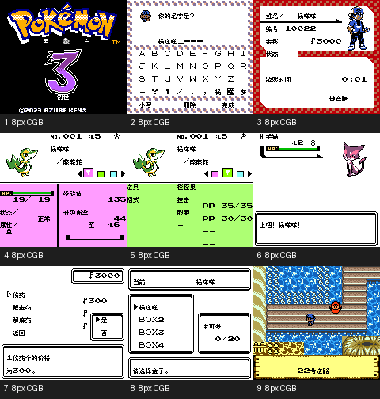

# 黑白3：创世

原输入：Pokemon Black and White 3: Genesis v1.2 (user-provided ROM hack)

原输入完整SHA256：`46f1ed26e5e4df7bd5a2c5d662a6aab3d5e6b48475ed45ca1d79a05a9b8ba64d`。此处“原输入”保留改版、既有汉化或地区修订身份，不一律称干净零售ROM。

| 字号 | 当前版本 | 音频 | 输出完整SHA256 |
| --- | --- | --- | --- |
| 8px | v1.0.0 | unchanged | `6fc8607be3e51bcf0e0a115c94cb78ac91721597a28266b46100168c687b1436` |

## 源码与补丁

- 8px／v1.0.0／unchanged：完整修改源码集合（须三个分包全部取得）：[分包01/03](https://github.com/shiyi1133/youxi-hanhua-releases/releases/download/source-migration-20261022/pokemon-black-white-3-current-source-5a5e6025345a-public-r02.zip)（ZIP SHA256 `4f25dfd58f7449a6eba64532d048ed4fde0f886d80c4399e8ec5a27c315d27c5`）；[分包02/03](https://github.com/shiyi1133/youxi-hanhua-releases/releases/download/source-migration-20261022/pokemon-black-white-3-current-source-5758cb356d60-public-r02.zip)（ZIP SHA256 `5758cb356d606c20f4a806a93f8f0d9093e775e9251c5932fdd0caaf35613e0b`）；[分包03/03](https://github.com/shiyi1133/youxi-hanhua-releases/releases/download/source-migration-20261022/pokemon-black-white-3-current-source-efb92a9b9cdf-public-r02.zip)（ZIP SHA256 `efb92a9b9cdf31b90b5b97d9980be81834e2165fa94086fbb868ff8a740caeb1`）；补丁：[下载](https://github.com/shiyi1133/youxi-hanhua-releases/releases/download/patch-migration-20261022/pokemon-black-white-3-current-patches.zip)（ZIP SHA256 `bd5bf9210f494f3db4c5795ce4cf4ce71473fd0275e08be600c63a7808c6dc36`）。
  三个ZIP必须全部下载，一起解压到同一个新空目录；单个分包不是完整工程。完整修改源码的判定适用于三包集合，不适用于任何单包。

补丁须直接应用于完整SHA一致的实际原输入；普通字、大字和音乐变体分别核对。公开源码归档不表示本轮重新构建或通过新的运行验收。原作、字体、已有翻译及工具依赖的权利与许可，依各包对应许可保留。

## 范围与验证边界

- 8px／v1.0.0：普通原生8px限定测试；10px未交付。
  普通原生8px限定测试版；使用现有Git精确版本，不递增或重传ROM。整作可达性和全流程验收未完成；1551处已构建遗留文字可达性待核，不能称全部汉化；10px未交付。图鉴/神秘礼物为诊断入口，打印非实机。
  整作可达性和全流程验收未完成；1551处已构建遗留文字可达性待核，不能称全部汉化；10px未交付。图鉴/神秘礼物为诊断入口，打印非实机。
  维护仅核实际ZIP、原件、IPS逐字节还原、九格原帧；没有运行游戏、没有全流程验收。

本次资料搬运未新增模拟器、实机或全通验收；未记录或未测试的范围不写成通过。问题单开放只表示尚未关闭，已关闭也不单独证明全部场景都修复。

[公开反馈及问题状态](feedback.md) · [报告BUG](https://github.com/shiyi1133/youxi-hanhua-releases/issues/new?template=bug_report.md)

## 对应版本截图

最终普通8px ROM真实CGB九宫格；限定自测，不是SGB

图像SHA256：`8c6ef0f14217195ecc8dfac93b234593cdead26966eb3cc25a7973b7bd92801a`；绑定ROM SHA256：`6fc8607be3e51bcf0e0a115c94cb78ac91721597a28266b46100168c687b1436`。

