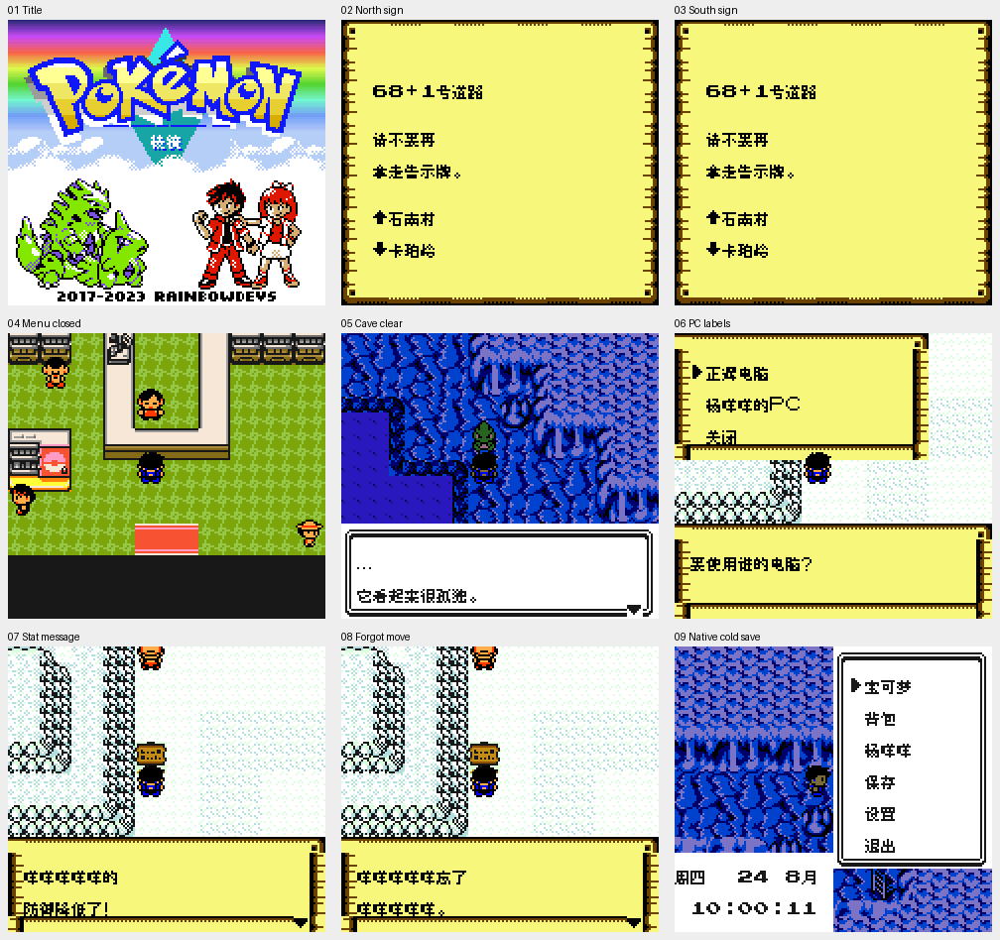

# 宝可梦棱镜 v0.1.1（限定测试版）

[源码与补丁Release](https://github.com/shiyi1133/youxi-hanhua-releases/releases/tag/pokemon-prism-v0.1.1) · [公开反馈](feedback.md) · [报告BUG](https://github.com/shiyi1133/youxi-hanhua-releases/issues/new?template=bug_report.md)

原游戏／实际输入：Pokemon Prism v0.95.0254

原输入完整SHA-256：`dea0729edbc5923f1af1fbd9c79e56cd7ff255642bca12f7fb146d506196077d`（2097152字节）。

范围：普通8px限定修复测试版：七处显式页眉路牌入口、菜单/洞窟清页消费者，PC九标签、八能力名称与忘招续段。

## 8px v0.1.1

字号范围：原生普通8px；无另行大字版；CGB原生彩色，非SGB验收。

目标完整SHA-256：`22d0f5475d912d006e2c622e524b67366effa2ae87659f46ed1d55f8bbdd6358`（2097152字节）。

补丁：`pokemon-prism-v0.1.1-8px.bps`，SHA-256 `8acaa7dc4640a17e20820cea14991f5d4cd5176948b99200a455feb95be80ea7`。

[源码（完整性未独立确认）](https://github.com/shiyi1133/youxi-hanhua-releases/releases/download/pokemon-prism-v0.1.1/pokemon-prism-v0.1.1-8px-SOURCE-public-r02.zip) · [补丁包](https://github.com/shiyi1133/youxi-hanhua-releases/releases/download/pokemon-prism-v0.1.1/pokemon-prism-v0.1.1-8px-PATCH-public.zip)

v0.1.1 原生普通8px最终ROM真实九宫格；自然/受控诊断消费者分层见说明，不作全流程/实机证明。

## 测试及限制

提供者自然路径：提供者自然自测：新开局玩家与首只精灵杨咩咩重复/删除/重输、首战、普通保存及新进程冷读；洞窟自然按键重放。

提供者诊断路径：两块路牌用原生warp诊断定位后正常保存、新进程Continue及普通交互；PC、能力变化及忘招是受控原生消费者入口，非自然升级/物品交易。

保存边界：提供者自测与诊断按上述边界区分；维护未运行ROM/源码，建议先备份存档、跨版本不用即时状态。

同一实现者自测，不是独立人员QA；维护未新增ROM运行或源码重建，未宣称实机或完整通关。

- 未验证：Issue109沙龙黑块受控测试未复现，不能称已修；自然完整行走状态未覆盖。
- 未验证：Issue110未知地点漏译仍待定位；POCKET/ITEMS图形标签保留，PC物品交易/自然升级忘招未完整验收。
- 未验证：全流程、实机、联机及所有外部旧档未测。
- 核对补丁还原、资产完整SHA和截图字节不等于全部游戏功能验收。

