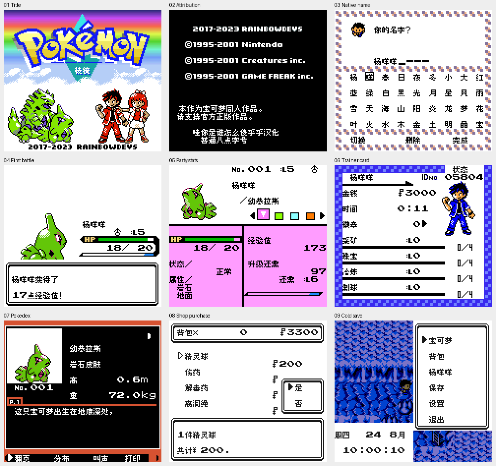

# 宝可梦棱镜

原输入：Pokemon Prism v0.95.0254

原输入完整SHA256：`dea0729edbc5923f1af1fbd9c79e56cd7ff255642bca12f7fb146d506196077d`。此处“原输入”保留改版、既有汉化或地区修订身份，不一律称干净零售ROM。

| 字号 | 当前版本 | 音频 | 输出完整SHA256 |
| --- | --- | --- | --- |
| 8px | v0.1.0 | unchanged | `ac912524bfe6a2eb1c109d5faf946e30456938ffe8f5af1b1470f391207e3562` |

## 源码与补丁

- 8px／v0.1.0／unchanged：源码包（完整性未独立确认）：[下载](https://github.com/shiyi1133/youxi-hanhua-releases/releases/download/source-migration-20261022-02b/pokemon-prism-current-source-7ed882da6799-public-r01.zip)（ZIP SHA256 `09d1c7c2dd79cd9b3de4440d7d811ee45eded7ce0f6901b2d3830be8c0008deb`）；补丁：[下载](https://github.com/shiyi1133/youxi-hanhua-releases/releases/download/patch-migration-20261022/pokemon-prism-current-patches.zip)（ZIP SHA256 `561d650c8b39cd43f916b9a742daf0d528886cd037963fdeed58c9de1f32cfb0`）。
  该包已核对对应版本与字节安全；完整修改源码覆盖范围未独立确认。

补丁须直接应用于完整SHA一致的实际原输入；普通字、大字和音乐变体分别核对。公开源码归档不表示本轮重新构建或通过新的运行验收。原作、字体、已有翻译及工具依赖的权利与许可，依各包对应许可保留。

## 范围与验证边界

- 8px／v0.1.0：普通8px；本次无大字版本；原生CGB彩色。。
  广泛文本翻译、限定验证的可玩初版。自然新游戏、中文命名重复删输、首战、菜单、商店购买及正常保存后的新进程读档有提供者实测；名称、说明、图鉴及边界有原生消费者诊断。保留 RainbowDevs、原作版权、商标及必要缩写；不冒称零售原版或从零原创游戏。
  未自然全通所有地图、深层任务、结局、小游戏、对战塔；未实机、真实交换、移动通信或多人联机。诊断注入不等于自然获得全部物品/抓全精灵。中文名称/缓存已改，先备份原生存档；不保证与其它ROM/Prism版本兼容，旧档已有箱名不主动迁移。部分调试/未证实可达遗留及刻意乱码谜题保留。

本次资料搬运未新增模拟器、实机或全通验收；未记录或未测试的范围不写成通过。问题单开放只表示尚未关闭，已关闭也不单独证明全部场景都修复。

[公开反馈及问题状态](feedback.md) · [报告BUG](https://github.com/shiyi1133/youxi-hanhua-releases/issues/new?template=bug_report.md)

## 对应版本截图

普通8px v0.1.0最终ROM原生CGB九宫格；提供者记录为自然场景，外侧标题/2倍最近邻排布，非全流程通关证明。

图像SHA256：`e7e401d92cc8c0e51315b38327822c92d840c75cb8e8a812eb1dece2e45a60d7`；绑定ROM SHA256：`ac912524bfe6a2eb1c109d5faf946e30456938ffe8f5af1b1470f391207e3562`。

