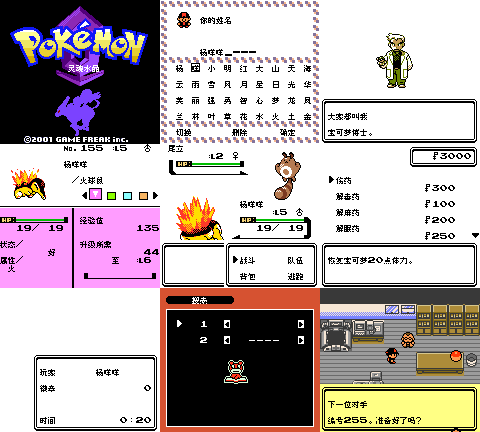

# 宝可梦 灵魂水晶42.0：公开反馈

[报告BUG](https://github.com/shiyi1133/youxi-hanhua-releases/issues/new?template=bug_report.md)。请说明实际版本、字号、必要触发步骤和已有截图，不上传ROM、存档、即时状态或私人资料。

当前公开索引已登记1项显示反馈，攻击变色、地点、图鉴与电话本分别记录，实际ROM版本和根因仍待核。开放问题不等于正在修复。

[贴吧原需求](https://tieba.baidu.com/p/11092365551?pid=154057797302#154057797302)。

## 维护者交付通知：v0.1.0（限定测试版）

[贴吧实际答复](https://tieba.baidu.com/p/11092365551?pid=154064647549#p154064647549)（215楼，PID 154064647549；原关联楼层回复）。

以下为去除下载信息后的维护者通知摘要，不是玩家测试结论，也不是原文全文。

> 《宝可梦 灵魂水晶42.0》v0.1.0限定测试版已发布。
> 字号：Fusion Pixel 2026.09.25 真实普通8px，原生8px字格；无10px大字版，CGB原生彩色，非SGB验收。。
> 范围：普通8px限定测试版；基于提供者英文改版Soul Crystal 42.0，非零售原版。开局、命名、菜单、野战及部分图形标签已有提供者运行证据；商店和图鉴取自既有实际进度，最长变量分页取自诊断入口。
> 原答复中的ROM下载链接、提取码、网盘目录及下载指示已省略；私库保留完整原文证据。

原答复全文UTF-8 SHA-256：`353891f6f100d4de7176e8a613b1eb2c2c84b6e9750b5df331882e01e66137ff`（269字节）。

v0.1.0 普通8px最终ROM真实九宫格。1—5格：标题、自然命名、开场、伙伴状态、野战；6—7格：既有实际进度商店与正常保存后新进程电池SAV冷读；8格：既有图鉴进度的正常菜单；9格：诊断入口最长255变量分页。原生160×144逐格像素核对，不是自然深层或全流程验收。

[贴吧该PID第1张实际公开图片](https://tiebapic.baidu.com/forum/pic/item/33a572ec54e736d1071e390fdd504fc2d46269d7.jpg?tbpicau=2026-11-04-05_22b7f977e8a85d7dfab09dd8d5cc94f6)。

原PNG SHA-256：`f94afee7405e4ff8855aed2c6a0456d4bfba6bf670dac3b3f9a29c032b03418e`；贴吧公开图片 SHA-256：`1e1bbd977c1eb0d6a0dfac1741da635302467b583598c30819c0e3f8c0baa484`。

原答复全文与全部图片已按该PID公开核验；此镜像不新增通关、实机、独立QA、源码完整性或BUG全部修复结论。

## 20261026-0419 玩家反馈增量

- 灵魂水晶：战斗颜色、地点、图鉴与电话本显示（保持开放）：同一原反馈报告攻击变色、地址显示、图鉴黑字及底部选项不可读、电话本难读，附4图。四个消费者分别保留，共同根因未知；尚待实际ROM文件名或版本，英文原版对照也未完成，不能认定全由补丁新增。输入作品为英文改版Soul Crystal 42.0。

本次仅登记玩家证据和限定复测，未运行ROM、未新增修复；当前发布参考不代表玩家实际ROM字节。

[fgjxchtd · 215楼 · 154071462318](https://tieba.baidu.com/p/11092365551?pid=154071462318#154071462318)

> 统一的小问题，攻击变色，地址显示，不知道图鉴有没有问题，我得测试英文原版才知道，中文改版图鉴街上全是黑的，连下面的四个功能选项都看不见字，电话本根本看不明白，目前就这些    

[原楼登记答复](https://tieba.baidu.com/p/11092365551?pid=154071815033#154071815033)：攻击变色、地名、图鉴黑字和电话本这几处已记录，4张图都收到了。麻烦补一下实际ROM文件名或版本，方便逐项核对。
