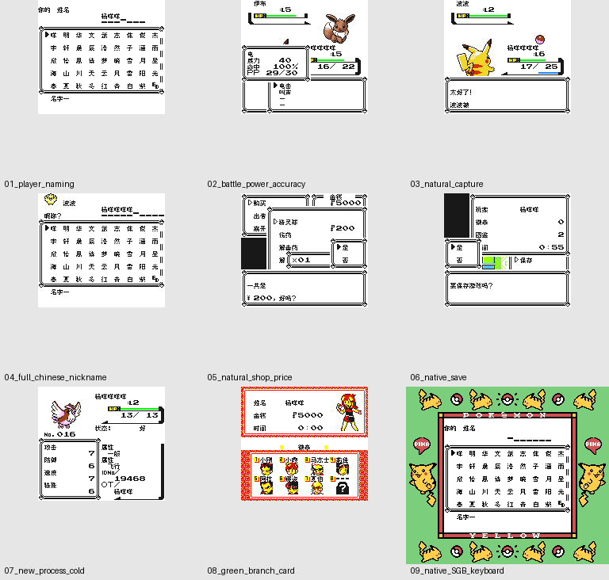

# 口袋黄：三主角改版

原输入：Pokemon Yellow three-protagonist hack (provided filename; upstream identity unverified)

原输入完整SHA256：`08707a21f3552f7d279d995cadb8b2cf47eaf8b4e6000e3125a19da3b9a05c4b`。此处“原输入”保留改版、既有汉化或地区修订身份，不一律称干净零售ROM。

| 字号 | 当前版本 | 音频 | 输出完整SHA256 |
| --- | --- | --- | --- |
| 8px | v0.1.0 | unchanged | `ec81df5c1512a06161e2b844d05613389ea70ec1038628c171dada3096cce93f` |

## 源码与补丁

- 8px／v0.1.0／unchanged：源码包（完整性未独立确认）：[下载](https://github.com/shiyi1133/youxi-hanhua-releases/releases/download/source-migration-20261022-02b/pokemon-yellow-three-protagonists-current-source-3039c5351fc4-public-r01.zip)（ZIP SHA256 `0ee700727bb8dd614ad9a1358fe13e46280d7ac40695fb65adb13c1e7036750a`）；补丁：[下载](https://github.com/shiyi1133/youxi-hanhua-releases/releases/download/patch-migration-20261022/pokemon-yellow-three-protagonists-current-patches.zip)（ZIP SHA256 `5158518e6d345adb5e1d590a04485a8ea1b9a44c92c9440fd1c38bbda4425e8d`）。
  该包已核对对应版本与字节安全；完整修改源码覆盖范围未独立确认。

补丁须直接应用于完整SHA一致的实际原输入；普通字、大字和音乐变体分别核对。公开源码归档不表示本轮重新构建或通过新的运行验收。原作、字体、已有翻译及工具依赖的权利与许可，依各包对应许可保留。

## 范围与验证边界

- 8px／v0.1.0：Fusion Pixel普通8px；只针对三主角改版实际输入；保留原字段容量与原字母/数字/符号，未另做大字。。
  Fusion Pixel普通8px；只针对三主角改版实际输入；保留原字段容量与原字母/数字/符号，未另做大字。
  改版上游作者/版本未独立认证；不是原版Yellow，输入按完整SHA识别。
  未通关、深层剧情/后日谈、实机/联机/交换/姓名鉴定师完整改名或所有旧存档兼容；未自然到达的冲浪、证书等只完成构建。

本次资料搬运未新增模拟器、实机或全通验收；未记录或未测试的范围不写成通过。问题单开放只表示尚未关闭，已关闭也不单独证明全部场景都修复。

[公开反馈及问题状态](feedback.md) · [报告BUG](https://github.com/shiyi1133/youxi-hanhua-releases/issues/new?template=bug_report.md)

## 对应版本截图

v0.1.0 Fusion Pixel普通8px；只针对三主角改版实际输入；保留原字段容量与原字母/数字/符号，未另做大字。 音频：unchanged；自然有限路线与电池冷读，SGB实际预设与CGB画面分列；不能以九格推定全部功能。

图像SHA256：`62650ffb74f2a4a2d6db4f7aef16565a9e94c51926497878b42d7a030785caad`；绑定ROM SHA256：`ec81df5c1512a06161e2b844d05613389ea70ec1038628c171dada3096cce93f`。

