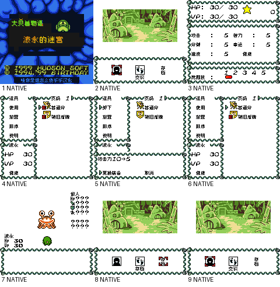
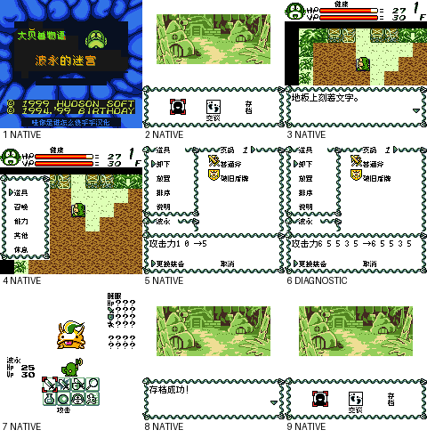

# 波永的迷宫1

原输入：Poyon no Dungeon Room

原输入完整SHA256：`9e8c11f2163d7e0006073caef0854ee0da5e5494fc0be02aeac0759fb798b100`。此处“原输入”保留改版、既有汉化或地区修订身份，不一律称干净零售ROM。

| 字号 | 当前版本 | 音频 | 输出完整SHA256 |
| --- | --- | --- | --- |
| 8px | v1.0.3限定修复测试版 | unchanged | `8c190a34ce0baaf413f42a5a6db18b70e42686854cd1c8446879dbeea9f901e4` |
| 10px | v1.0.5限定修复测试版 | unchanged | `aff1722da6ac58bcfb046eb0bc6ff20057ca3f5e94605eefbb855d1925584109` |

## 源码与补丁

- 8px／v1.0.3限定修复测试版／unchanged：源码包（完整性未独立确认）：[下载](https://github.com/shiyi1133/youxi-hanhua-releases/releases/download/source-migration-20261022-02b/poyon-dungeon-1-current-source-96aff407939c-public-r01.zip)（ZIP SHA256 `7ae7189dd0b4556ce21c0ae688d7af38021873ec1c08ee50cbbfdaf104a8ca62`）；补丁：[下载](https://github.com/shiyi1133/youxi-hanhua-releases/releases/download/patch-migration-20261022/poyon-dungeon-1-current-patches.zip)（ZIP SHA256 `112a43c0cc0024d950648fe6a04de1fac12254f363735094e931e6f17ad4e20f`）。
  该包已核对对应版本与字节安全；完整修改源码覆盖范围未独立确认。
- 10px／v1.0.5限定修复测试版／unchanged：源码包（完整性未独立确认）：[下载](https://github.com/shiyi1133/youxi-hanhua-releases/releases/download/source-migration-20261022-02b/poyon-dungeon-1-current-source-96aff407939c-public-r01.zip)（ZIP SHA256 `7ae7189dd0b4556ce21c0ae688d7af38021873ec1c08ee50cbbfdaf104a8ca62`）；补丁：[下载](https://github.com/shiyi1133/youxi-hanhua-releases/releases/download/patch-migration-20261022/poyon-dungeon-1-current-patches.zip)（ZIP SHA256 `112a43c0cc0024d950648fe6a04de1fac12254f363735094e931e6f17ad4e20f`）。
  该包已核对对应版本与字节安全；完整修改源码覆盖范围未独立确认。

补丁须直接应用于完整SHA一致的实际原输入；普通字、大字和音乐变体分别核对。公开源码归档不表示本轮重新构建或通过新的运行验收。原作、字体、已有翻译及工具依赖的权利与许可，依各包对应许可保留。

## 范围与验证边界

- 8px／v1.0.3限定修复测试版：原生8px普通版。
  既有反馈限定修复：普通8px v1.0.3及对白10px v1.0.5分别交付；其他功能/排版/未复现场景不随发版冒称解决，既有反馈/28保持open。
  既有反馈并未全部原反馈闭环；花皮名称及历史身份待核，深层NPC/沟渠/物品等20图未全自然重走。
  既有反馈召唤兽四变二未触及，保持open。
  本轮未自然重走命名/改名与命名保存，原中文页仍仅8个可选字。
  全通、联机成功、实机、全部旧档及跨字号迁移未验；大字拖慢/残留不能保证全部消除。
  65535、满背包、18脚本和4共存菜单为明确诊断，不冒充自然路线。
  提供者同一实现者自测；维护仅静态/补丁/图片核验，没有运行附包代码或模拟器。
- 10px／v1.0.5限定修复测试版：仅真10px对白，菜单/选项/命名/战斗命令维持8px。
  既有反馈限定修复：普通8px v1.0.3及对白10px v1.0.5分别交付；其他功能/排版/未复现场景不随发版冒称解决，既有反馈/28保持open。
  既有反馈并未全部原反馈闭环；花皮名称及历史身份待核，深层NPC/沟渠/物品等20图未全自然重走。
  既有反馈召唤兽四变二未触及，保持open。
  本轮未自然重走命名/改名与命名保存，原中文页仍仅8个可选字。
  全通、联机成功、实机、全部旧档及跨字号迁移未验；大字拖慢/残留不能保证全部消除。
  65535、满背包、18脚本和4共存菜单为明确诊断，不冒充自然路线。
  提供者同一实现者自测；维护仅静态/补丁/图片核验，没有运行附包代码或模拟器。

本次资料搬运未新增模拟器、实机或全通验收；未记录或未测试的范围不写成通过。问题单开放只表示尚未关闭，已关闭也不单独证明全部场景都修复。

[公开反馈及问题状态](feedback.md) · [报告BUG](https://github.com/shiyi1133/youxi-hanhua-releases/issues/new?template=bug_report.md)

## 对应版本截图

波永的迷宫1 v1.0.3限定修复测试版 普通8px；提供方最终ROM画面，诊断/自然范围按图及证据明确标注，未新增维护运行。

图像SHA256：`302656e2f9aaf4a2a6bf049b2cb9282bd111a5e09e0ddf0013abf5899c0496a1`；绑定ROM SHA256：`8c190a34ce0baaf413f42a5a6db18b70e42686854cd1c8446879dbeea9f901e4`。

波永的迷宫1 v1.0.5限定修复测试版 对白10px；提供方最终ROM画面，诊断/自然范围按图及证据明确标注，未新增维护运行。

图像SHA256：`548aee0da2e9ce150d1193eac1ff356aadf7d67e3c4d833ab07210b674ba353b`；绑定ROM SHA256：`aff1722da6ac58bcfb046eb0bc6ff20057ca3f5e94605eefbb855d1925584109`。

