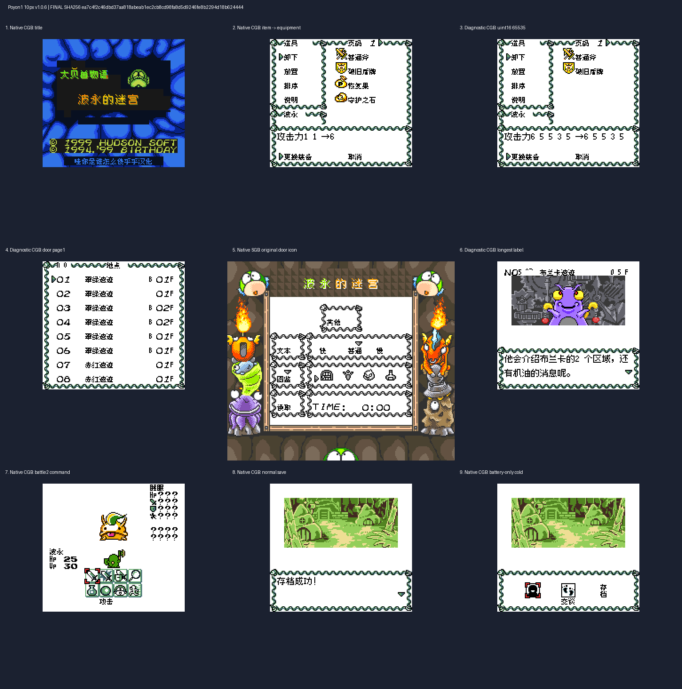
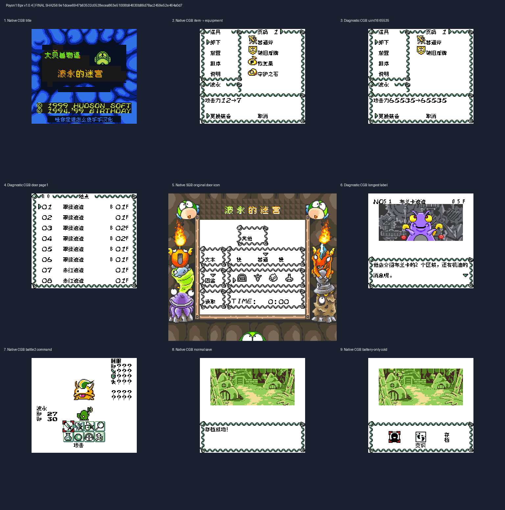

# 波永的迷宫1 v1.0.6（限定测试版）

[源码与补丁Release](https://github.com/shiyi1133/youxi-hanhua-releases/releases/tag/poyon-dungeon-1-v1.0.6) · [公开反馈](feedback.md) · [报告BUG](https://github.com/shiyi1133/youxi-hanhua-releases/issues/new?template=bug_report.md)

原游戏／实际输入：Poyon no Dungeon Room

原输入完整 SHA-256：`9e8c11f2163d7e0006073caef0854ee0da5e5494fc0be02aeac0759fb798b100`（2097152字节）。

范围：普通8px与既有10px对白分别修门图鉴地点名/详情原生消费者；Issue16/28及整体排版另保留。

## 10px v1.0.6 / unchanged

字号范围：普通8px与既有10px对白分别修门图鉴地点名/详情原生消费者；Issue16/28及整体排版另保留。

目标完整 SHA-256：`ea7c4f2c46dbd37aa818abeab1ec2cb8cd98fa8d5d9246fe8b2294d18b624444`（4194304字节）。

补丁：`poyon1_v1.0.6_10px.bps`，SHA-256 `17237b0481cf389121ee38782f0f44351fe8667cb13876c8fbd651ba033478ca`。

[源码（完整性未独立确认）](https://github.com/shiyi1133/youxi-hanhua-releases/releases/download/poyon-dungeon-1-v1.0.6/poyon-dungeon-1-v1.0.6-complete-source.zip) · [补丁包](https://github.com/shiyi1133/youxi-hanhua-releases/releases/download/poyon-dungeon-1-v1.0.6/poyon-dungeon-1-v1.0.6-patches.zip)

普通8px与既有10px对白分别修门图鉴地点名/详情原生消费者；Issue16/28及整体排版另保留。；提供方对应最终ROM图证，具体自然/诊断类别见原图标签及材料；非维护运行、全通或实机验收。

## 8px v1.0.4 / unchanged

字号范围：普通8px与既有10px对白分别修门图鉴地点名/详情原生消费者；Issue16/28及整体排版另保留。

目标完整 SHA-256：`9e1dcee6947b63532c0528ecea863e51008b94030b86d78ac2459e52e464a0d7`（4194304字节）。

补丁：`poyon1_v1.0.4_8px.bps`，SHA-256 `6a3654c408a1f78ee1c4463fb966d7ca66304062f3903dc72cda329f87f70c3f`。

[源码（完整性未独立确认）](https://github.com/shiyi1133/youxi-hanhua-releases/releases/download/poyon-dungeon-1-v1.0.6/poyon-dungeon-1-v1.0.6-complete-source.zip) · [补丁包](https://github.com/shiyi1133/youxi-hanhua-releases/releases/download/poyon-dungeon-1-v1.0.6/poyon-dungeon-1-v1.0.6-patches.zip)

普通8px与既有10px对白分别修门图鉴地点名/详情原生消费者；Issue16/28及整体排版另保留。；提供方对应最终ROM图证，具体自然/诊断类别见原图标签及材料；非维护运行、全通或实机验收。

## 测试及限制

提供方自然范围：提供方报告的自然/正常按键流程，维护未重跑。

提供方诊断范围：提供方明确标注的受控消费者、解锁或边界测试，不能冒充自然到达。

保存边界：仅按具体版本材料，不推定所有旧存档兼容。

维护本轮独立核原输入、补丁逐字节还原、ZIP/CRC、Source安全与原图字节；未执行提供方源码、未重建或运行ROM，未宣称独立人员QA、实机或全流程验收。

- 未验证：维护仅独立核用户输入ZIP/ROM完整SHA、补丁逐字节还原、ZIP成员/CRC与源包静态材料；未执行提供者源码、重建工程或运行ROM。
- 未验证：运行、自然按键、受控诊断、保存/新进程冷读等范围以所附提供方报告分别为据，不冒充维护重跑、独立人员QA、玩家验收、实机或全流程通关。
- 未验证：使用前备份普通存档；不跨ROM版本/字号套用即时状态，旧电池兼容仅按提供方实际样本说明。

大字版更容易出现拖慢、刷新残留等问题，遇到请及时在原楼反馈。
