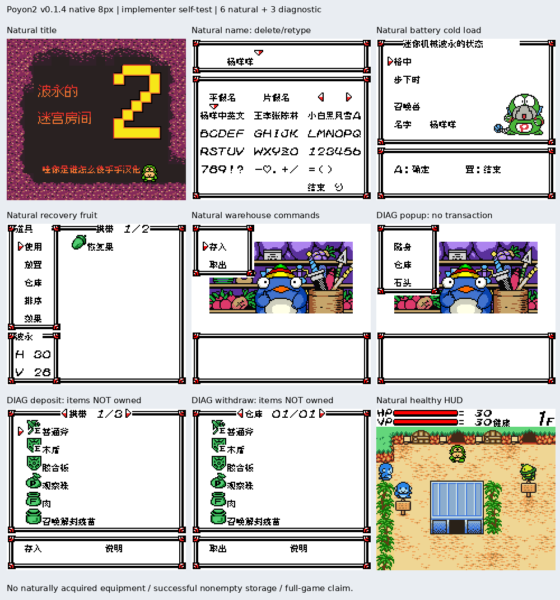

# 波永的迷宫2

原输入：Poyon no Dungeon Room 2

原输入完整SHA256：`ec80348ce790c4afca7d0447c21b4146968bc55fd450960cae9334cf283d2148`。此处“原输入”保留改版、既有汉化或地区修订身份，不一律称干净零售ROM。

| 字号 | 当前版本 | 音频 | 输出完整SHA256 |
| --- | --- | --- | --- |
| 8px | v0.1.4 | unchanged | `b0444ebf01b262e18b4f7f8a7e03ff231be03c4f3b5166154bd1787a01f6f7ff` |

## 源码与补丁

- 8px／v0.1.4／unchanged：源码包（完整性未独立确认）：[下载](https://github.com/shiyi1133/youxi-hanhua-releases/releases/download/source-migration-20261022-02b/poyon-dungeon-2-current-source-fc1000a54c54-public-r01.zip)（ZIP SHA256 `5bc79197f6854afb7f85cc84c53a7841931b0bd7ba60a0aa735f97d00af7d217`）；补丁：[下载](https://github.com/shiyi1133/youxi-hanhua-releases/releases/download/patch-migration-20261022/poyon-dungeon-2-current-patches.zip)（ZIP SHA256 `0e01cd9bfde43ddbe9420069200b112bc642b0ecb9466cb2702e4d83df26867d`）。
  该包已核对对应版本与字节安全；完整修改源码覆盖范围未独立确认。

补丁须直接应用于完整SHA一致的实际原输入；普通字、大字和音乐变体分别核对。公开源码归档不表示本轮重新构建或通过新的运行验收。原作、字体、已有翻译及工具依赖的权利与许可，依各包对应许可保留。

## 范围与验证边界

- 8px／v0.1.4：普通原生8px，仓库存入/取出E装备标记及五项小弹窗局部修复；保留此前已修内容，无大字。。
  普通原生8px，仓库存入/取出E装备标记及五项小弹窗局部修复；保留此前已修内容，无大字。
  未自然获得装备后实际非空存取交易与冷读、其它仓库、自然实战、深层职业/合成/全通/实机/联机。
  八字召唤兽命名及图鉴/预览等其它问题不在本次结论；暂停长攻略不恢复。

本次资料搬运未新增模拟器、实机或全通验收；未记录或未测试的范围不写成通过。问题单开放只表示尚未关闭，已关闭也不单独证明全部场景都修复。

[公开反馈及问题状态](feedback.md) · [报告BUG](https://github.com/shiyi1133/youxi-hanhua-releases/issues/new?template=bug_report.md)

## 对应版本截图

v0.1.4 普通原生8px，仓库存入/取出E装备标记及五项小弹窗局部修复；保留此前已修内容，无大字。 音频：unchanged；九宫格6自然+3诊断，2倍最近邻展示及外加说明；诊断装备并非自然持有/穿戴或成功存取。

图像SHA256：`5f569cf892060c0fc7df06ca534653cbdf86c04dd05c67950c39afc005fe328d`；绑定ROM SHA256：`b0444ebf01b262e18b4f7f8a7e03ff231be03c4f3b5166154bd1787a01f6f7ff`。

