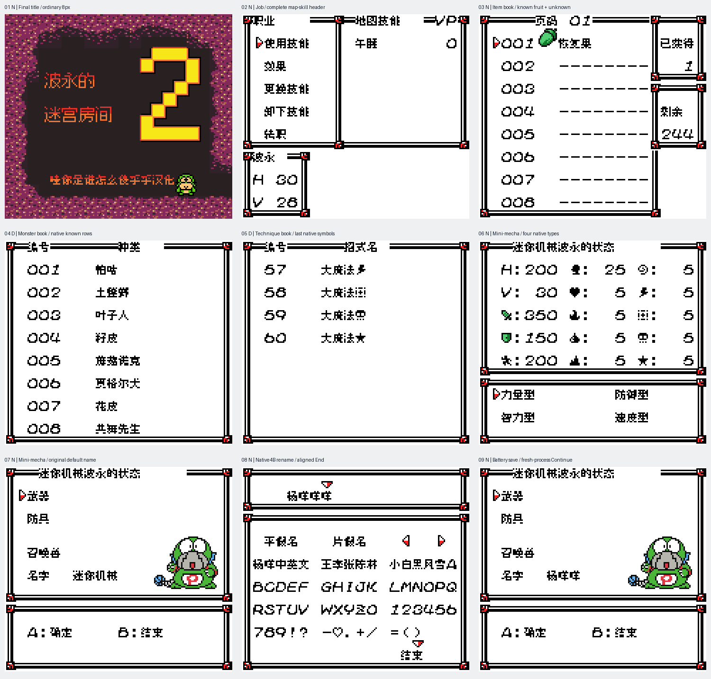

# 波永的迷宫2 v0.1.7（限定测试版）

[源码与补丁Release](https://github.com/shiyi1133/youxi-hanhua-releases/releases/tag/poyon-dungeon-2-v0.1.7) · [公开反馈](feedback.md) · [报告BUG](https://github.com/shiyi1133/youxi-hanhua-releases/issues/new?template=bug_report.md)

原游戏／实际输入：Poyon no Dungeon Room 2

原输入完整 SHA-256：`ec80348ce790c4afca7d0447c21b4146968bc55fd450960cae9334cf283d2148`（2097152字节）。

范围：职业栏、三个图鉴及初村迷你机械改装/4字节命名短路线的限定显示修复。

## 8px v0.1.7 / unchanged

字号范围：普通8px；本批不新增大字号。

目标完整 SHA-256：`f2260fe64fc9b2a06845a00a92ec3c7954902c47235fd9bd3222c53a4536ca74`（4194304字节）。

补丁：`Poyon2_v0.1.7_8px_limited.bps`，SHA-256 `320f6cc5bd17e9811beded6c35b7ce9c27d5681b68ed1d83533fccfbb3fca5e7`。

[源码（完整性未独立确认）](https://github.com/shiyi1133/youxi-hanhua-releases/releases/download/poyon-dungeon-2-v0.1.7/poyon-dungeon-2-v0.1.7-SOURCE-public.zip) · [补丁包](https://github.com/shiyi1133/youxi-hanhua-releases/releases/download/poyon-dungeon-2-v0.1.7/poyon-dungeon-2-v0.1.7-PATCH-public.zip)

v0.1.7 / 8px / unchanged 最终ROM提供者实际画面；真实九格，按提供者场景分别保留自然和诊断边界。维护未运行、未全通或实机验收。

## 测试及限制

提供方自然范围：提供者自测：最终ROM自然初村职业栏、未知图鉴页、迷你机械房菜单/命名、普通保存及新进程Continue。

提供方诊断范围：提供者诊断：已知图鉴全项与混合发现位/机械名字边界为明确受控诊断；不当自然发现或全收集。

保存边界：仅按具体版本材料，不推定所有旧存档兼容。

维护本轮独立核原输入、补丁逐字节还原、ZIP/CRC、Source安全与原图字节；未执行提供方源码、未重建或运行ROM，未宣称独立人员QA、实机或全流程验收。

- 未验证：维护仅做数据/字节与独立补丁验证，未执行提供者源码或ROM，未独立重建。
- 未验证：全作未译仍开放；Boss/第二大关/包子比赛长路线暂停保持。
- 未验证：迷你机械改装房不等于格斗家劈瓦迷你游戏；不得据本版冒称该反馈已修。
- 未验证：未全通/实机/自然全物品/玩家真实旧档；保存计时差异保留精确说明。
