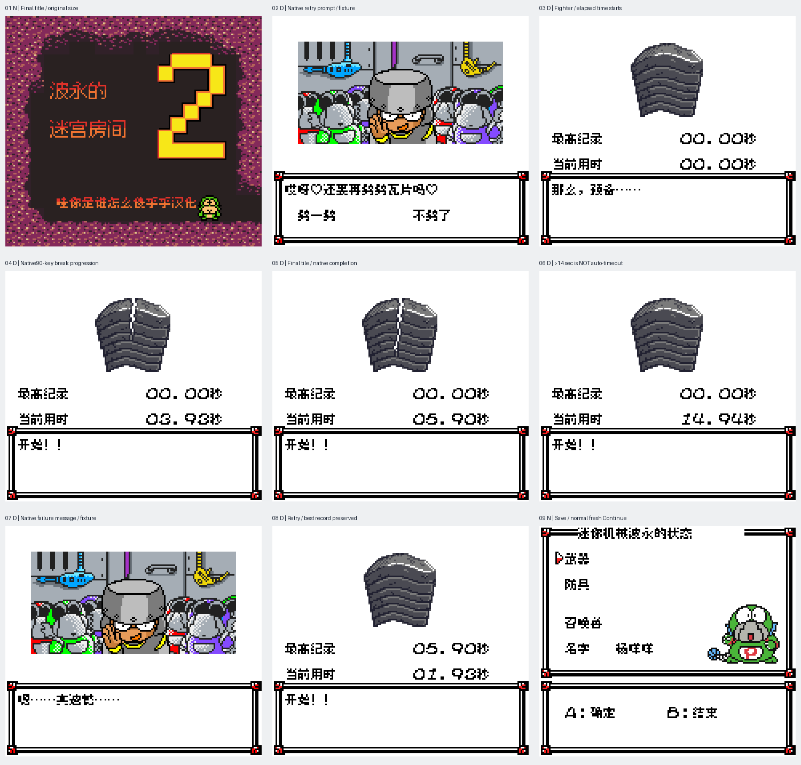

# 波永的迷宫2 v0.1.8（限定测试版）

[源码与补丁Release](https://github.com/shiyi1133/youxi-hanhua-releases/releases/tag/poyon-dungeon-2-v0.1.8) · [公开反馈](feedback.md) · [报告BUG](https://github.com/shiyi1133/youxi-hanhua-releases/issues/new?template=bug_report.md)

原游戏／实际输入：Poyon no Dungeon Room 2

原输入完整 SHA-256：`ec80348ce790c4afca7d0447c21b4146968bc55fd450960cae9334cf283d2148`（2097152字节）。

范围：修正格斗家劈瓦小游戏的“最高纪录、当前用时、秒”显示，保留递增计时、数字、瓦片美术和原生玩法。

## 8px v0.1.8 / unchanged

字号范围：普通原生8px；未新增大字号。

目标完整 SHA-256：`0540567042665cd522ec25ee2478db40dbe5c035c0c8b2af41899771bd5420c6`（4194304字节）。

补丁：`Poyon2_v0.1.8_8px_limited.bps`，SHA-256 `ea7fcb3176f1e3384a8b7f53bb2aebed134b27d92539f7ba05e5c734b5142b77`。

[源码（完整性未独立确认）](https://github.com/shiyi1133/youxi-hanhua-releases/releases/download/poyon-dungeon-2-v0.1.8/poyon-dungeon-2-v0.1.8-complete-source.zip) · [补丁包](https://github.com/shiyi1133/youxi-hanhua-releases/releases/download/poyon-dungeon-2-v0.1.8/poyon-dungeon-2-v0.1.8-PATCH.zip)

修正格斗家劈瓦小游戏的“最高纪录、当前用时、秒”显示，保留递增计时、数字、瓦片美术和原生玩法。 标题与普通存档新进程Continue为自然范围；提供方40组继承回归明确绑定本版。 劈瓦六组关卡、按键/计时/失败/纪录/重试均为显式原生诊断入口，未自然走到第二关前村庄；未执行奖励/职业推进。

## 测试及限制

提供方自然范围：标题与普通存档新进程Continue为自然范围；提供方40组继承回归明确绑定本版。

提供方诊断范围：劈瓦六组关卡、按键/计时/失败/纪录/重试均为显式原生诊断入口，未自然走到第二关前村庄；未执行奖励/职业推进。

保存边界：仅按具体版本材料，不推定所有旧存档兼容。

维护本轮独立核原输入、补丁逐字节还原、ZIP/CRC、Source安全与原图字节；未执行提供方源码、未重建或运行ROM，未宣称独立人员QA、实机或全流程验收。

- 未验证：维护独立核输入ZIP/ROM完整SHA、BPS逐字节还原、ZIP成员CRC与Root实际查看最终图；未执行附件源码或ROM、未独立重建。
- 未验证：提供方自然/受控/静态证据分别记录，不冒充维护运行、独立外部人员QA、玩家实际存档、实机、联机或完整通关验收。
- 未验证：备份原件与普通存档，不跨ROM完整SHA加载即时状态；既有旧Release、标签、引用、原始包与本地历史保留。
- 未验证：Issue22保留open；Boss全身介绍、第二关入口标题、包子比赛及其它未覆盖反馈未声明修复，用户暂停长攻略保持暂停。
