# 波永的迷宫2：公开反馈

以下均为公开证据，玩家原话不自动等于维护已复现或已修复。

## 154029487823

61楼 · 球总好学 · [原回帖](https://tieba.baidu.com/p/11092365551?pid=154029487823#154029487823)

> 8px，0.1版，角色状态页面，中间靠右位置，图片显示错误，有红色的一张脸的一小部分

[玩家公开图片](https://tiebapic.baidu.com/forum/pic/item/01b86a2762d0f703cf2156da4efa513d2797c555.jpg)（玩家反馈图）

## 154029490009

61楼 · 球总好学 · [原回帖](https://tieba.baidu.com/p/11092365551?pid=154029490009#154029490009)

> 8px，0.1版，菜单-设置-列表里面，第一个门图标里面显示错误，第二个脚印里面显示错误，满屏文字或者不明意思的翻译显示

[玩家公开图片](https://tiebapic.baidu.com/forum/pic/item/949be024b899a90102b898305b950a7b0308f557.jpg)（玩家反馈图）

[玩家公开图片](https://tiebapic.baidu.com/forum/pic/item/3332a0014c086e064d25fc4d44087bf40bd1cb57.jpg)（玩家反馈图）

## 154029491531

61楼 · 球总好学 · [原回帖](https://tieba.baidu.com/p/11092365551?pid=154029491531#154029491531)

> 8px，0.1版，右上角的角色状态，显示日文，未翻译

[玩家公开图片](https://tiebapic.baidu.com/forum/pic/item/7bb433292df5e0fe50974a071a6034a85fdf7251.jpg)（玩家反馈图）

## 154038630725

61楼 · 球总好学 · [原回帖](https://tieba.baidu.com/p/11092365551?pid=154038630725#154038630725)

> 8px 0.1.0，装备武器和防具后，武器和盾牌图标右下方会有一个小的记号表示此装备已经装备上，但汉化版中此标记未统一，前两个是“骰”字，第四个看似是标记，但该物品不是可装备物品，应该是字符溢出等类似的情况

[玩家公开图片](https://tiebapic.baidu.com/forum/pic/item/aa94b10e7bec54e7b87c3619ff389b504ec26a54.jpg)（玩家反馈图）

## 154038635323

61楼 · 球总好学 · [原回帖](https://tieba.baidu.com/p/11092365551?pid=154038635323#154038635323)

> 8px 0.1.0，战斗中，逃跑图标下的表述，单单一个“逃”字，应该是显示不全或者文本未对齐等情况

[玩家公开图片](https://tiebapic.baidu.com/forum/pic/item/5aa2bade9c82d1587a0975b6c60a19d8bd3e425d.jpg)（玩家反馈图）

## 154038639796

61楼 · 球总好学 · [原回帖](https://tieba.baidu.com/p/11092365551?pid=154038639796#154038639796)

> 8px 0.1.0，角色状态画面中，未装备武器和盾牌时显示正常，但装备武器和盾牌后画面中间位置显示异常，有类似红色的部分人脸的图像显示异常

[玩家公开图片](https://tiebapic.baidu.com/forum/pic/item/fda24236acaf2edd267765eecb1001e93801935a.jpg)（玩家反馈图）

[玩家公开图片](https://tiebapic.baidu.com/forum/pic/item/c09da5af2edda3ccfa62942747e93901203f925a.jpg)（玩家反馈图）

## 154038903946

61楼 · 球总好学 · [原回帖](https://tieba.baidu.com/p/11092365551?pid=154038903946#154038903946)

> 8px 0.1.1，进入设置-列表-“门”后，显示异常

[玩家公开图片](https://tiebapic.baidu.com/forum/pic/item/22aa45086e061d9527a3183f3df40ad163d9ca7f.jpg)（玩家反馈图）

[玩家公开图片](https://tiebapic.baidu.com/forum/pic/item/3bfaf1198618367ac06c50da68738bd4b21ce57f.jpg)（玩家反馈图）

[玩家公开图片](https://tiebapic.baidu.com/forum/pic/item/bdd1d3b44aed2e73960ca92bc101a18b86d6fa7f.jpg)（玩家反馈图）

[玩家公开图片](https://tiebapic.baidu.com/forum/pic/item/22dc3012b31bb051efc19c2f707adab44bede07f.jpg)（玩家反馈图）

## 154030050041

61楼 · 球总好学 · [原回帖](https://tieba.baidu.com/p/11092365551?pid=154030050041#154030050041)

> 8px，0.1版，战斗中，选项说明错误，图2应该为类似“状态”，而非“召”，图1正确

[玩家公开图片](https://tiebapic.baidu.com/forum/pic/item/848f4ba7d933c895c8d5557d971373f0830200bc.jpg)（玩家反馈图）

[玩家公开图片](https://tiebapic.baidu.com/forum/pic/item/c90cd033c895d143b7dd292535f082025baf07bc.jpg)（玩家反馈图）

## 154030062259

61楼 · 球总好学 · [原回帖](https://tieba.baidu.com/p/11092365551?pid=154030062259#154030062259)

> 8px v0.1.0，打开菜单栏，道具栏，道具显示错误

[玩家公开图片](https://tiebapic.baidu.com/forum/pic/item/e0cb05338744ebf860eea9399ff9d72a6159a741.jpg)（玩家反馈图）

[玩家公开图片](https://tiebapic.baidu.com/forum/pic/item/87988e44ebf81a4c2aad21cf912a6059242da641.jpg)（玩家反馈图）

## 154045178810

61楼 · 球总好学 · [原回帖](https://tieba.baidu.com/p/11092365551?pid=154045178810#154045178810)

> 8px 0.1.2，菜单-列表的后面三个图鉴“物品”“怪物”“T”，点进去都是显示异常，包括满屏的“纸”字以及方框上方的汉字

## 154045181696

61楼 · 球总好学 · [原回帖](https://tieba.baidu.com/p/11092365551?pid=154045181696#154045181696)

> 8px 0.1.2，日文残留，角色走动界面，画面右上方的角色状态为日文，未翻译

## 154045188200

61楼 · 球总好学 · [原回帖](https://tieba.baidu.com/p/11092365551?pid=154045188200#154045188200)

> 8px 0.1.2，战斗画面，这两个行动指令的中文汉字显示异常

## 154045197555

61楼 · 球总好学 · [原回帖](https://tieba.baidu.com/p/11092365551?pid=154045197555#154045197555)

> 8px 0.1.2，菜单-使用，第四个道具，“木返程珠”显示异常，“木”应该是文本溢出或者显示异常，这个位置不该有“木”这个字

## 154045208965

61楼 · 球总好学 · [原回帖](https://tieba.baidu.com/p/11092365551?pid=154045208965#154045208965)

> 8px 0.1.2，返程珠名字左侧有多余文字“胶”

## 154045219514

61楼 · 球总好学 · [原回帖](https://tieba.baidu.com/p/11092365551?pid=154045219514#154045219514)

> 8px 0.1.2，物品栏的物品名字显示错误或乱码，第一个物品不是“胶合板”，第二个道具不是“返程”，第三个道具不是“肉合板”，第六个道具不是“返返程珠”（左侧多出来一个汉字）

## 154047257767

61楼 · 球总好学 · [原回帖](https://tieba.baidu.com/p/11092365551?pid=154047257767#154047257767)

> 8px 0.1.3，初始村庄上方第一个房间，寄存物品的地方，进入后对话指令未翻译，日文残留

## 154047260710

61楼 · 球总好学 · [原回帖](https://tieba.baidu.com/p/11092365551?pid=154047260710#154047260710)

> 8px 0.1.3，初始村庄，上方第一个房间，寄存物品的地方，选择寄存物品后进入的界面，武器和盾牌装备标记显示异常，平时状态下物品栏中武器和盾牌装备标记已正常

## 154047266943

61楼 · 球总好学 · [原回帖](https://tieba.baidu.com/p/11092365551?pid=154047266943#154047266943)

> 8px 0.1.3，刚进入迷宫时，显示迷宫预览图片的界面，迷宫名字未翻译，日文残留（画面下方）

## 154047305266

61楼 · 球总好学 · [原回帖](https://tieba.baidu.com/p/11092365551?pid=154047305266#154047305266)

> 8px 0.1.3，菜单-列表，后面三种图鉴，进入后显示异常

## 154058589879

61楼 · 球总好学 · [原回帖](https://tieba.baidu.com/p/11092365551?pid=154058589879#154058589879)

> 8px 0.1.4，初始村庄这个房间（上方右2）进入后，点手动进入后，一些翻译意义不明。图3左下方“置：减少”，图3右下方“转TA赌T：下一步”，图4上方“格中”“步下时”，图4中间“名字 态带怪存”。

[玩家公开图片](https://tiebapic.baidu.com/forum/pic/item/1bf99122720e0cf3d70a1cfc4c46f21fbf09aa67.jpg)（玩家反馈图）

[玩家公开图片](https://tiebapic.baidu.com/forum/pic/item/a39f3d9b033b5bb5df2a72f970d3d539b700bc67.jpg)（玩家反馈图）

[玩家公开图片](https://tiebapic.baidu.com/forum/pic/item/f9a505f3d7ca7bcb08869528f8096b63f724a867.jpg)（玩家反馈图）

[玩家公开图片](https://tiebapic.baidu.com/forum/pic/item/f0600346f21fbe096ea391132d600c338644ad67.jpg)（玩家反馈图）

## 154058601449

61楼 · 球总好学 · [原回帖](https://tieba.baidu.com/p/11092365551?pid=154058601449#154058601449)

> 8px 0.1.4，初始村庄这个房间（上方右2）进入后，点手动（点“自动”进入后也有一样的问题）进入后，有词条翻译的意义不明，图3右下角“置：结束”

[玩家公开图片](https://tiebapic.baidu.com/forum/pic/item/1bf99122720e0cf3d70a1cfc4c46f21fbf09aa67.jpg)（玩家反馈图）

[玩家公开图片](https://tiebapic.baidu.com/forum/pic/item/a39f3d9b033b5bb5df2a72f970d3d539b700bc67.jpg)（玩家反馈图）

[玩家公开图片](https://tiebapic.baidu.com/forum/pic/item/e5ad14950a7b020899246de624d9f2d3562cc870.jpg)（玩家反馈图）

## 154058621132

61楼 · 球总好学 · [原回帖](https://tieba.baidu.com/p/11092365551?pid=154058621132#154058621132)

> 8px 0.1.4，初始村庄这个房间（图1）（上方右2）进入后，点“自动”进入后的这个界面（图3 4 5 6）显示异常，画面下方四个选项应该由光标所指，分别是四个选项，分别为力量型、防御型、智力型、速度型，四个选项的文字显示错误、不全或位置不对，比如图6光标所指位置显示空白，应该是速度型，其余选项文字显示不全或位置错误。

[玩家公开图片](https://tiebapic.baidu.com/forum/pic/item/1bf99122720e0cf3d70a1cfc4c46f21fbf09aa67.jpg)（玩家反馈图）

[玩家公开图片](https://tiebapic.baidu.com/forum/pic/item/2a208ed6277f9e2fd0d74f0f5930e924b999f307.jpg)（玩家反馈图）

[玩家公开图片](https://tiebapic.baidu.com/forum/pic/item/5b0905f431adcbef45e92c01eaaf2edda2cc9f07.jpg)（玩家反馈图）

[玩家公开图片](https://tiebapic.baidu.com/forum/pic/item/fda24236acaf2edd942c1beecb1001e938019307.jpg)（玩家反馈图）

[玩家公开图片](https://tiebapic.baidu.com/forum/pic/item/40447f094b36acaf183dc4fb3ad98d1000e99c07.jpg)（玩家反馈图）

[玩家公开图片](https://tiebapic.baidu.com/forum/pic/item/a485b0389b504fc29082e202a3dde71191ef6d07.jpg)（玩家反馈图）

## 154058633740

61楼 · 球总好学 · [原回帖](https://tieba.baidu.com/p/11092365551?pid=154058633740#154058633740)

> 8px 0.1.4，进入初始村庄的上方右2房间（图1），点击“自动”之后，再点击几次选项之后会显示图3 4界面，再点击“格中”或者“步下时”（当然这两个选项的翻译也不对，需要修改）之后进入的界面，武器和盾牌已装备的标记显示异常（图5 6）

[玩家公开图片](https://tiebapic.baidu.com/forum/pic/item/1bf99122720e0cf3d70a1cfc4c46f21fbf09aa67.jpg)（玩家反馈图）

[玩家公开图片](https://tiebapic.baidu.com/forum/pic/item/2a208ed6277f9e2fd0d74f0f5930e924b999f307.jpg)（玩家反馈图）

[玩家公开图片](https://tiebapic.baidu.com/forum/pic/item/7651a651f3deb48fdea4f3d9b61f3a292cf57817.jpg)（玩家反馈图）

[玩家公开图片](https://tiebapic.baidu.com/forum/pic/item/d57484b1cb13495469d3ba63104e9258d0094a17.jpg)（玩家反馈图）

[玩家公开图片](https://tiebapic.baidu.com/forum/pic/item/24fafadeb48f8c54c71e97287c292df5e1fe7f17.jpg)（玩家反馈图）

[玩家公开图片](https://tiebapic.baidu.com/forum/pic/item/3f24855494eef01f6fd94ac2a6fe9925bd317d17.jpg)（玩家反馈图）

## 154058646517

61楼 · 球总好学 · [原回帖](https://tieba.baidu.com/p/11092365551?pid=154058646517#154058646517)

> 8px 0.1.4，点击菜单-职业后进入的页面，“地图 能”“战斗 能”等词条显示异常，翻译错误或缺字，比如图3右上方“地图 能”，图4右上方“战斗 能”，图5中间位置“战斗 能”等。

[玩家公开图片](https://tiebapic.baidu.com/forum/pic/item/270427dda3cc7cd9b4ef66de7f01213fb90e9126.jpg)（玩家反馈图）

[玩家公开图片](https://tiebapic.baidu.com/forum/pic/item/329392504fc2d562c3ca82eaa11190ef77c66c26.jpg)（玩家反馈图）

[玩家公开图片](https://tiebapic.baidu.com/forum/pic/item/c09da5af2edda3cc4426ea2747e93901203f9226.jpg)（玩家反馈图）

[玩家公开图片](https://tiebapic.baidu.com/forum/pic/item/a576aacc7cd98d103b165e36673fb80e7aec9026.jpg)（玩家反馈图）

[玩家公开图片](https://tiebapic.baidu.com/forum/pic/item/a485b0389b504fc2909de202a3dde71191ef6d26.jpg)（玩家反馈图）

## 问题状态

- [待复现] 波永的迷宫2 8px v0.1：状态图块、门/脚印列表文字异常；未译范围继续完善；波永2：8px v0.1.0战斗选项说明及道具菜单错误；原报告者补充五组可定位问题：初始村上方右2房间手动/自动说明词条意义不明；自动成长四类型选项错误、不全、偏位或空白；从该房间选格中/步下时后武器盾牌的已装备标记异常；菜单→职业的地图/战斗技能栏缺字。：开放；公开Issue待单独建档。

## 已公开答复

- [原答复](https://tieba.baidu.com/p/11092365551?pid=154059389867#154059389867)：@球总好学 8px v0.1.4这五组反馈和截图已补进记录：成长说明与自动成长选项、装备标记、职业技能栏，后续排查。

实际玩家ROM SHA未知时保持未知；当前参考版本SHA不能冒充玩家字节。

## 20261024-0412 公开反馈补充

公开 BUG 入口：[提交反馈](https://github.com/shiyi1133/youxi-hanhua-releases/issues/new/choose)。

61楼 · 球总好学 · [原回帖](https://tieba.baidu.com/p/11092365551?pid=154062893301#154062893301)

> 8px 0.1.4，第一大关迷宫中，这个房间里面，跟人进行吃包子比赛的界面，中文显示错误。图4和图5的左上方文字、右上方文字、中间位置的左侧两行文字。

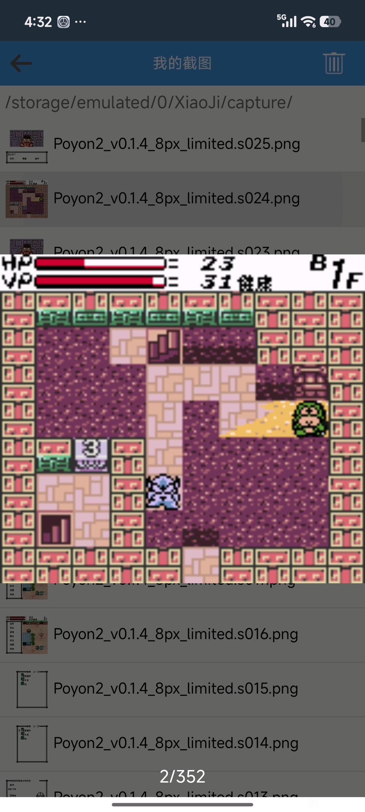

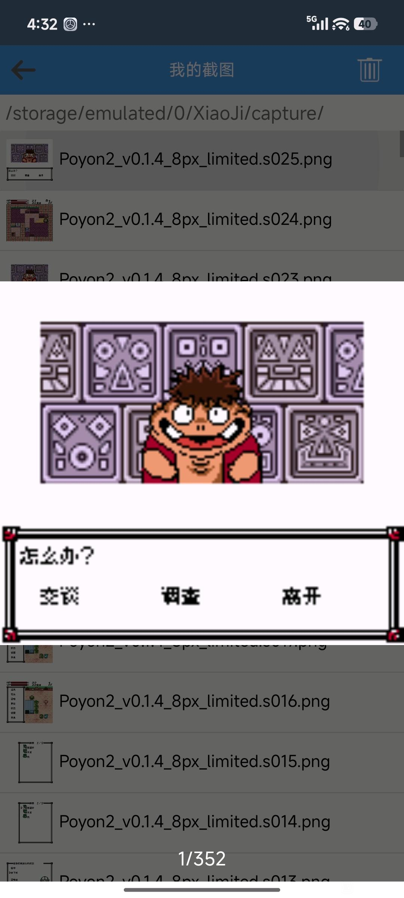

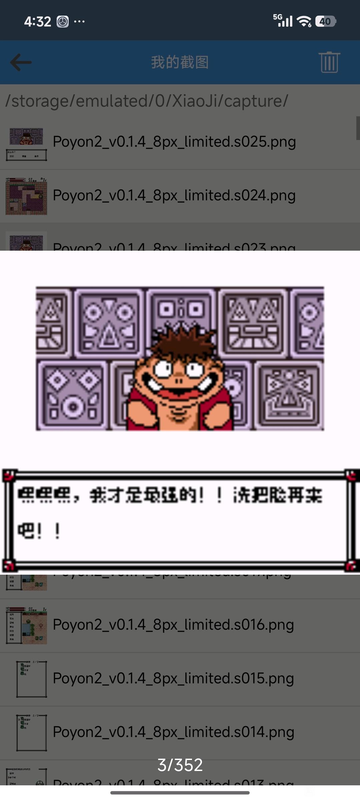

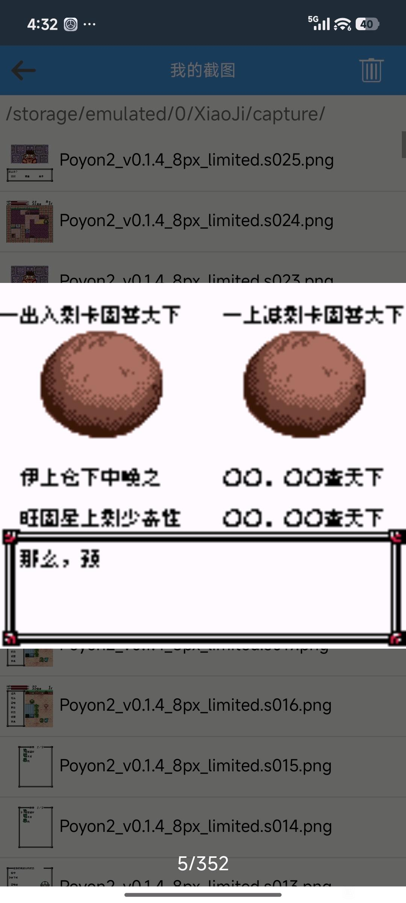

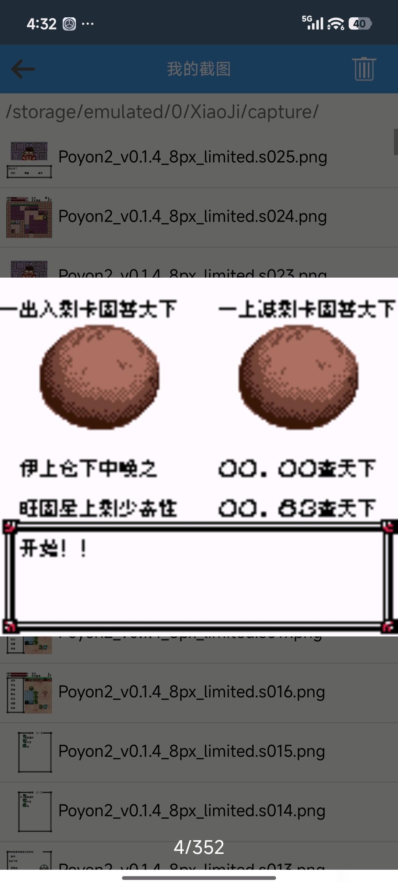

61楼 · 球总好学 · [原回帖](https://tieba.baidu.com/p/11092365551?pid=154062915836#154062915836)

> 8px 0.1.4，获得了第一只召唤兽（炸弹怪），获得之后显示的召唤兽状态页面的右上角文字错误或乱码（右上角“爆兽”下方）

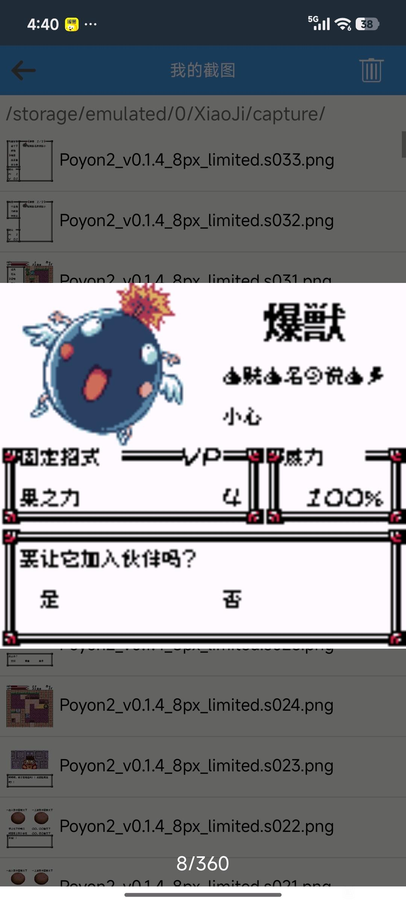

61楼 · 球总好学 · [原回帖](https://tieba.baidu.com/p/11092365551?pid=154062922078#154062922078)

> 8px 0.1.4，获得的召唤兽的名字显示错误或乱码，菜单-召唤。图2、图3画面右上方

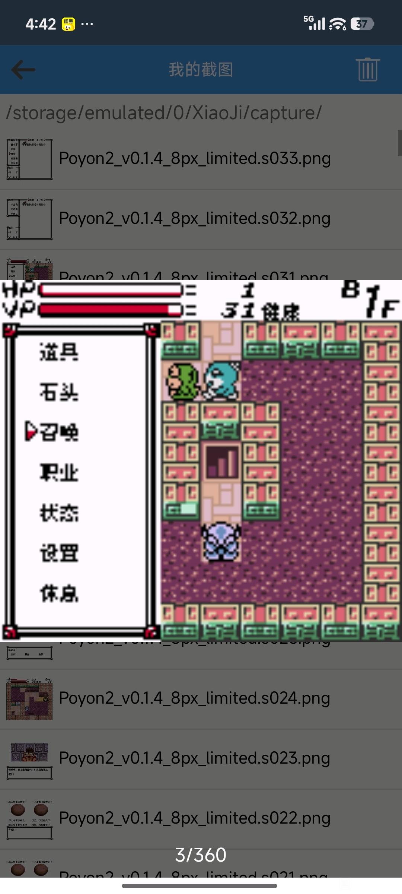

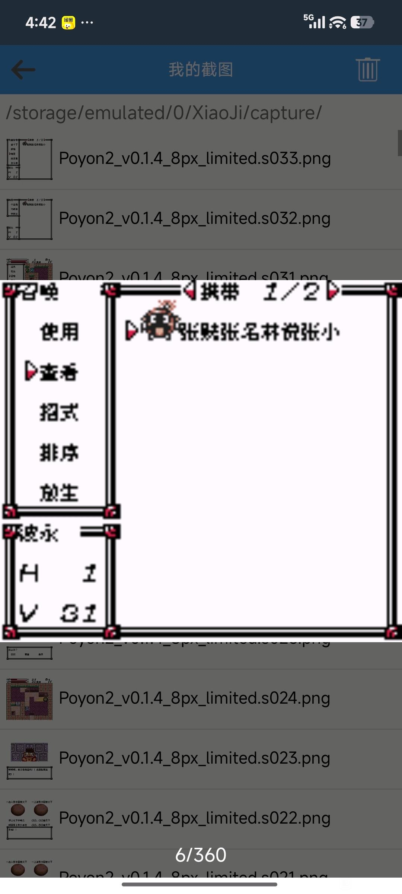

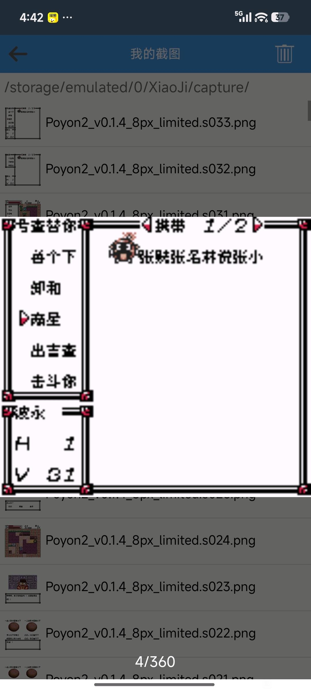

61楼 · 球总好学 · [原回帖](https://tieba.baidu.com/p/11092365551?pid=154062937675#154062937675)

> 8px 0.1.4，菜单-召唤-招式，点进去后的选项显示错误（图3左上三个选项），且这时返回上一级菜单，选项也显示错误（图4共六处错误）（图4左上五个选项加左上方框上方词条）

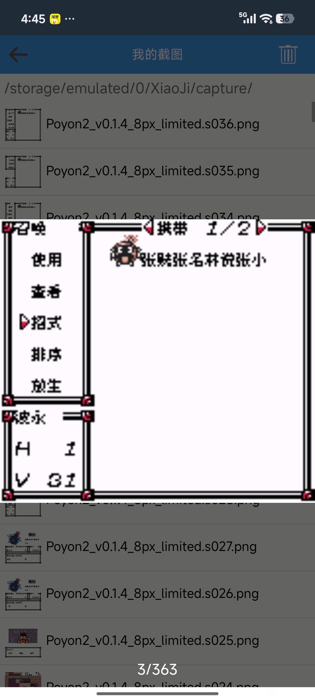

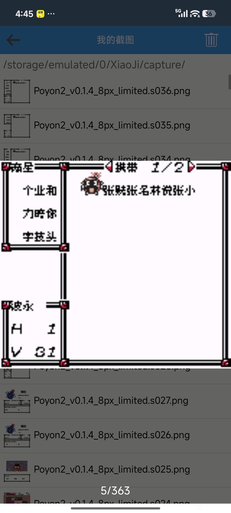

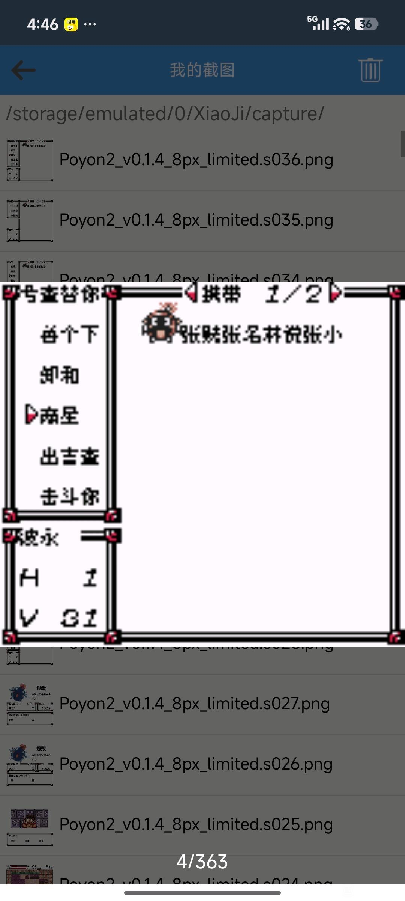

61楼 · 球总好学 · [原回帖](https://tieba.baidu.com/p/11092365551?pid=154063905648#154063905648)

> 8px 0.1.4，打第一个boss时，进入这个房间后会显示boss的全身图像，此画面下方为boss的名字等信息，残留日文，未翻译（图2）

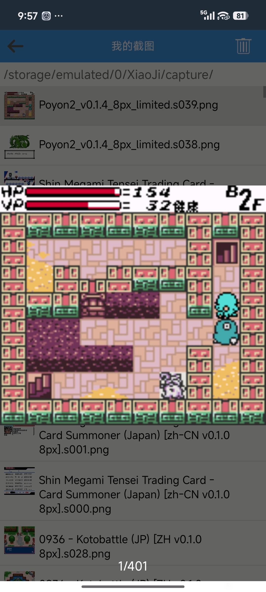

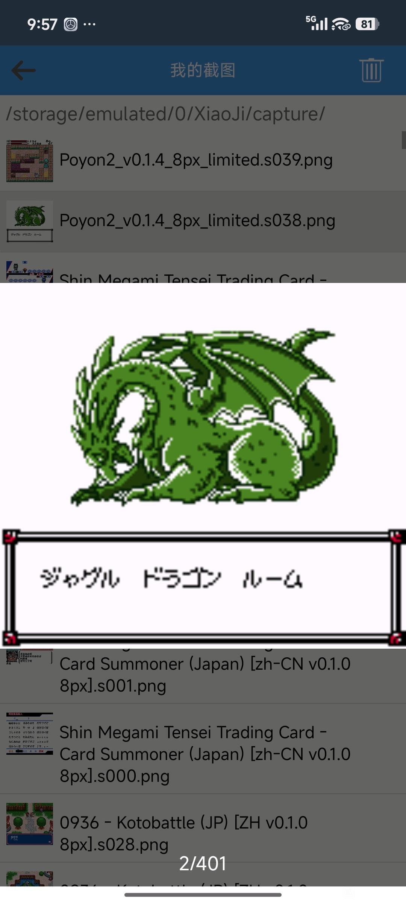

- 波永2 v0.1.4普通8px：包子比赛、召唤兽及招式菜单、Boss介绍反馈：已记录，开放待核。

[已公开登记答复](https://tieba.baidu.com/p/11092365551?pid=154064805250#154064805250)：@球总好学 v0.1.4普通8px的吃包子界面、召唤兽说明/名称/菜单异常和首个BOSS日文已一起记录，后续排查。

除另注已实收核验的译版 ROM 外，玩家实际输入/输出 SHA 未核定。图片与通关描述仅为玩家反馈；本次没有新增维护运行复现、修复或完整流程验收。

## 20261024-1615 公开反馈补充

公开 BUG 入口：[提交反馈](https://github.com/shiyi1133/youxi-hanhua-releases/issues/new/choose)。

61楼 · 球总好学 · [原回帖](https://tieba.baidu.com/p/11092365551?pid=154065524006#154065524006)

> 8px 0.1.4，仓库（初始村庄左上1房间，图1）中取出或者卖出道具的界面，物品名称显示错乱。比如文字显示位置错乱或溢出，图3、图5；再比如物品名称显示错误，图2、图4的“豆沙”应为“木盾”等

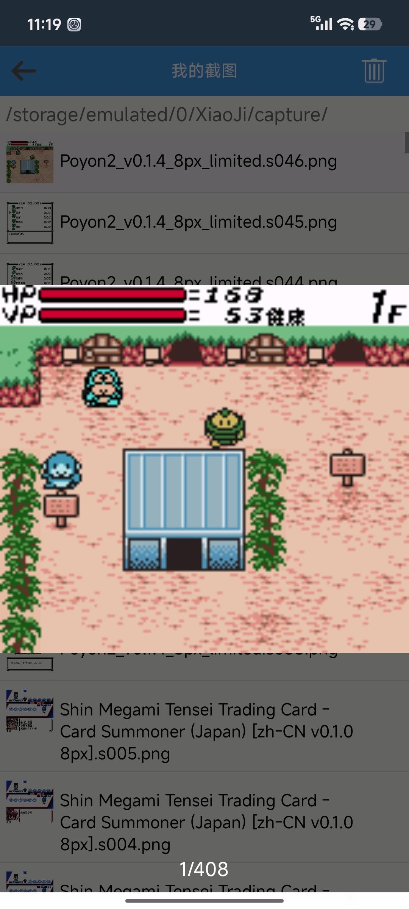

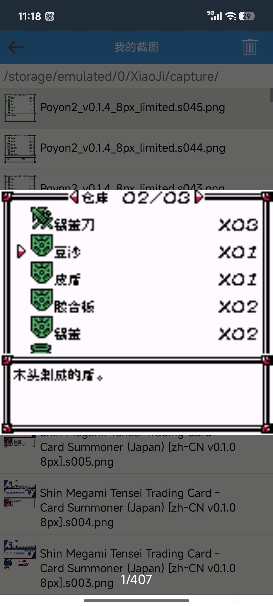

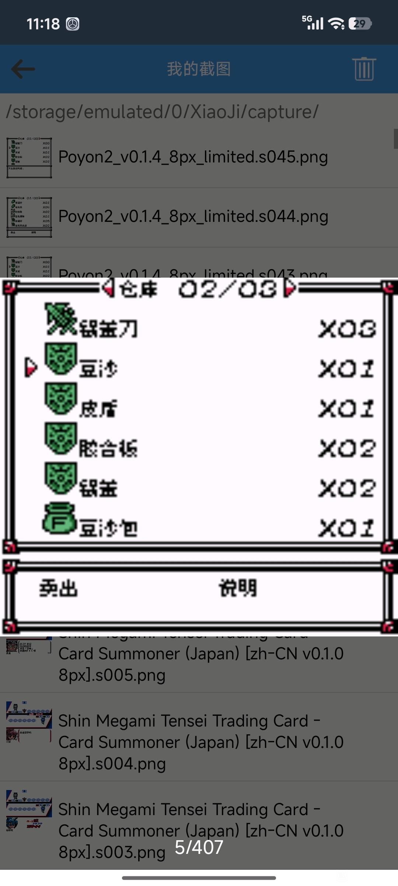

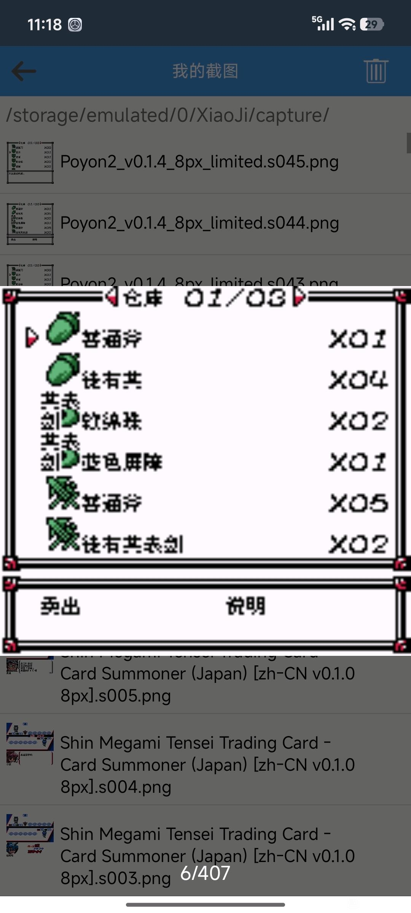

61楼 · 球总好学 · [原回帖](https://tieba.baidu.com/p/11092365551?pid=154065538172#154065538172)

> 8px 0.1.4，第二大关进入迷宫时，迷宫的标题页面下方的日文未翻译（图2）

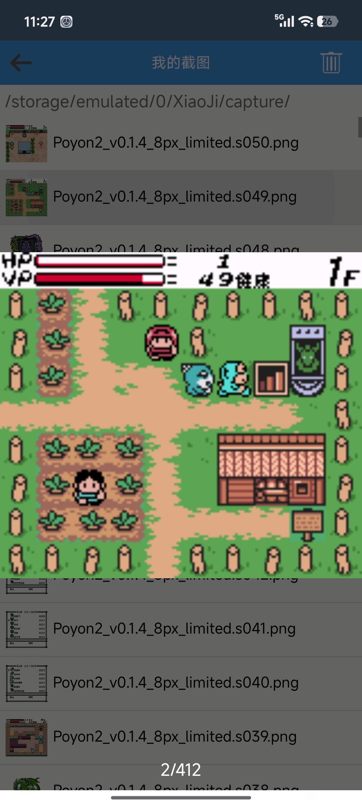

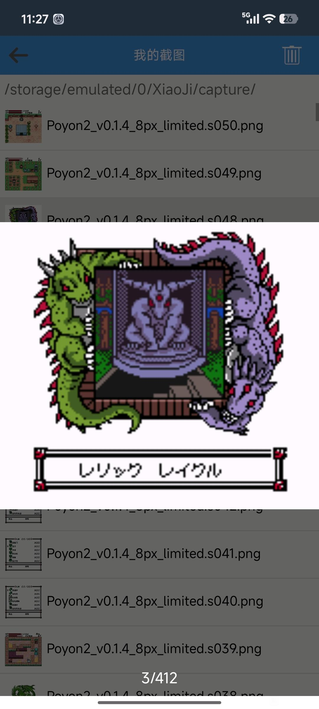

61楼 · 球总好学 · [原回帖](https://tieba.baidu.com/p/11092365551?pid=154065541954#154065541954)

> 8px 0.1.4，获得的召唤兽名字，全都显示错误

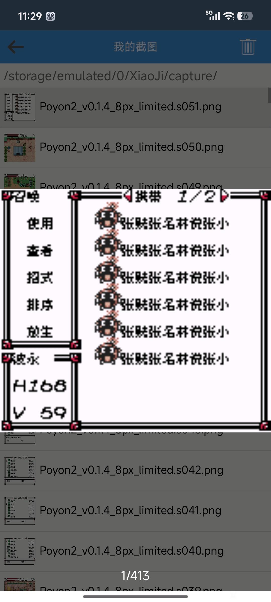

- 波永的迷宫2 v0.1.4普通8px：仓库名称错位、迷宫标题日文及召唤名续证据：已记录，开放待核。

[实际公开登记答复](https://tieba.baidu.com/p/11092365551?pid=154066489145#154066489145)：@球总好学 v0.1.4普通8px的仓库名称/位置异常、第二关迷宫标题日文和召唤名异常已一起记录，后续排查。

玩家实际ROM完整SHA未知仍保留未知。原图为玩家反馈，不等同维护复现、修复、全流程或实机验收。

## 20261025-0421 公开反馈补充

61楼 · 球总好学 · [原回帖](https://tieba.baidu.com/p/11092365551?pid=154066475055#154066475055)

> 8px 0.1.4，此武器（图1）的说明文本请确认。““贝兽”职业时全能力加5”。全职业列表如图2所示。推测为“怪兽”职业时全能力加5。请统一职业名，或者确认此武器正确效果。个人推荐初始职业名（图2中）左上第一个职业名称为“贝兽”，而非“怪兽”。请进一步确认

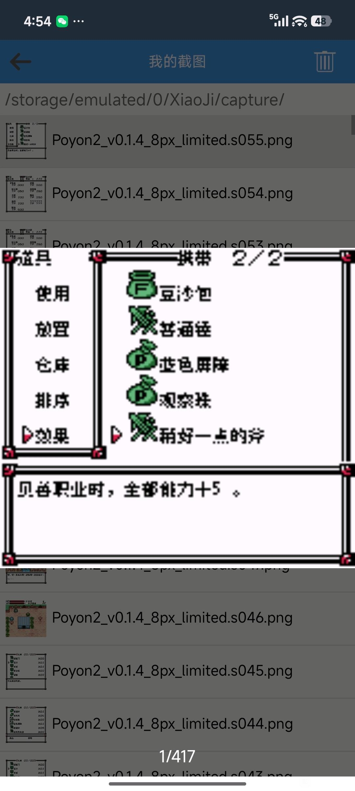

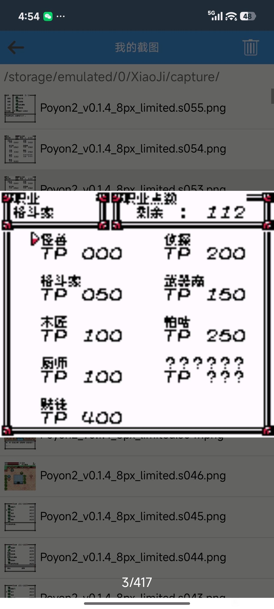

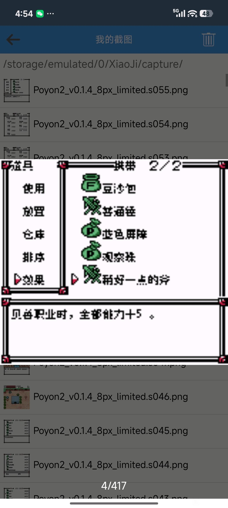

61楼 · 球总好学 · [原回帖](https://tieba.baidu.com/p/11092365551?pid=154066502119#154066502119)

> 8px 0.1.4，这句文本超出边框，边框右边横线缺失

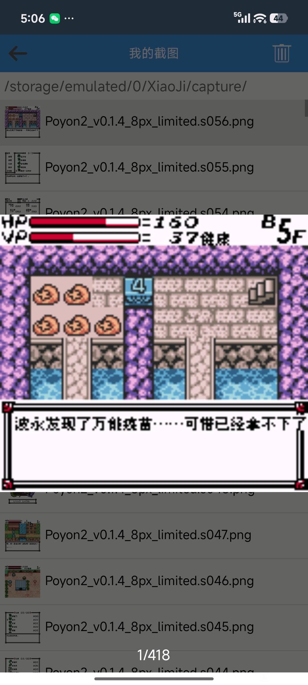

61楼 · 球总好学 · [原回帖](https://tieba.baidu.com/p/11092365551?pid=154066519512#154066519512)

> 8px 0.1.4，这句话文本超出边框，对话框右边横线缺失

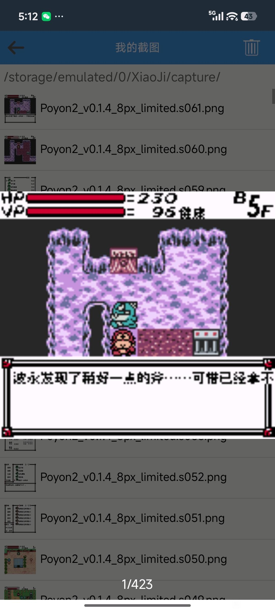

61楼 · 球总好学 · [原回帖](https://tieba.baidu.com/p/11092365551?pid=154066523183#154066523183)

> 8px 0.1.4，第二大关，这个门（图1）进去后跟这个npc（图2）对话的选项（图2左上角三个选项）日文残留，未翻译

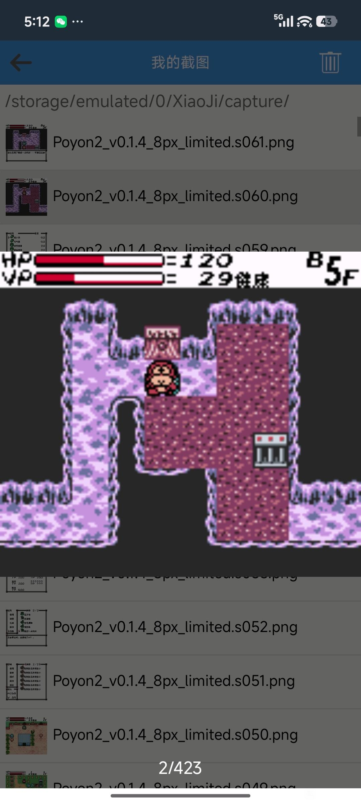

61楼 · 球总好学 · [原回帖](https://tieba.baidu.com/p/11092365551?pid=154066531004#154066531004)

> 8px 0.1.4，第二大关这个门（图1）进入后跟npc（图2）对话选择第一个选项后进入的界面（图3），界面中物品显示错误，比如第一个物品估计是回复药（图3上方第一个道具），但显示为“缩小饮”，估计是文本显示错位

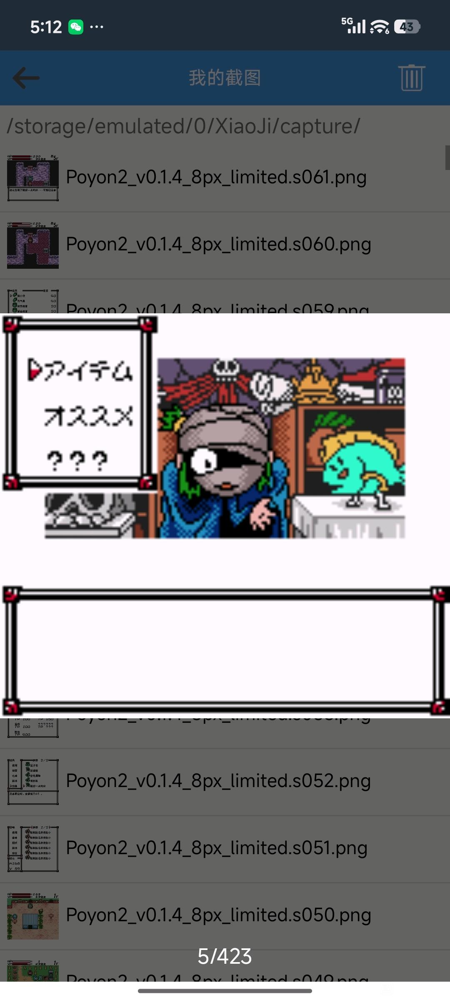

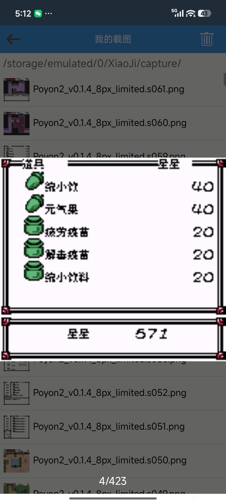

- 波永的迷宫2 v0.1.4普通8px：职业术语、NPC日文选项与商店物品名：已记录，开放待核。
- 波永的迷宫2 v0.1.4普通8px：两句拾取物品文本越右边框：已记录，开放待核。

[实际公开登记答复](https://tieba.baidu.com/p/11092365551?pid=154068344415#154068344415)：@球总好学 v0.1.4普通8px的职业用词、两句越框、NPC日文选项和商店物品名已一起记录，后续排查。

玩家完整ROM身份未知保留未知；静态图与玩家通关陈述不等于维护运行或全部场景验收。

## 20261025-1619 公开反馈更新

按当前实际未关闭问题去重：纯BUG 2 项，建议/覆盖等 0 项，分类待核 0 项。开放不代表正在修复。

83楼 · 球总好学 · [原回帖](https://tieba.baidu.com/p/11092365551?pid=154069220570#154069220570)

> 运动篇0.1.3，开始新游戏，确定好自己的出生年月和血型后的界面，画面下方有文本显示重叠或显示不全  

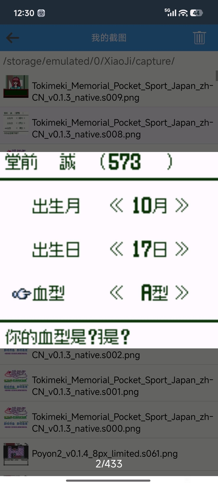

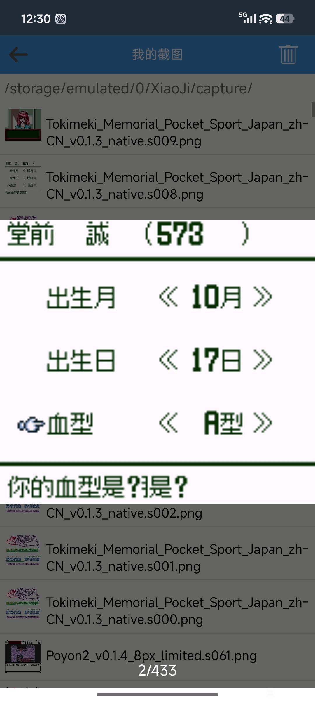

61楼 · 球总好学 · [原回帖](https://tieba.baidu.com/p/11092365551?pid=154069297278#154069297278)

> 8px 0.1.4，第二个迷宫前的村庄，在图1房间，进入后，转职成格斗家职业劈瓦，在劈瓦过程中的界面，显示不明中文，如图2、图3，如秒数后面的“查天下”，图2画面中间位置的“伊上仓……”“旺固……”等   

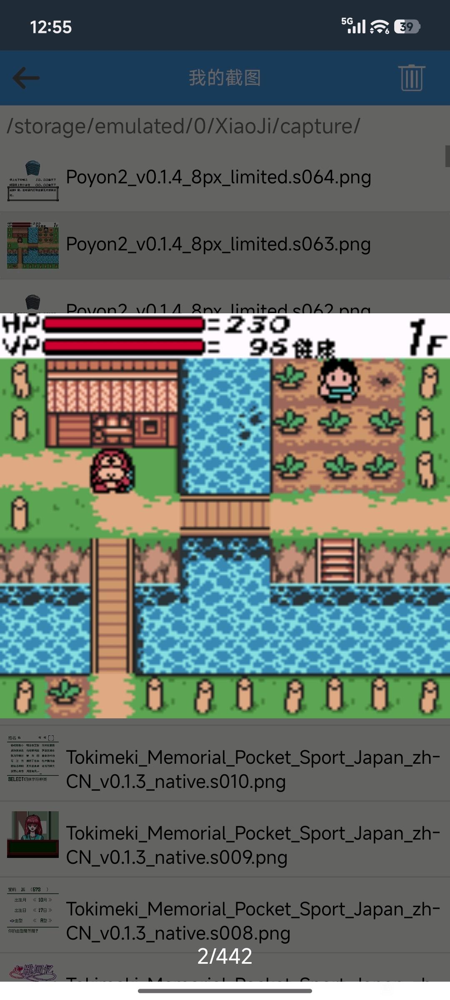

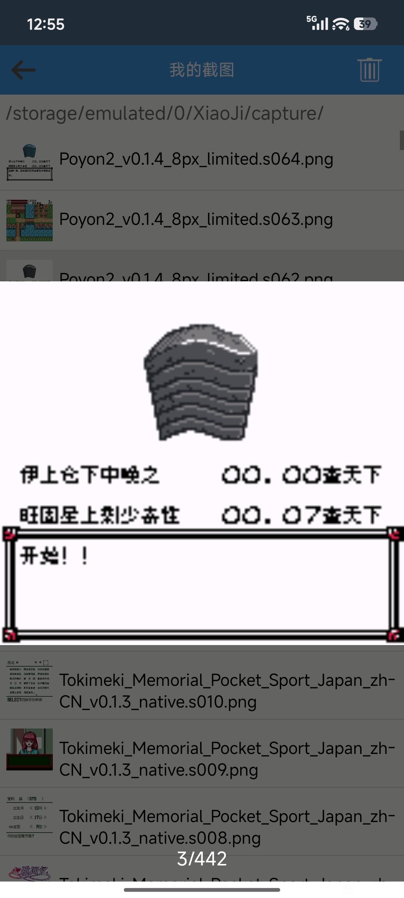

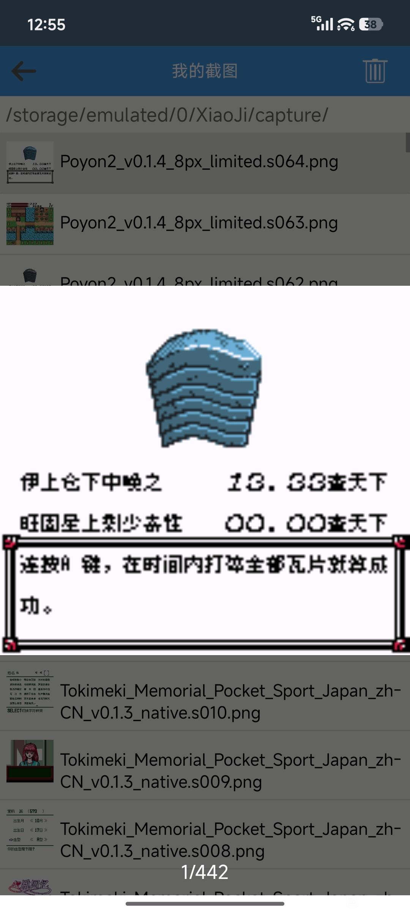

61楼 · 球总好学 · [原回帖](https://tieba.baidu.com/p/11092365551?pid=154069350075#154069350075)

> 8px 0.1.4，文本框内文本超出方框 

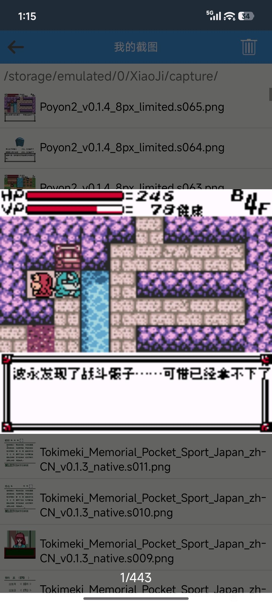

- 波永2：格斗家劈瓦界面异常字：登记时保持开放；当前状态以本页问题元数据为准。
- 波永2与心跳回忆运动篇：文本越框及出生确认重叠：登记时保持开放；当前状态以本页问题元数据为准。
- v0.1.8：此次修订格斗家劈瓦小游戏的最高纪录、当前时间和秒单位显示；提供方在原生诊断入口覆盖六关、慢速失败、重试及纪录保存。 小游戏六关使用诊断入口，未自然推进第二村入口、职业/奖励事件；Boss全身图、包子比赛及其它原反馈未据此称已修。 Git发布已完整回读；网盘新版同步待核验，问题保持开放。

[实际公开答复](https://tieba.baidu.com/p/11092365551?pid=154070364931#154070364931)：劈瓦界面的异常字和文本越框都已记录，图片已留存，后续继续排查。

玩家实际完整ROM字节未知时仍保留未知；自然流程、原生消费者诊断及静态证据分别记录，不外推实机或全流程。

## 20261026-0419 玩家反馈增量

- 波永2：仓库、召唤招式与学招提示显示（保持开放）：普通8px v0.1.4新增仓库取出页图标上乱码、第二召唤兽固定招式词条错误，以及学敌技提示日文和已学招式名乱码。分别记录消费者，共同根因未知；当前v0.1.8的劈瓦修订不代表这些旧版报告已修，新版网盘仍待同步。
- 波永2：普通8px旧版文本越框（保持开放）：玩家报告普通8px v0.1.4文本越框并附1图，补入集中排版记录；保持开放。不能当作当前v0.1.8回归，仓库或技能乱码仍与越框分开排查。

本次仅登记玩家证据和限定复测，未运行ROM、未新增修复；当前发布参考不代表玩家实际ROM字节。

[球总好学 · 61楼 · 154069982105](https://tieba.baidu.com/p/11092365551?pid=154069982105#154069982105)

> 8px 0.1.4，初始村庄上面左1的房间（图1）内，仓库-取出，之后的界面，物品图标上面显示乱码（图4、图5）     

[球总好学 · 61楼 · 154069998453](https://tieba.baidu.com/p/11092365551?pid=154069998453#154069998453)

> 8px 0.1.4，第二只召唤兽的固定招式名显示错误（图2中间位置，图3上方），“御暗果……”，中文词条错误  

[球总好学 · 61楼 · 154070170298](https://tieba.baidu.com/p/11092365551?pid=154070170298#154070170298)

> 8px 0.1.4，在战斗中学会敌人的此招式时，有日文残留（图1），且在菜单-召唤-招式中，装备已学会的敌人技能的界面时，招式名都为乱码（图2）  

[球总好学 · 61楼 · 154070171453](https://tieba.baidu.com/p/11092365551?pid=154070171453#154070171453)

> 8px 0.1.4，文本超出文本框 

[原楼登记答复](https://tieba.baidu.com/p/11092365551?pid=154071813906#154071813906)：仓库乱码、召唤招式词条、学招提示和文本越框这几处都收到，已合并补进原有记录，继续排查。

## 20261026-1624 玩家反馈增量

- 波永2：临时文件的召唤、仓库与招式显示反馈（保持开放）：玩家补充召唤状态小字与原生大字重叠、仓库取出图标异常、固定及替换招式名异常。所用pending_native_20261025_文件名对应历史v0.1.7上传计划，但临时文件和玩家实际字节均未核验，命名ID不是ROM哈希，不能称已验证v0.1.7或当前v0.1.8。保留原生大汉字仅为玩家建议，未实施。
- 波永2：临时文件的文本越框（保持开放）：玩家补充文本超框及所用临时文件截图，合入集中排版反馈。文件名只对应历史v0.1.7上传计划，实际字节未知；不能标为v0.1.8回归，亦不把其它图块和招式问题预先认作同一根因。

本次仅登记玩家证据和限定复测，未运行ROM、未新增修复；当前发布参考不代表玩家实际ROM字节。

[球总好学 · 61楼 · 154072000224](https://tieba.baidu.com/p/11092365551?pid=154072000224#154072000224)

> 20261025版，菜单-召唤-查看，选项进入后的召唤兽状态页面，画面右上角显示出错，翻译后的中文小字与原本的日文汉字大字重叠（图1、图2右上角），此处建议只保留原本的日文汉字大字    

[球总好学 · 61楼 · 154072094051](https://tieba.baidu.com/p/11092365551?pid=154072094051#154072094051)

> 20261025版，文本超过文本框 

[球总好学 · 61楼 · 154072096626](https://tieba.baidu.com/p/11092365551?pid=154072096626#154072096626)

> 20261025版，仓库-取出，道具图标乱码    

[球总好学 · 61楼 · 154072100439](https://tieba.baidu.com/p/11092365551?pid=154072100439#154072100439)

> 20261025版，召唤兽固定招式和替换招式，招式名异常，图1-3左侧，图4中间两行    

[球总好学 · 61楼 · 154072608407](https://tieba.baidu.com/p/11092365551?pid=154072608407#154072608407)

> 20261025版是图中上面那个pending_native_20261025_的版本 

[原楼登记答复](https://tieba.baidu.com/p/11092365551?pid=154075362879#154075362879)：这份pending_native_20261025_临时文件的说明已收到，召唤状态叠字、仓库和招式异常、文本越框都已补充记录，继续排查。

## 20261027-0422 玩家反馈增量

- 波永2：招式同名与转职预览残字补充（保持开放）：同一玩家新四图报告不同招式均显示“连发拳”，转职待确定页右上混入“告别”“连发”等片段；玩家推测的正确招式对应仍待核。20261025临时文件名只关联历史v0.1.7上传计划，随机叶名不是ROM哈希，临时对象及玩家实际字节未回读；不能称已核v0.1.7或当前v0.1.8复现，不预判与其它消费者同根因。

本次仅登记玩家证据和限定复测，未运行ROM、未新增修复；当前发布参考不代表玩家实际ROM字节。

[球总好学 · 61楼 · 154074333182](https://tieba.baidu.com/p/11092365551?pid=154074333182#154074333182)

> 20261025版，两个不同的招式，显示一样的招式名称（图1、图2，连发拳）。且在转职待确定页面（图3），右上角“告别”“连发”应该是显示错误，显示成了其他选项的部分文字，图3右上角两个招式推测应该为图4右侧的三个招式中的两个。请排查问题    

## 20261028-0426 玩家反馈增量

- 波永的迷宫2：拾取提示越框补充（保持开放）：同一反馈组的两条来源、三张照片分别保留拾取提示靠右越框或裁切的可见线索，归既有排版集中范围。玩家字面日期标签不能确认ROM版本、字号或完整SHA，当前v0.1.8普通8px仅作发布参考；未运行、复现或新增修复。
- 波永的迷宫2：学敌技日文和手动石头菜单补充（保持开放）：学敌技两张照片保留不同技能名称的日文与中文提示并存；手动石头菜单六图保留标签、片段重叠或位置变化的静态线索。未确认随机数据损坏、存档受损或共同根因。保留玩家原写20261025与202610125，不将日期或截图文件名替代实际ROM身份，也不把当前v0.1.8当玩家已测版本。

本次只登记公开证据，未运行ROM或新增修复；当前发布参考不能替代玩家实际ROM字节。

[球总好学 · 61楼 · 154077412797](https://tieba.baidu.com/p/11092365551?pid=154077412797#154077412797)

> 20261025版，文本超出文本框 

公开原图1：SHA256 `9b9c24fab146e8a7ae54e33f7295b0ae201371099727c31a3182bda2061885f1`，199072字节。原图含可见设备相册路径，公开镜像不重托管或裁改图片；原帖定位与原字节哈希保留。

[球总好学 · 61楼 · 154077414545](https://tieba.baidu.com/p/11092365551?pid=154077414545#154077414545)

> 20261025版，在战斗中学会敌人技能时，有日文残留 

公开原图1：SHA256 `62dd1be77d1b85f0baef66ea515af3e2e45fb9153df637988ee6c7e19881cc1b`，180658字节。原图含可见设备相册路径，公开镜像不重托管或裁改图片；原帖定位与原字节哈希保留。

[球总好学 · 61楼 · 154077978874](https://tieba.baidu.com/p/11092365551?pid=154077978874#154077978874)

> 20261025版，菜单-石头界面，使用石头时会有文字显示错乱和乱码的情况，在菜单-设置-石头-手动使用时      

公开原图1：SHA256 `b5557429863bbe091d5a3e032f971ba1577e9de373cd2fdd5dcfef7c8b444831`，202346字节。原图含可见设备相册路径，公开镜像不重托管或裁改图片；原帖定位与原字节哈希保留。

公开原图2：SHA256 `9b10e1a76778efb64996a3dd9932c117ab9d48e3ed276d76cdb8430235c8a045`，156492字节。原图含可见设备相册路径，公开镜像不重托管或裁改图片；原帖定位与原字节哈希保留。

公开原图3：SHA256 `7b5c2ba77f1ff2d7821a1630d0f6bacedae85796853b9c3f55845d99aa21d6b9`，156655字节。原图含可见设备相册路径，公开镜像不重托管或裁改图片；原帖定位与原字节哈希保留。

公开原图4：SHA256 `5cd5888d94f66fa3ca21fb0fb29c467393c336cf8809f937c0fd7e1c655cd2cd`，149753字节。原图含可见设备相册路径，公开镜像不重托管或裁改图片；原帖定位与原字节哈希保留。

公开原图5：SHA256 `abb6787ac19f1b709aeeb55a29cb2516e6ae77567824f3f679dc53c1980801d5`，151002字节。原图含可见设备相册路径，公开镜像不重托管或裁改图片；原帖定位与原字节哈希保留。

公开原图6：SHA256 `f09028aa986a788fa5d41d2d0c93a4e4f3be23d39fe47f74f47cf50273465ab0`，157347字节。原图含可见设备相册路径，公开镜像不重托管或裁改图片；原帖定位与原字节哈希保留。

[球总好学 · 61楼 · 154078059214](https://tieba.baidu.com/p/11092365551?pid=154078059214#154078059214)

> 20261025版，文本超出文本框  

公开原图1：SHA256 `e162af33cfcde4393fab5d259f93727366167f0dd777b0e6c44d96b5c5653c7c`，201334字节。原图含可见设备相册路径，公开镜像不重托管或裁改图片；原帖定位与原字节哈希保留。

公开原图2：SHA256 `0f5fcad0234800198cc993006224ec02693f44b9ccb45171d28834f1686e3029`，201747字节。原图含可见设备相册路径，公开镜像不重托管或裁改图片；原帖定位与原字节哈希保留。

[球总好学 · 61楼 · 154078060981](https://tieba.baidu.com/p/11092365551?pid=154078060981#154078060981)

> 202610125版，学会敌人招式时日文残留 

公开原图1：SHA256 `18fd4537632fecb25c4d9b465ca36a5a7227adfde818a5697594730f178b5497`，184467字节。原图含可见设备相册路径，公开镜像不重托管或裁改图片；原帖定位与原字节哈希保留。

[原楼登记答复](https://tieba.baidu.com/p/11092365551?pid=154079011259#154079011259)：这五条越框、学招日文和石头手动使用显示异常都已补进原有记录，后续排查。
