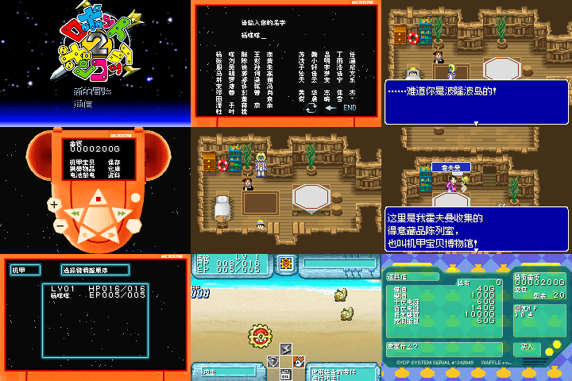

# 机甲宝贝2 十字版

原输入：Robot Ponkottsu 2 - Cross Version (Japan)

原输入完整SHA256：`f64b71f18458de35b24af085319b4fb0a7345e2415ba2631ec499b6e92a4f57e`。此处“原输入”保留改版、既有汉化或地区修订身份，不一律称干净零售ROM。

| 字号 | 当前版本 | 音频 | 输出完整SHA256 |
| --- | --- | --- | --- |
| native12-8 | v0.1.4 | unchanged | `ebb8f4b8ddbab0ebfd7e4d11f2a0243e24f937df870776c632dd43dd37a18104` |

## 源码与补丁

- native12-8／v0.1.4／unchanged：源码包（完整性未独立确认）：[下载](https://github.com/shiyi1133/youxi-hanhua-releases/releases/download/source-migration-20261022-02b/robot-ponkottsu-2-cross-current-source-9d2d032e1cc3-public-r01.zip)（ZIP SHA256 `eb0844136b4df7131d2b4d3a315fcbd8490ac41d4810869dbf57f5db43968d87`）；补丁：[下载](https://github.com/shiyi1133/youxi-hanhua-releases/releases/download/patch-migration-20261022/robot-ponkottsu-2-cross-current-patches.zip)（ZIP SHA256 `21f282862e910dac38268da5be1191275418e63a32a7b5c4bdbabcf20ee51c04`）。
  该包已核对对应版本与字节安全；完整修改源码覆盖范围未独立确认。

补丁须直接应用于完整SHA一致的实际原输入；普通字、大字和音乐变体分别核对。公开源码归档不表示本轮重新构建或通过新的运行验收。原作、字体、已有翻译及工具依赖的权利与许可，依各包对应许可保留。

## 范围与验证边界

- native12-8／v0.1.4：普通原生Fusion Pixel12px对白／密集UI8px，单普通版本，无10px大字版。
  仅恢复两组原版标题艺术资源和指针，不在标题叠署名；正文普通原生12px、密集UI8px、100字键盘及存档布局沿用v0.1.3，开始提示与菜单中文保留。
  完整通关
  实机
  真实联机
  深层机器人自然改名路线
  全部最长变量
  密码自然UI端到端
  v0.1.4未逐项重测62拉丁键/100键盘槽/陈胖胖及杨－♪咩各自独立冷读

本次资料搬运未新增模拟器、实机或全通验收；未记录或未测试的范围不写成通过。问题单开放只表示尚未关闭，已关闭也不单独证明全部场景都修复。

[公开反馈及问题状态](feedback.md) · [报告BUG](https://github.com/shiyi1133/youxi-hanhua-releases/issues/new?template=bug_report.md)

## 对应版本截图

机甲宝贝2 十字版 v0.1.4 native12-8；普通原生Fusion Pixel12px对白／密集UI8px，单普通版本，无10px大字版；最终ROM真实九宫格（自然/诊断/续行边界按本说明）

图像SHA256：`36282c66222b2594175db047cdccea2ccdca1f8e2d94039adc8b7ab41f17c39d`；绑定ROM SHA256：`ebb8f4b8ddbab0ebfd7e4d11f2a0243e24f937df870776c632dd43dd37a18104`。

