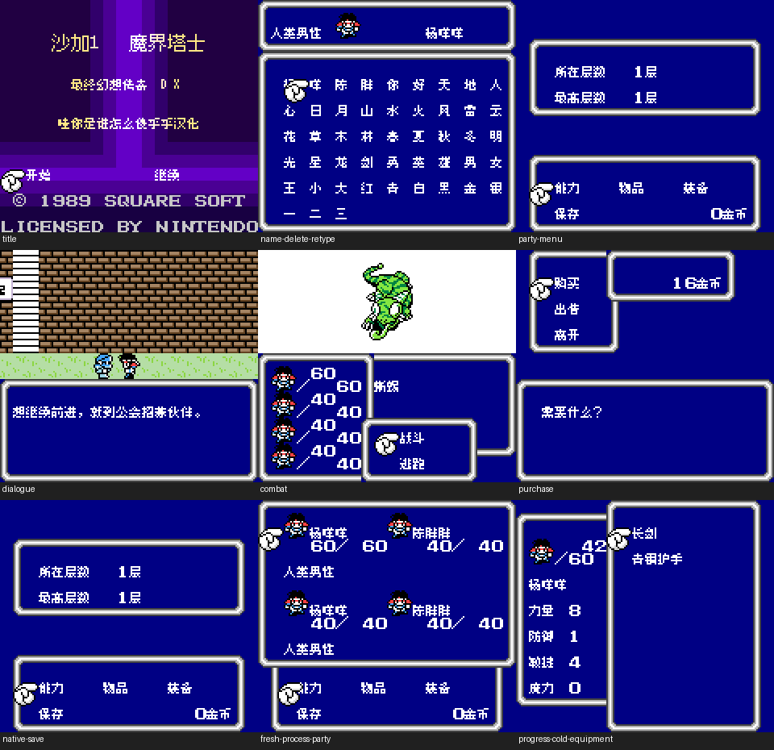
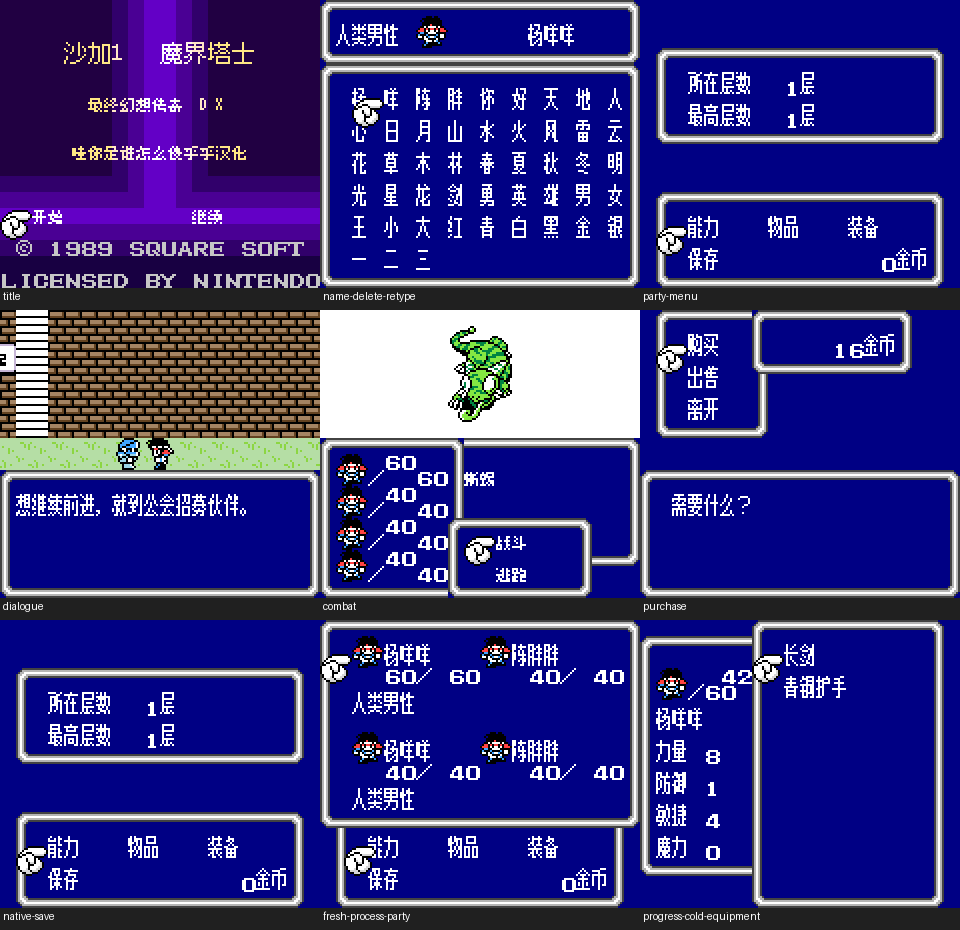

# 沙加1 DX彩色改版

原输入：Final Fantasy Legend DX (user-provided English color modified edition)

原输入完整SHA256：`e0b1d738905d014c74ea712d1250d97aa59c7fddea471da3cf4dff0aca857b49`。此处“原输入”保留改版、既有汉化或地区修订身份，不一律称干净零售ROM。

| 字号 | 当前版本 | 音频 | 输出完整SHA256 |
| --- | --- | --- | --- |
| 8px | v0.1.1 | music | `27f06e524c02bcd7fd97fa5823868c619055435a152f78ca782fd0cbe8e942f6` |
| 8px | v0.1.1 | no-music | `76115e8f7df94ce218c680dd2b28251f8a05953d4af41e02ad0d2de405f184a4` |
| 8x12 | v0.1.1 | music | `8cc77a324c55c8dc007a224518a43491e4a81c713eb63e4e584f41aecc7b4f04` |
| 8x12 | v0.1.1 | no-music | `04093951bdfcb251caa93da147bbe1a51c08962b67addc8a0499256b986acdaf` |

## 源码与补丁

- 8px／v0.1.1／music：源码包（完整性未独立确认）：[下载](https://github.com/shiyi1133/youxi-hanhua-releases/releases/download/source-migration-20261022-02b/saga-1-dx-current-source-572f3f696036-public-r01.zip)（ZIP SHA256 `c65fbfa880584a7c54c449bd87a7b532cdf04a3e83eabfd951416a88dc849960`）；补丁：[下载](https://github.com/shiyi1133/youxi-hanhua-releases/releases/download/patch-migration-20261022/saga-1-dx-current-patches.zip)（ZIP SHA256 `fd261c3fd54ae75502c5f430731670703f181267d58cc748217be2586a290935`）。
  该包已核对对应版本与字节安全；完整修改源码覆盖范围未独立确认。
- 8px／v0.1.1／no-music：源码包（完整性未独立确认）：[下载](https://github.com/shiyi1133/youxi-hanhua-releases/releases/download/source-migration-20261022-02b/saga-1-dx-current-source-572f3f696036-public-r01.zip)（ZIP SHA256 `c65fbfa880584a7c54c449bd87a7b532cdf04a3e83eabfd951416a88dc849960`）；补丁：[下载](https://github.com/shiyi1133/youxi-hanhua-releases/releases/download/patch-migration-20261022/saga-1-dx-current-patches.zip)（ZIP SHA256 `fd261c3fd54ae75502c5f430731670703f181267d58cc748217be2586a290935`）。
  该包已核对对应版本与字节安全；完整修改源码覆盖范围未独立确认。
- 8x12／v0.1.1／music：源码包（完整性未独立确认）：[下载](https://github.com/shiyi1133/youxi-hanhua-releases/releases/download/source-migration-20261022-02b/saga-1-dx-current-source-572f3f696036-public-r01.zip)（ZIP SHA256 `c65fbfa880584a7c54c449bd87a7b532cdf04a3e83eabfd951416a88dc849960`）；补丁：[下载](https://github.com/shiyi1133/youxi-hanhua-releases/releases/download/patch-migration-20261022/saga-1-dx-current-patches.zip)（ZIP SHA256 `fd261c3fd54ae75502c5f430731670703f181267d58cc748217be2586a290935`）。
  该包已核对对应版本与字节安全；完整修改源码覆盖范围未独立确认。
- 8x12／v0.1.1／no-music：源码包（完整性未独立确认）：[下载](https://github.com/shiyi1133/youxi-hanhua-releases/releases/download/source-migration-20261022-02b/saga-1-dx-current-source-572f3f696036-public-r01.zip)（ZIP SHA256 `c65fbfa880584a7c54c449bd87a7b532cdf04a3e83eabfd951416a88dc849960`）；补丁：[下载](https://github.com/shiyi1133/youxi-hanhua-releases/releases/download/patch-migration-20261022/saga-1-dx-current-patches.zip)（ZIP SHA256 `fd261c3fd54ae75502c5f430731670703f181267d58cc748217be2586a290935`）。
  该包已核对对应版本与字节安全；完整修改源码覆盖范围未独立确认。

补丁须直接应用于完整SHA一致的实际原输入；普通字、大字和音乐变体分别核对。公开源码归档不表示本轮重新构建或通过新的运行验收。原作、字体、已有翻译及工具依赖的权利与许可，依各包对应许可保留。

## 范围与验证边界

- 8px／v0.1.1：普通Fusion Pixel8px；大字正常对白Muzai真8×12，部分有足够空白菜单12px，密集/开场单行/英文键盘8px；CGB专用。。
  普通Fusion Pixel8px；大字正常对白Muzai真8×12，部分有足够空白菜单12px，密集/开场单行/英文键盘8px；CGB专用。
  未全流程/深层结局/所有敌技能商店/最长变量、死亡复活完整循环、联机/实机或跨旧汉化存档互换。
  大字仍可能拖慢/残留；音频指令减少不等于整体91%提速；诊断入口未捕获正文不称视觉通过。
- 8px／v0.1.1：普通Fusion Pixel8px；大字正常对白Muzai真8×12，部分有足够空白菜单12px，密集/开场单行/英文键盘8px；CGB专用。。
  普通Fusion Pixel8px；大字正常对白Muzai真8×12，部分有足够空白菜单12px，密集/开场单行/英文键盘8px；CGB专用。
  未全流程/深层结局/所有敌技能商店/最长变量、死亡复活完整循环、联机/实机或跨旧汉化存档互换。
  大字仍可能拖慢/残留；音频指令减少不等于整体91%提速；诊断入口未捕获正文不称视觉通过。
- 8x12／v0.1.1：普通Fusion Pixel8px；大字正常对白Muzai真8×12，部分有足够空白菜单12px，密集/开场单行/英文键盘8px；CGB专用。。
  普通Fusion Pixel8px；大字正常对白Muzai真8×12，部分有足够空白菜单12px，密集/开场单行/英文键盘8px；CGB专用。
  未全流程/深层结局/所有敌技能商店/最长变量、死亡复活完整循环、联机/实机或跨旧汉化存档互换。
  大字仍可能拖慢/残留；音频指令减少不等于整体91%提速；诊断入口未捕获正文不称视觉通过。
- 8x12／v0.1.1：普通Fusion Pixel8px；大字正常对白Muzai真8×12，部分有足够空白菜单12px，密集/开场单行/英文键盘8px；CGB专用。。
  普通Fusion Pixel8px；大字正常对白Muzai真8×12，部分有足够空白菜单12px，密集/开场单行/英文键盘8px；CGB专用。
  未全流程/深层结局/所有敌技能商店/最长变量、死亡复活完整循环、联机/实机或跨旧汉化存档互换。
  大字仍可能拖慢/残留；音频指令减少不等于整体91%提速；诊断入口未捕获正文不称视觉通过。

本次资料搬运未新增模拟器、实机或全通验收；未记录或未测试的范围不写成通过。问题单开放只表示尚未关闭，已关闭也不单独证明全部场景都修复。

[公开反馈及问题状态](feedback.md) · [报告BUG](https://github.com/shiyi1133/youxi-hanhua-releases/issues/new?template=bug_report.md)

## 对应版本截图

v0.1.1 普通Fusion Pixel8px；大字正常对白Muzai真8×12，部分有足够空白菜单12px，密集/开场单行/英文键盘8px；CGB专用。 音频：music；各精确目标自然按键/进度电池冷读9格；音效请求和深层消费者诊断不混作自然通关。

图像SHA256：`c0c769f338edd1b344c47c04f86ede9d4e55770cd8ff5c4c97942a086f86f98a`；绑定ROM SHA256：`27f06e524c02bcd7fd97fa5823868c619055435a152f78ca782fd0cbe8e942f6`。

v0.1.1 普通Fusion Pixel8px；大字正常对白Muzai真8×12，部分有足够空白菜单12px，密集/开场单行/英文键盘8px；CGB专用。 音频：no-music；各精确目标自然按键/进度电池冷读9格；音效请求和深层消费者诊断不混作自然通关。

图像SHA256：`c0c769f338edd1b344c47c04f86ede9d4e55770cd8ff5c4c97942a086f86f98a`；绑定ROM SHA256：`76115e8f7df94ce218c680dd2b28251f8a05953d4af41e02ad0d2de405f184a4`。

v0.1.1 普通Fusion Pixel8px；大字正常对白Muzai真8×12，部分有足够空白菜单12px，密集/开场单行/英文键盘8px；CGB专用。 音频：music；各精确目标自然按键/进度电池冷读9格；音效请求和深层消费者诊断不混作自然通关。

图像SHA256：`7e9510c269d27e1214300fd2e61265d4d957339f698888dbacff80a1e863bb55`；绑定ROM SHA256：`8cc77a324c55c8dc007a224518a43491e4a81c713eb63e4e584f41aecc7b4f04`。

v0.1.1 普通Fusion Pixel8px；大字正常对白Muzai真8×12，部分有足够空白菜单12px，密集/开场单行/英文键盘8px；CGB专用。 音频：no-music；各精确目标自然按键/进度电池冷读9格；音效请求和深层消费者诊断不混作自然通关。

图像SHA256：`adc1b18fcc5cc757fca34876b1999849cc35d3bfb9d6005a877b705795758405`；绑定ROM SHA256：`04093951bdfcb251caa93da147bbe1a51c08962b67addc8a0499256b986acdaf`。

