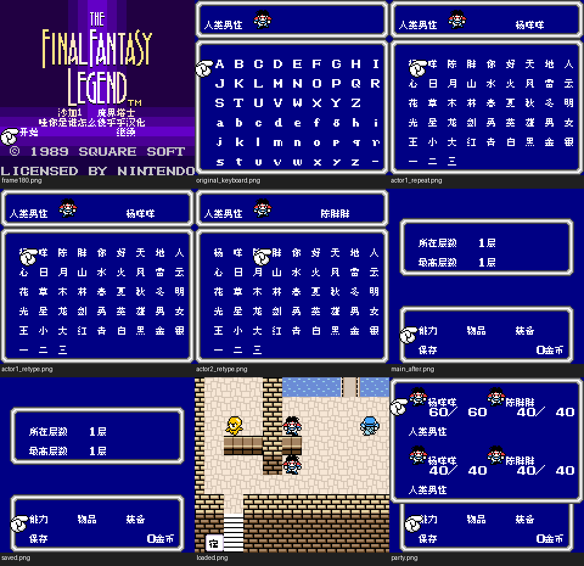
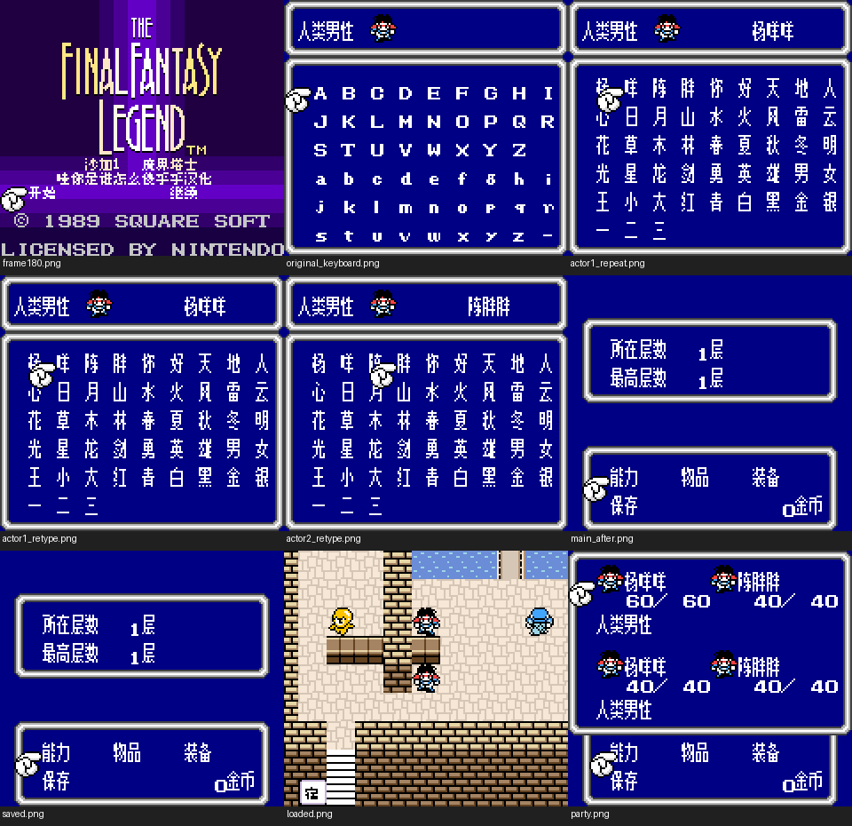

# 沙加1 DX彩色改版（限定测试版）

[公开反馈](feedback.md) · [报告BUG](https://github.com/shiyi1133/youxi-hanhua-releases/issues/new?template=bug_report.md)

原游戏／实际基底：Final Fantasy Legend DX (user-provided English color modified edition)

原输入完整SHA-256：`e0b1d738905d014c74ea712d1250d97aa59c7fddea471da3cf4dff0aca857b49`（262144字节）。原输入保留其地区、修订、改版或已有汉化基底身份。

## 8px v0.1.2 music

字号范围：普通原生8px；标题中文为独立静态字图，不等于正文字号变化。

[源码包（完整性未独立确认）](https://github.com/shiyi1133/youxi-hanhua-releases/releases/download/localization-update-20261022-six-games/saga-1-dx-logo-restored-four-variants-source-public-r01.zip) · [补丁包](https://github.com/shiyi1133/youxi-hanhua-releases/releases/download/localization-update-20261022-six-games/saga-1-dx-v0.1.2-patches-public.zip)

目标完整SHA-256：`876d03661385dd0d3992dbfc0855c915181ebd1a259b62fef13719e09f4657fc`（524288字节）。

图证：v0.1.2 普通原生8px；标题中文为独立静态字图，不等于正文字号变化。 音频：music；提供方最终ROM真实CGB九宫格，维护侧新运行未执行。

## 8px v0.1.2 no-music

字号范围：普通原生8px；标题中文为独立静态字图，不等于正文字号变化。

[源码包（完整性未独立确认）](https://github.com/shiyi1133/youxi-hanhua-releases/releases/download/localization-update-20261022-six-games/saga-1-dx-logo-restored-four-variants-source-public-r01.zip) · [补丁包](https://github.com/shiyi1133/youxi-hanhua-releases/releases/download/localization-update-20261022-six-games/saga-1-dx-v0.1.2-patches-public.zip)

目标完整SHA-256：`666e80b228ba63b4d947993f8340c731d556984e2dfa53b2579eaa07cd03c5fd`（524288字节）。

图证：v0.1.2 普通原生8px；标题中文为独立静态字图，不等于正文字号变化。 音频：no-music；提供方最终ROM真实CGB九宫格，维护侧新运行未执行。

## 8x12 v0.1.2 music

字号范围：普通对白原生8×12；部分留白菜单使用大字，密集UI/开场单行/英文命名键盘仍8px。

[源码包（完整性未独立确认）](https://github.com/shiyi1133/youxi-hanhua-releases/releases/download/localization-update-20261022-six-games/saga-1-dx-logo-restored-four-variants-source-public-r01.zip) · [补丁包](https://github.com/shiyi1133/youxi-hanhua-releases/releases/download/localization-update-20261022-six-games/saga-1-dx-v0.1.2-patches-public.zip)

目标完整SHA-256：`b71eca5162689c8d5d2e793637aa6877a95923017fc0a5721c6a6b90629a9acd`（524288字节）。

图证：v0.1.2 普通对白原生8×12；部分留白菜单使用大字，密集UI/开场单行/英文命名键盘仍8px。 音频：music；提供方最终ROM真实CGB九宫格，维护侧新运行未执行。

## 8x12 v0.1.2 no-music

字号范围：普通对白原生8×12；部分留白菜单使用大字，密集UI/开场单行/英文命名键盘仍8px。

[源码包（完整性未独立确认）](https://github.com/shiyi1133/youxi-hanhua-releases/releases/download/localization-update-20261022-six-games/saga-1-dx-logo-restored-four-variants-source-public-r01.zip) · [补丁包](https://github.com/shiyi1133/youxi-hanhua-releases/releases/download/localization-update-20261022-six-games/saga-1-dx-v0.1.2-patches-public.zip)

目标完整SHA-256：`d9e6f0d115f8bb0ebe28304a813f395bdef979dc6a4d99e67a8bb3065d051ab8`（524288字节）。

图证：v0.1.2 普通对白原生8×12；部分留白菜单使用大字，密集UI/开场单行/英文命名键盘仍8px。 音频：no-music；提供方最终ROM真实CGB九宫格，维护侧新运行未执行。

## 范围与测试边界

- Restore original title logo/background/copyright and add Chinese title in blank rows; title/init/local data/checksum increment.
- 未全流程/深层结局/所有敌技能商店/最长变量、死亡复活完整循环、联机/实机或跨旧汉化存档互换。
- 大字仍可能拖慢/残留；音频指令减少不等于整体91%提速；诊断入口未捕获正文不称视觉通过。
- 本次是标题恢复修订；独立核验对应补丁还原完整目标字节及最终九宫格原生像素。本轮维护未执行源码、重新构建或运行游戏；不增加SAVE、冷读或自然全流程通过声明。

维护侧独立补丁应用与目标字节一致；18张本批最终九宫格已各自核对9张原生单帧。未执行源码、未新增游戏运行、全流程或实机验收。

大字版更容易出现拖慢、刷新残留等问题，遇到请在原反馈楼说明版本和触发方式。

公开问题状态与玩家测试记录见[反馈页](feedback.md)。开放不代表正在修复；已关闭也不能单独证明所有症状或完整游戏验收。
