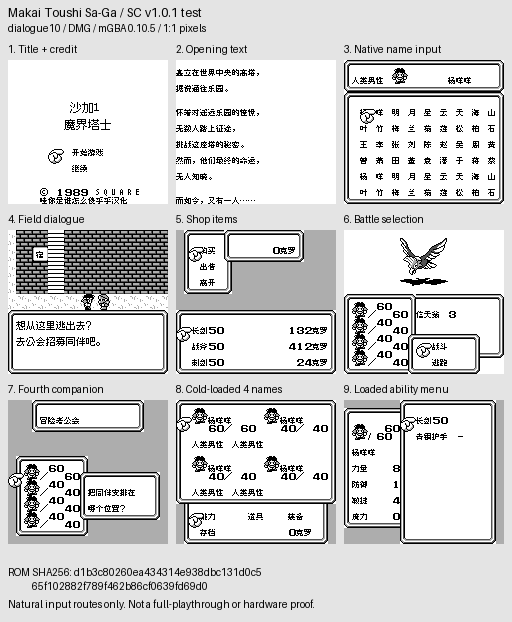
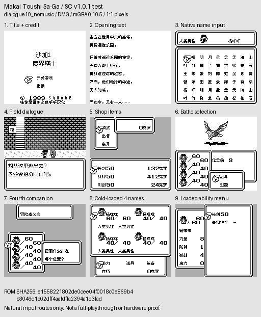
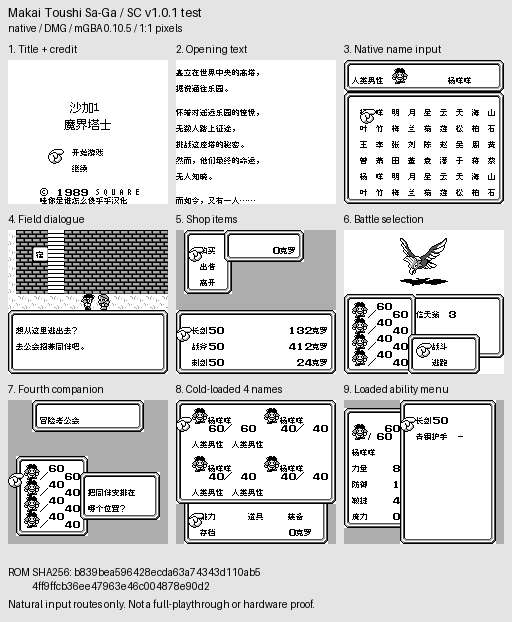

# 沙加1／魔界塔士

原输入：Makai Toushi Sa-Ga

原输入完整SHA256：`4d537adaaa8d395a7b724b084d57f2c9b704e6f348103a399cd7c1f73174801f`。此处“原输入”保留改版、既有汉化或地区修订身份，不一律称干净零售ROM。

| 字号 | 当前版本 | 音频 | 输出完整SHA256 |
| --- | --- | --- | --- |
| 10px-dialogue | v1.0.1-test | music | `d1b3c80260ea434314e938dbc131d0c565f102882f789f462b86cf0639fd69d0` |
| 10px-dialogue | v1.0.1-test | no-music | `e1558221802de0cee04f0018c0e869b4b3046e1c02dff4aafdffa2394a1e3fad` |
| 8px | v1.0.1-test | music | `b839bea596428ecda63a74343d110ab54ff9ffcb36ee47963e46c004878e90d2` |
| 8px | v1.0.1-test | no-music | `56cf00ba5df1bee155a92d118d43b1233c9f043457f4875f9ef61258eeb3c701` |

## 源码与补丁

- 10px-dialogue／v1.0.1-test／music：源码包（完整性未独立确认）：[下载](https://github.com/shiyi1133/youxi-hanhua-releases/releases/download/source-migration-20261022-02b/saga-1-current-source-91055caa9157-public-r01.zip)（ZIP SHA256 `f0f183bb9e7d4f91b3a3049c15904d9b70297479bf82b9deac2914f334e408d5`）；补丁：[下载](https://github.com/shiyi1133/youxi-hanhua-releases/releases/download/patch-migration-20261022/saga-1-current-patches.zip)（ZIP SHA256 `fe2813b2c2169fe85b9e10402c99fb1ac4d97bc1827ed15cd0f81f8d7741e91d`）。
  该包已核对对应版本与字节安全；完整修改源码覆盖范围未独立确认。
- 10px-dialogue／v1.0.1-test／no-music：源码包（完整性未独立确认）：[下载](https://github.com/shiyi1133/youxi-hanhua-releases/releases/download/source-migration-20261022-02b/saga-1-current-source-91055caa9157-public-r01.zip)（ZIP SHA256 `f0f183bb9e7d4f91b3a3049c15904d9b70297479bf82b9deac2914f334e408d5`）；补丁：[下载](https://github.com/shiyi1133/youxi-hanhua-releases/releases/download/patch-migration-20261022/saga-1-current-patches.zip)（ZIP SHA256 `fe2813b2c2169fe85b9e10402c99fb1ac4d97bc1827ed15cd0f81f8d7741e91d`）。
  该包已核对对应版本与字节安全；完整修改源码覆盖范围未独立确认。
- 8px／v1.0.1-test／music：源码包（完整性未独立确认）：[下载](https://github.com/shiyi1133/youxi-hanhua-releases/releases/download/source-migration-20261022-02b/saga-1-current-source-91055caa9157-public-r01.zip)（ZIP SHA256 `f0f183bb9e7d4f91b3a3049c15904d9b70297479bf82b9deac2914f334e408d5`）；补丁：[下载](https://github.com/shiyi1133/youxi-hanhua-releases/releases/download/patch-migration-20261022/saga-1-current-patches.zip)（ZIP SHA256 `fe2813b2c2169fe85b9e10402c99fb1ac4d97bc1827ed15cd0f81f8d7741e91d`）。
  该包已核对对应版本与字节安全；完整修改源码覆盖范围未独立确认。
- 8px／v1.0.1-test／no-music：源码包（完整性未独立确认）：[下载](https://github.com/shiyi1133/youxi-hanhua-releases/releases/download/source-migration-20261022-02b/saga-1-current-source-91055caa9157-public-r01.zip)（ZIP SHA256 `f0f183bb9e7d4f91b3a3049c15904d9b70297479bf82b9deac2914f334e408d5`）；补丁：[下载](https://github.com/shiyi1133/youxi-hanhua-releases/releases/download/patch-migration-20261022/saga-1-current-patches.zip)（ZIP SHA256 `fe2813b2c2169fe85b9e10402c99fb1ac4d97bc1827ed15cd0f81f8d7741e91d`）。
  该包已核对对应版本与字节安全；完整修改源码覆盖范围未独立确认。

补丁须直接应用于完整SHA一致的实际原输入；普通字、大字和音乐变体分别核对。公开源码归档不表示本轮重新构建或通过新的运行验收。原作、字体、已有翻译及工具依赖的权利与许可，依各包对应许可保留。

## 范围与验证边界

- 10px-dialogue／v1.0.1-test：普通Fusion Pixel8px；大字仅剧情真10×10，菜单8px；主标题静态12px。音乐/无音乐各自最终ROM。。
  普通Fusion Pixel8px；大字仅剧情真10×10，菜单8px；主标题静态12px。音乐/无音乐各自最终ROM。
  未全流程/全部深层剧情/技能事件、实机/联机；大字可能拖慢/残留。
  无音乐节省音频子程序开销，不是整体倍速或全面零卡顿；旧日文姓名编码语义不承诺兼容。
- 10px-dialogue／v1.0.1-test：普通Fusion Pixel8px；大字仅剧情真10×10，菜单8px；主标题静态12px。音乐/无音乐各自最终ROM。。
  普通Fusion Pixel8px；大字仅剧情真10×10，菜单8px；主标题静态12px。音乐/无音乐各自最终ROM。
  未全流程/全部深层剧情/技能事件、实机/联机；大字可能拖慢/残留。
  无音乐节省音频子程序开销，不是整体倍速或全面零卡顿；旧日文姓名编码语义不承诺兼容。
- 8px／v1.0.1-test：普通Fusion Pixel8px；大字仅剧情真10×10，菜单8px；主标题静态12px。音乐/无音乐各自最终ROM。。
  普通Fusion Pixel8px；大字仅剧情真10×10，菜单8px；主标题静态12px。音乐/无音乐各自最终ROM。
  未全流程/全部深层剧情/技能事件、实机/联机；大字可能拖慢/残留。
  无音乐节省音频子程序开销，不是整体倍速或全面零卡顿；旧日文姓名编码语义不承诺兼容。
- 8px／v1.0.1-test：普通Fusion Pixel8px；大字仅剧情真10×10，菜单8px；主标题静态12px。音乐/无音乐各自最终ROM。。
  普通Fusion Pixel8px；大字仅剧情真10×10，菜单8px；主标题静态12px。音乐/无音乐各自最终ROM。
  未全流程/全部深层剧情/技能事件、实机/联机；大字可能拖慢/残留。
  无音乐节省音频子程序开销，不是整体倍速或全面零卡顿；旧日文姓名编码语义不承诺兼容。

本次资料搬运未新增模拟器、实机或全通验收；未记录或未测试的范围不写成通过。问题单开放只表示尚未关闭，已关闭也不单独证明全部场景都修复。

[公开反馈及问题状态](feedback.md) · [报告BUG](https://github.com/shiyi1133/youxi-hanhua-releases/issues/new?template=bug_report.md)

## 对应版本截图

v1.0.1-test 普通Fusion Pixel8px；大字仅剧情真10×10，菜单8px；主标题静态12px。音乐/无音乐各自最终ROM。 音频：music；提供方同SHA自然路线/电池冷读拼图；独立原生单帧未附，不能声称本次逐格比原帧PNG。

图像SHA256：`5920918f2c69081f6c187812803fb2fc732c8303091fffb38ff4ca1a4b420682`；绑定ROM SHA256：`d1b3c80260ea434314e938dbc131d0c565f102882f789f462b86cf0639fd69d0`。

v1.0.1-test 普通Fusion Pixel8px；大字仅剧情真10×10，菜单8px；主标题静态12px。音乐/无音乐各自最终ROM。 音频：no-music；提供方同SHA自然路线/电池冷读拼图；独立原生单帧未附，不能声称本次逐格比原帧PNG。

图像SHA256：`8c29021ec05455ec400731410ea6d44ae62a2c4b92561bc7956a4d7b1af99ce6`；绑定ROM SHA256：`e1558221802de0cee04f0018c0e869b4b3046e1c02dff4aafdffa2394a1e3fad`。

v1.0.1-test 普通Fusion Pixel8px；大字仅剧情真10×10，菜单8px；主标题静态12px。音乐/无音乐各自最终ROM。 音频：no-music；提供方同SHA自然路线/电池冷读拼图；独立原生单帧未附，不能声称本次逐格比原帧PNG。

图像SHA256：`462b702bdee6e08009fd898c5ff0c25aa636204de885a2bf9a56d9d2c86d0450`；绑定ROM SHA256：`56cf00ba5df1bee155a92d118d43b1233c9f043457f4875f9ef61258eeb3c701`。

v1.0.1-test 普通Fusion Pixel8px；大字仅剧情真10×10，菜单8px；主标题静态12px。音乐/无音乐各自最终ROM。 音频：music；提供方同SHA自然路线/电池冷读拼图；独立原生单帧未附，不能声称本次逐格比原帧PNG。

图像SHA256：`6cfb59a3696fd2560a60e0bc3a44a128e39ed69cd1262b285b57868e214087b3`；绑定ROM SHA256：`b839bea596428ecda63a74343d110ab54ff9ffcb36ee47963e46c004878e90d2`。

