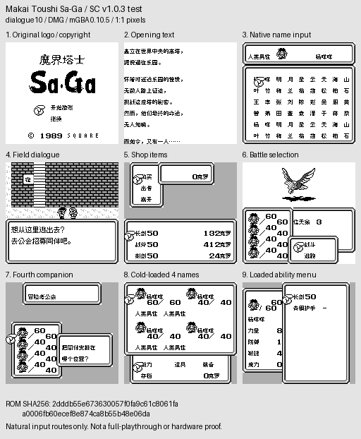
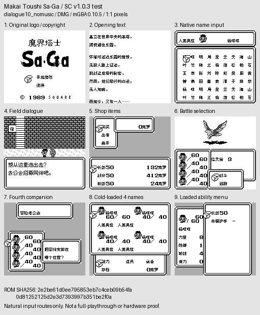
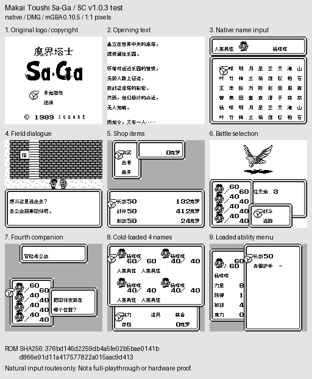

# 沙加1／魔界塔士 v1.0.3（限定测试版）

[源码与补丁Release](https://github.com/shiyi1133/youxi-hanhua-releases/releases/tag/saga-1-v1.0.3) · [公开反馈](feedback.md) · [报告BUG](https://github.com/shiyi1133/youxi-hanhua-releases/issues/new?template=bug_report.md)

原游戏／实际输入：Makai Toushi Sa-Ga

原输入完整 SHA-256：`4d537adaaa8d395a7b724b084d57f2c9b704e6f348103a399cd7c1f73174801f`（131072字节）。

范围：开场种族选择B键返回银行修复；继承v1.0.2逃跑消息与八状态修复。

## 10px-dialogue v1.0.3 / music

字号范围：普通8px；既有大字仅对白，密集界面保留原字号。

目标完整 SHA-256：`2dddb55e673630057f0fa9c61c8061faa0006fb60ecef8e874ca8b55b48e06da`（262144字节）。

补丁：`saga1_sc_dialogue10_v1.0.3_test.bps`，SHA-256 `9cd078a1ee27f3d970039b406802066b3baa4ea2d801b37b991cd0b39657b3ba`。

[源码（完整性未独立确认）](https://github.com/shiyi1133/youxi-hanhua-releases/releases/download/saga-1-v1.0.3/saga-1-v1.0.3-SOURCE-public.zip) · [补丁包](https://github.com/shiyi1133/youxi-hanhua-releases/releases/download/saga-1-v1.0.3/saga-1-v1.0.3-PATCH-public.zip)

v1.0.3 / 10px-dialogue / music 最终ROM提供者实际画面；真实九格，按提供者场景分别保留自然和诊断边界。维护未运行、未全通或实机验收。

## 10px-dialogue v1.0.3 / no-music

字号范围：普通8px；既有大字仅对白，密集界面保留原字号。

目标完整 SHA-256：`2e2be61d0ee795853eb7c4ceb09b54fa0d81252125d2e3d7393997b351be2f0a`（262144字节）。

补丁：`saga1_sc_dialogue10_nomusic_v1.0.3_test.bps`，SHA-256 `c488564c8d805ce97605f465ad7c8a3c7b75b81caaa0340b3b25878de85ad7db`。

[源码（完整性未独立确认）](https://github.com/shiyi1133/youxi-hanhua-releases/releases/download/saga-1-v1.0.3/saga-1-v1.0.3-SOURCE-public.zip) · [补丁包](https://github.com/shiyi1133/youxi-hanhua-releases/releases/download/saga-1-v1.0.3/saga-1-v1.0.3-PATCH-public.zip)

v1.0.3 / 10px-dialogue / no-music 最终ROM提供者实际画面；真实九格，按提供者场景分别保留自然和诊断边界。维护未运行、未全通或实机验收。

## 8px v1.0.3 / music

字号范围：普通8px；既有大字仅对白，密集界面保留原字号。

目标完整 SHA-256：`376bd146d2259db4a5fe02b5bae0141bd866e91d11a417577822a015aac9d413`（262144字节）。

补丁：`saga1_sc_native_v1.0.3_test.bps`，SHA-256 `597ab44b50ab3033e37d9e8e8d96f9c5f5b4f237719fc33b1282cf8f2b83bcaf`。

[源码（完整性未独立确认）](https://github.com/shiyi1133/youxi-hanhua-releases/releases/download/saga-1-v1.0.3/saga-1-v1.0.3-SOURCE-public.zip) · [补丁包](https://github.com/shiyi1133/youxi-hanhua-releases/releases/download/saga-1-v1.0.3/saga-1-v1.0.3-PATCH-public.zip)

v1.0.3 / 8px / music 最终ROM提供者实际画面；真实九格，按提供者场景分别保留自然和诊断边界。维护未运行、未全通或实机验收。

## 8px v1.0.3 / no-music

字号范围：普通8px；既有大字仅对白，密集界面保留原字号。

目标完整 SHA-256：`9512ad348afdbca0e456f5b2a599c8d0b510e95e84ffbfe89ada057b621a82d1`（262144字节）。

补丁：`saga1_sc_native_nomusic_v1.0.3_test.bps`，SHA-256 `c3f72bbcb3db1573b562d0683968f2c5c80b30f9ec1ef421fc64fbeafd4ba07d`。

[源码（完整性未独立确认）](https://github.com/shiyi1133/youxi-hanhua-releases/releases/download/saga-1-v1.0.3/saga-1-v1.0.3-SOURCE-public.zip) · [补丁包](https://github.com/shiyi1133/youxi-hanhua-releases/releases/download/saga-1-v1.0.3/saga-1-v1.0.3-PATCH-public.zip)

v1.0.3 / 8px / no-music 最终ROM提供者实际画面；真实九格，按提供者场景分别保留自然和诊断边界。维护未运行、未全通或实机验收。

## 测试及限制

提供方自然范围：提供者自测：四最终变体分别自然开场B控制、主角/伙伴命名、对白/商店/战斗与正常保存新进程冷读。

提供方诊断范围：提供者诊断：提供者逐指令只读追踪与原件/旧版本对照；非玩家三文件身份核验。

保存边界：仅按具体版本材料，不推定所有旧存档兼容。

维护本轮独立核原输入、补丁逐字节还原、ZIP/CRC、Source安全与原图字节；未执行提供方源码、未重建或运行ROM，未宣称独立人员QA、实机或全流程验收。

- 未验证：维护仅做数据/字节与独立补丁验证，未执行提供者源码或ROM，未独立重建。
- 未验证：暂停的历史renderer问题未改；玩家三份旧ROM具体字节未知。
- 未验证：未全通、未实机/联机；不保证任意玩家旧档兼容。

大字版更容易出现拖慢、刷新残留等问题，遇到请及时在原楼反馈。
