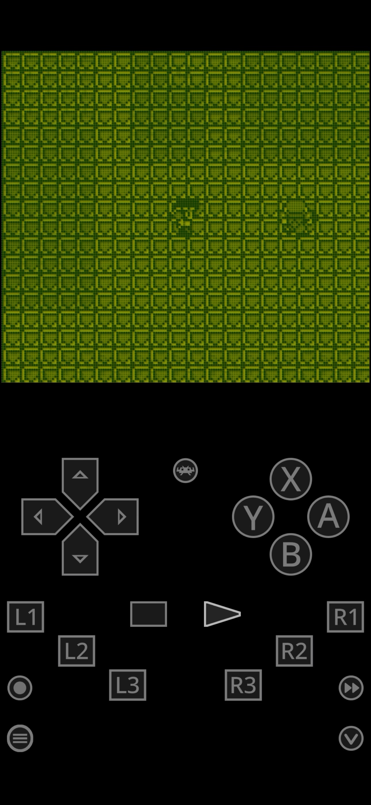
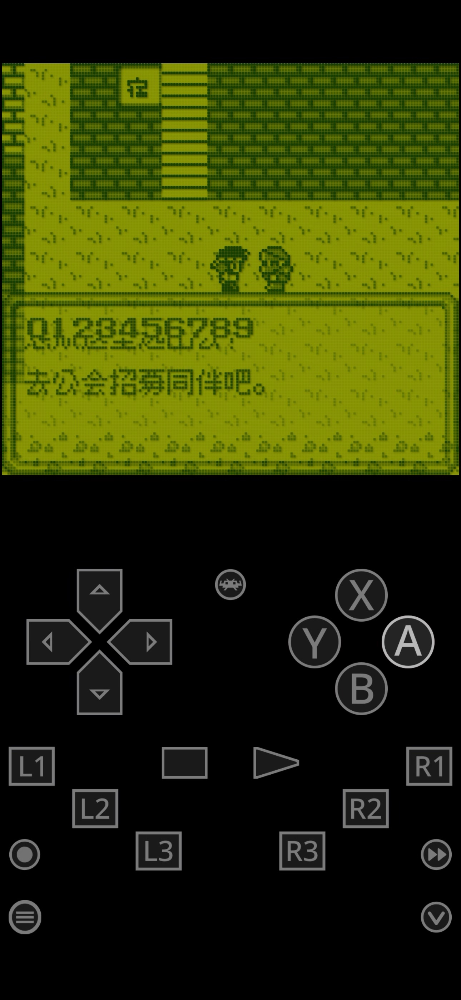
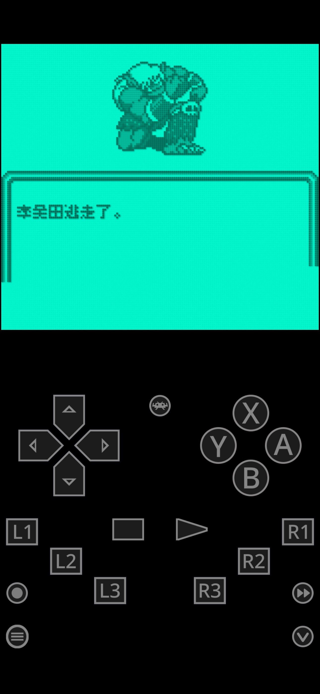
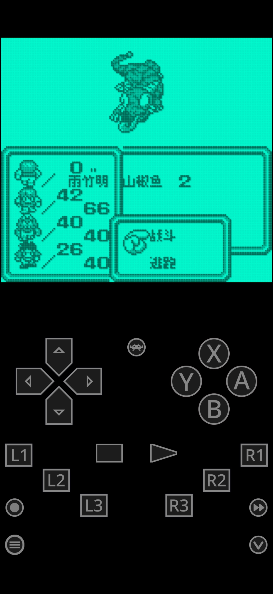
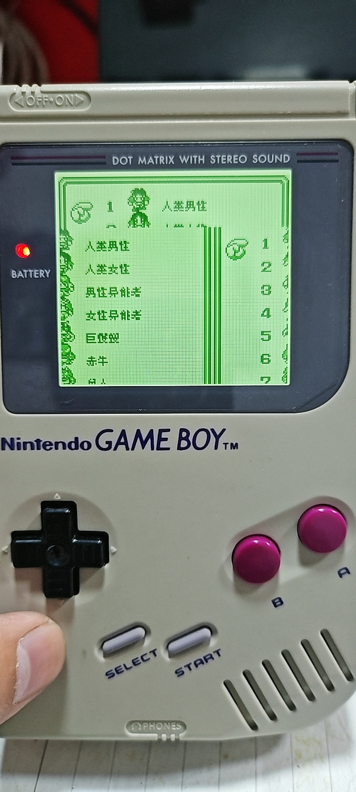

# 沙加1／魔界塔士：公开反馈

以下为已公开证据摘录，不能自动当成已经复现或修复。下载／存档分享地址、本机路径或项目署名文字省略时逐条标记。

## 154038632735

48楼 · ♬肚皮吸碗🎶 · [原回帖](https://tieba.baidu.com/p/11092365551?pid=154038632735#154038632735)

> 游戏中按暂停会产生背景花屏

[玩家公开图片](https://tiebapic.baidu.com/forum/pic/item/c050f2edab64034f7b46ee01e9c379310b551d5c.jpg)（玩家反馈图，不作当前最终ROM运行证明）

## 154039624497

48楼 · ♬肚皮吸碗🎶 · [原回帖](https://tieba.baidu.com/p/11092365551?pid=154039624497#154039624497)

> rom名称： saga1_sc_native_v1.0.0_test 后缀名.gb saga1_sc_dialogue10_v1.0.0_test 后缀名.gb 不能连着发后缀名，会被判定为网络链接

## 154039625473

48楼 · ♬肚皮吸碗🎶 · [原回帖](https://tieba.baidu.com/p/11092365551?pid=154039625473#154039625473)

> 8号和10号字都会花屏

## 问题状态

- [待核版本与复现] 沙加1／魔界塔士：游戏内按暂停时背景花屏：开放；公开问题单待单独建档。

问题单开放不等于正在修复；关闭不自动代表所有报告症状全部验收。玩家实际ROM SHA未知时仍保留未知，当前版本的参考SHA见[游戏页面](README.md)。

## 20261023-0416 公开反馈补充

48楼 · ♬肚皮吸碗🎶 · [原回帖](https://tieba.baidu.com/p/11092365551?pid=154060646908#154060646908)

> 经测试，沙加1_魔界塔士_v1.0.1_dialogue10 仍有如下两处花屏。 图1是在游戏中按暂停键，画面出现一帧花屏。 图2是和游戏中的人物对话时，对话框打开瞬间会有一帧乱码。

- 沙加GB1 v1.0.1 dialogue10：暂停和开对白瞬间花屏：开放待核；本次没有新增维护复现、修复或完整流程验收。

[已公开答复](https://tieba.baidu.com/p/11092365551?pid=154061177158#154061177158)：@♬肚皮吸碗🎶 沙加1黑白GB大字v1.0.1暂停、开启对白时的瞬间花屏已补进原问题，继续排查。

玩家实际输入/输出完整SHA保持未知；公开答复属于登记/信息回复，不是ROM新交付或修复完成通知。

## 20261024-0412 公开反馈补充

公开 BUG 入口：[提交反馈](https://github.com/shiyi1133/youxi-hanhua-releases/issues/new/choose)。

48楼 · ♬肚皮吸碗🎶 · [原回帖](https://tieba.baidu.com/p/11092365551?pid=154063176256#154063176256)

> v1.0.1的所有版本，在战斗中选择逃跑就死机。

48楼 · ♬肚皮吸碗🎶 · [原回帖](https://tieba.baidu.com/p/11092365551?pid=154063313518#154063313518)

> V1.0.1的所有版本，战斗中阵亡的角色名字会变成乱码

- [BUG待复现] 沙加1 v1.0.1：战斗选择逃跑后死机：已记录，开放待核。
- [BUG待复现] 沙加1 v1.0.1：战斗阵亡后角色名字乱码：已记录，开放待核。

[已公开登记答复](https://tieba.baidu.com/p/11092365551?pid=154064804797#154064804797)：@♬肚皮吸碗🎶 v1.0.1逃跑死机和阵亡角色姓名乱码已一起记录，后续排查。

除另注已实收核验的译版 ROM 外，玩家实际输入/输出 SHA 未核定。图片与通关描述仅为玩家反馈；本次没有新增维护运行复现、修复或完整流程验收。

## 20261024-1615 公开反馈补充

公开 BUG 入口：[提交反馈](https://github.com/shiyi1133/youxi-hanhua-releases/issues/new/choose)。

48楼 · ♬肚皮吸碗🎶 · [原回帖](https://tieba.baidu.com/p/11092365551?pid=154065039552#154065039552)

> 再汇报一条，全部3个1.0.1版本，在开头选人界面时，按B键会死机，

- [BUG待复现] 沙加1 v1.0.1：开头选人界面按B键死机：已记录，开放待核。

[实际公开登记答复](https://tieba.baidu.com/p/11092365551?pid=154066487634#154066487634)：@♬肚皮吸碗🎶 v1.0.1开头选人界面按B键死机已记录，后续排查。

玩家实际ROM完整SHA未知仍保留未知。原图为玩家反馈，不等同维护复现、修复、全流程或实机验收。

## 20261025-1619 公开反馈更新

按当前实际未关闭问题去重：纯BUG 1 项，建议/覆盖等 0 项，分类待核 0 项。开放不代表正在修复。

- 开场选人B返回银行错误这一消费者（记录版本：v1.0.3）：限定证据已核验；原报告范围关闭；该证据不代表当前最新版或整作全通。
- 原案战斗选择逃跑后停留／死机的四变体消息消费者（记录版本：v1.0.3）：限定证据已核验；原报告范围关闭；该证据不代表当前最新版或整作全通。
- 原案战斗阵亡后状态显示似姓名乱码的四变体原生opcode2C消费者（记录版本：v1.0.3）：限定证据已核验；原报告范围关闭；该证据不代表当前最新版或整作全通。

玩家实际完整ROM字节未知时仍保留未知；自然流程、原生消费者诊断及静态证据分别记录，不外推实机或全流程。
